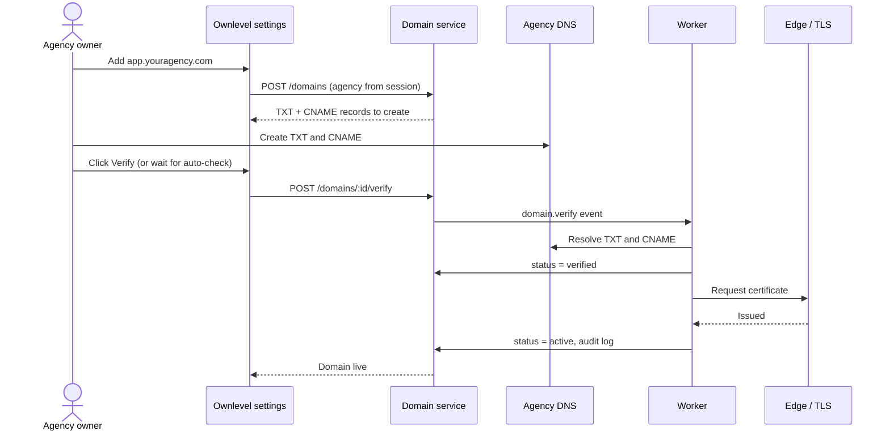
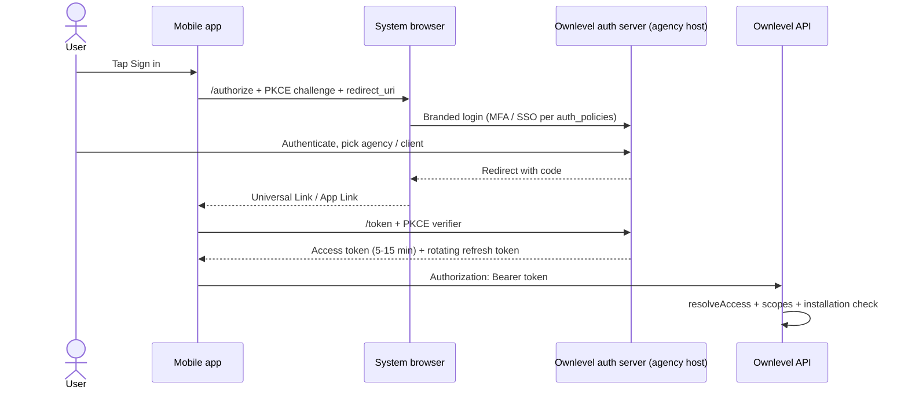
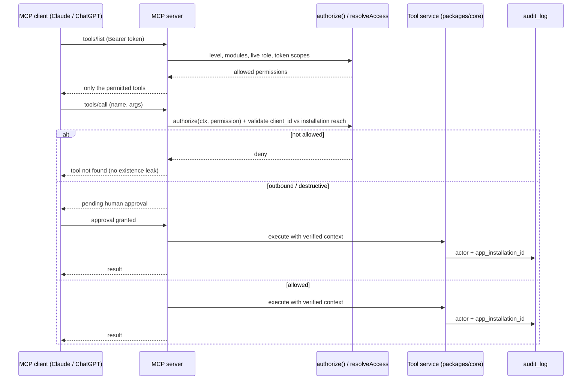

# Ownlevel — Authentication & Authorization

Oct 28, 2026 · @Prakash

## Overview

A person authenticates once as themselves; what they can reach is decided per request by their memberships at the agency level and the client level. Apps and AI agents follow the same rule through OAuth installations.

| Term | Meaning | In code |
| --- | --- | --- |
| Agency | Top-level account; Ownlevel's paying customer | `agencies`, `agency_id` |
| Client | Sub-account owned by an agency; shown as "Account" in the UI (label configurable per agency) | `clients`, `client_id` |
| Contact | A person in a client's CRM (the client's own customers and leads) | `contacts` |
| User | A person who logs in: agency staff or client staff | `users` |
| App | Any OAuth client: first-party apps, marketplace apps, MCP clients, native mobile apps (Android / iOS) | `apps`, `oauth_apps` |

Naming rules: never call OAuth apps `clients`; never call the end-customer portal the "client portal" (it is the contact portal); user settings are "Profile", not "Account settings".

## Identity model

One global `users` row per person, plus one `memberships` row per place they work. A membership with `client_id = NULL` is agency-level; with `client_id` set it is client-level. Every membership carries `agency_id`, so all of a user's access under one agency is a single indexed lookup.

```sql
create table users (
  id            uuid primary key,
  email         citext unique not null,
  password_hash text,                -- null if SSO / magic-link only
  mfa_enabled   boolean not null default false,
  status        text not null default 'active'
);

create table memberships (
  id            uuid primary key,
  user_id       uuid not null references users(id),
  agency_id     uuid not null references agencies(id),
  client_id     uuid references clients(id),      -- NULL = agency-level
  role_id       uuid not null references roles(id),
  client_access text check (client_access in ('all','assigned')), -- agency-level only
  created_at    timestamptz not null default now(),
  unique nulls not distinct (user_id, agency_id, client_id)
);

-- agency staff limited to specific clients
create table membership_clients (
  membership_id uuid references memberships(id) on delete cascade,
  client_id     uuid references clients(id) on delete cascade,
  primary key (membership_id, client_id)
);
```

| Level | Default roles | Can reach | Cannot reach |
| --- | --- | --- | --- |
| Agency | agency\_owner, agency\_admin, agency\_user, custom | Agency settings, billing, white-label, snapshots, client creation, cross-client reports; all clients or assigned ones | Clients outside `membership_clients` when access is `assigned` |
| Client | client\_admin, client\_user, custom | That client's enabled modules | Agency view, other clients |

One person can hold several memberships, for example a freelancer working for two agencies, or a business owner with two brands under one agency.

## Access resolution

One function decides whether a user (or an app token) can act in an agency or client. Results are cached in Redis and invalidated on any membership, role or entitlement change, so revocation takes effect immediately.

```ts
async function resolveAccess(userId: string, agencyId: string, clientId: string | null) {
  const ms = await getMemberships(userId, agencyId); // cached

  const agencyM = ms.find(m => m.clientId === null);
  if (!clientId) return agencyM ? { level: 'agency', role: agencyM.role } : null;

  const clientM = ms.find(m => m.clientId === clientId);
  if (clientM) return { level: 'client', role: clientM.role };

  if (agencyM && (agencyM.clientAccess === 'all' ||
      agencyM.assignedClients.includes(clientId)))
    return { level: 'agency', role: agencyM.role }; // agency staff inside a client

  return null; // respond 404, not 403: don't reveal the client exists
}
```

Permissions are namespaced by module (`crm:contacts.read`, `conversations:send`, `workflows:publish`). Roles are bundles of permissions; agencies can define custom roles. A request is allowed only when all of these hold:

```
allowed = membership covers this agency/client      (resolveAccess)
        ∧ module is enabled for this client           (client_modules)
        ∧ role grants the permission                  (role_permissions)
        ∧ app token scope includes it, if an app      (app_installations)
```

Start with Postgres tables and one `authorize(ctx, permission)` function. Move to OpenFGA, SpiceDB or Cedar only if per-object sharing becomes necessary (for example, one pipeline visible to three users).

## Login, domains and sessions

The agency is resolved from the hostname before login, so every agency's portal looks like its own product.

| Host | Resolves to | Login page |
| --- | --- | --- |
| `app.youragency.com` (custom domain) | Agency A | A's branding, A's allowed methods and SSO |
| `{slug}.ownlevel.app` (platform subdomain, e.g. `a.ownlevel.app`) | The agency that owns `{slug}` | Same as above |
| `app.ownlevel.app` | Platform | Ownlevel branding; for agency owners and multi-agency users |

After login on an agency host, show only memberships where `agency_id` matches that host. A user who also works for agency B never sees B's name on A's domain.

**Landing:**

1. Has an agency-level membership → agency view.
2. Has exactly one client membership → that client directly.
3. Has several client memberships → account picker.

**Sessions:** server-side sessions in Redis with an `HttpOnly`, `Secure`, `SameSite=Lax` cookie, one per domain. Avoid long-lived JWTs for the web app so revocation is immediate.

```sql
-- or keep in Redis only; this table is for listing/revoking devices
create table sessions (
  id             uuid primary key,          -- random, stored hashed in cookie lookup
  user_id        uuid not null references users(id),
  agency_id      uuid references agencies(id), -- host it was created on
  impersonating_user_id uuid references users(id),
  ip             inet,
  user_agent     text,
  created_at     timestamptz not null default now(),
  expires_at     timestamptz not null,
  revoked_at     timestamptz
);
```

**Switching accounts** needs no re-login. The active context lives in the URL (`/agency/:agencyId/client/:clientId/...`) and `resolveAccess` runs on every request, so bookmarks and multiple tabs on different clients just work.

## Custom domains

An agency serves its portal from its own hostname (for example `app.youragency.com`). Ownlevel only routes a hostname to an agency after the agency has proven it controls that domain.

```sql
create table agency_domains (
  id                 uuid primary key,
  agency_id          uuid not null references agencies(id),
  hostname           citext unique not null,   -- globally unique: one owner only
  kind               text not null check (kind in ('subdomain','custom')),
  verification_token text not null,            -- random, shown to the owner as a TXT value
  status             text not null default 'pending'
                     check (status in ('pending','verified','active','failed','disabled')),
  tls_status         text,                     -- pending | issued | error
  is_primary         boolean not null default false,  -- used in invite and reset emails
  verified_at        timestamptz,
  last_checked_at    timestamptz,
  created_by         uuid not null references users(id),
  created_at         timestamptz not null default now()
);
create unique index on agency_domains (agency_id) where is_primary;
-- RLS: agency staff see their own agency's rows. Hostname lookup at the edge uses a
-- narrow service role that reads only (hostname, agency_id) where status = 'active'.
```



### Platform subdomains and slugs

Every agency gets `{slug}.ownlevel.app` without any setup. Because Ownlevel owns the parent domain, no verification is needed.

**One-time platform setup**

1. **Wildcard DNS:** create a proxied `*` record in the `ownlevel.app` zone pointing at the web Worker. This one record covers every present and future agency, so no DNS change is needed when an agency signs up.
2. **Wildcard certificate:** slugs are flat (`{slug}.ownlevel.app`, one label), so Cloudflare Universal SSL's `*.ownlevel.app` certificate covers every agency with no extra setup. This is why we do not use a two-level `{slug}.ownlevel.app`, which Universal SSL would not cover. Because the slug shares a namespace with the platform's own hostnames, the reserved list below must include every first-party label.
3. The resolver maps `Host` to `agency_id` through `agency_domains`; an unknown slug returns a generic 404 page.

**Slug rules**

- 3 to 40 characters, lowercase letters, digits and hyphens; must start and end with a letter or digit.
- Globally unique (enforced by the unique `hostname` column).
- Reserved, never assignable: `www`, `app`, `api`, `mcp`, `admin`, `auth`, `login`, `mail`, `status`, `docs`, `support`, `domains`, `agency`, `platform`, `ownlevel`.
- Changing a slug is an owner-only action, audit-logged. The old slug is quarantined for 90 days so nobody else can claim it, and until then it redirects to the new one.
- Sessions are bound to the host, so changing the slug signs users out.

### Steps for the agency owner

1. Open **Settings → White-label → Domains** (agency owner or admin only).
2. Choose a **subdomain** you control, such as `app.youragency.com`. Apex domains (`youragency.com`) are not supported, and they usually host the agency's marketing site.
3. Click **Add domain**. Ownlevel shows two DNS records:
   - `TXT  _ownlevel-verify.app.youragency.com  →  <verification token>`
   - `CNAME app.youragency.com  →  domains.ownlevel.app`
4. Create both records at your DNS provider (Cloudflare, GoDaddy, Route 53 and so on). If the domain is behind Cloudflare, set the CNAME to **DNS only** (grey cloud) so certificate issuance works.
5. Click **Verify**. DNS changes can take a few minutes to a few hours. Ownlevel also re-checks automatically.
6. When the status shows **Active**, open the domain and confirm you see your branded login page.
7. Optionally mark it **Primary**, so invites and password-reset emails use this domain.
8. Tell staff and clients about the new URL. Existing sessions on `{slug}.ownlevel.app` stay separate, and users sign in once on the new domain.

Do not delete the DNS records afterwards. If the TXT or CNAME disappears, the domain is set to **Failed** and the portal falls back to `{slug}.ownlevel.app`.

### Steps for Ownlevel (platform)

**One-time setup**

1. Reserve `domains.ownlevel.app` as the CNAME target. Point it at the Cloudflare for SaaS fallback origin; Cloudflare issues and renews certificates for each registered custom hostname.
2. Register a hostname with Cloudflare (Custom Hostnames API) only after our own TXT verification succeeds, and store the returned id in `agency_domains.cf_hostname_id`. Cloudflare only serves hostnames registered this way, so unverified domains never get a certificate or traffic. (With Caddy on-demand TLS instead, gate issuance with `GET /internal/domains/allowed?host=...`.)
3. Add a hostname resolver in `packages/tenancy` (Host → `agency_id`, cached in Redis, invalidated on any domain status change). Trust `Host` only from the known proxy and ignore `X-Forwarded-Host` otherwise.
4. Add a `domain.verify` worker job and a scheduled re-verification job.
5. Add the endpoints to the OpenAPI spec and regenerate `packages/sdk`: `GET /domains`, `POST /domains`, `POST /domains/:id/verify`, `POST /domains/:id/primary`, `DELETE /domains/:id`.

**Per domain (automated)**

1. `POST /domains`: the domain service takes `agency_id` from the session, never from the body. It validates the hostname, then stores a `pending` row with a random `verification_token`.
2. Validation rejects: apex domains, anything under `ownlevel.app`, IP addresses, and hostnames already claimed by another agency.
3. The worker resolves the TXT and CNAME records. On a match it sets `verified` and requests the certificate.
4. When the certificate is issued it sets `active`, clears the resolver cache and writes `audit_log` (`domains:activate`).
5. Every 6 hours the worker re-verifies active domains. After 3 consecutive failures it sets the domain to `failed` and notifies agency owners by email, which prevents subdomain takeover.

**Rules**

- Cookies are host-only (no `Domain=` attribute), so each hostname has its own session. This matches the one-cookie-per-domain rule above.
- Only `agency_owner` / `agency_admin` can add, verify or remove domains, and each action is audit-logged.
- Platform subdomains (`{slug}.ownlevel.app`) are created automatically when the agency is created, as `kind = 'subdomain'`, `status = 'active'`, with no DNS work for the agency. Each agency has exactly one; many agencies can coexist, one subdomain each (`a.ownlevel.app` → Agency X, `b.ownlevel.app` → Agency B).
- Validation rejects anything under `ownlevel.app` for custom domains, since that namespace belongs to platform subdomains.
- Removing a domain revokes its sessions (`sessions.agency_id` plus host) and clears the resolver cache.
- Logic lives in a domain service in `packages/core`. The API route in `apps/*` only calls it.

## Per-level auth policies

Agency settings are the default; a client can tighten them but never loosen them. Agency owners and admins always require MFA, because they hold access to every client.

```sql
create table auth_policies (
  id                  uuid primary key,
  agency_id           uuid not null references agencies(id),
  client_id           uuid references clients(id),   -- NULL = agency-wide default
  require_mfa         boolean,
  allowed_methods     text[],      -- {'password','magic_link','google','sso'}
  session_ttl_minutes int,
  sso_connection_id   uuid references sso_connections(id),
  ip_allowlist        cidr[],
  unique nulls not distinct (agency_id, client_id)
);

create table sso_connections (
  id         uuid primary key,
  agency_id  uuid not null references agencies(id),
  client_id  uuid references clients(id),
  protocol   text check (protocol in ('saml','oidc')),
  config     jsonb not null,     -- issuer, metadata URL, cert, client id/secret ref
  domains    citext[]            -- email domains routed to this IdP
);

create table user_mfa_factors (
  id         uuid primary key,
  user_id    uuid not null references users(id),
  kind       text check (kind in ('totp','webauthn','recovery_code')),
  secret_enc bytea,
  created_at timestamptz not null default now()
);
```

| Policy | Agency level | Client level |
| --- | --- | --- |
| MFA | Forced for owner/admin; optional for all staff | Can force for client staff |
| SSO (SAML/OIDC) | Agency staff via agency IdP; enterprise tier | Later: large clients' own IdP |
| Allowed methods | Sets defaults | Subset of agency's |
| Session length | Sets default | Shorter only |

## Invitations and impersonation

Invites are always scoped to one agency or one client, and impersonation is a flagged session, never a real login.

```sql
create table invitations (
  id          uuid primary key,
  agency_id   uuid not null references agencies(id),
  client_id   uuid references clients(id),  -- NULL = agency-level invite
  email       citext not null,
  role_id     uuid not null references roles(id),
  token_hash  text not null unique,
  invited_by  uuid not null references users(id),
  expires_at  timestamptz not null,
  accepted_at timestamptz
);
```

**Invitation rules**

- Agency admins invite at both levels; client admins invite only into their own client, with roles at or below their own.
- Existing email → accepting adds a membership. New email → the user sets up login on the agency's branded domain.
- Invite and reset emails use the branding of the domain they belong to.

**Impersonation ("Log in as")**

- Allowed for agency admins into users of clients they can reach.
- Session stores `impersonating_user_id`; permissions come from the impersonated user.
- Audit log records both the real and impersonated identity.
- Persistent banner, 30-minute limit, and blocked sensitive actions: password/MFA changes, payouts and payment methods, deleting users.

## Apps and AI / MCP access

Ownlevel runs its own OAuth 2.1 authorization server. Every app, including first-party apps and MCP clients like Claude or ChatGPT, gets a token bound to one installation at the agency or client level.

```sql
create table apps (
  id               uuid primary key,
  name             text not null,
  owner_agency_id  uuid references agencies(id),  -- NULL = platform / first-party
  client_id_url    text unique,   -- MCP clients using Client ID Metadata Documents
  redirect_uris    text[] not null,
  requested_scopes text[] not null,
  first_party      boolean not null default false
);

create table app_installations (
  id             uuid primary key,
  app_id         uuid not null references apps(id),
  agency_id      uuid not null references agencies(id),
  client_id      uuid references clients(id),  -- NULL = agency-level install
  client_access  text check (client_access in ('all','assigned')),
  granted_scopes text[] not null,
  installed_by   uuid not null references users(id),
  created_at     timestamptz not null default now(),
  revoked_at     timestamptz
);

create table oauth_tokens (
  id              uuid primary key,
  installation_id uuid not null references app_installations(id),
  user_id         uuid references users(id),   -- NULL = installation token (no user)
  kind            text check (kind in ('access','refresh')),
  token_hash      text not null unique,
  scopes          text[] not null,
  expires_at      timestamptz not null,
  revoked_at      timestamptz
);

create table api_keys (
  id          uuid primary key,
  agency_id   uuid not null references agencies(id),
  client_id   uuid references clients(id),     -- NULL = agency key
  prefix      text not null,                   -- olk_agency_ / olk_client_
  key_hash    text not null unique,
  scopes      text[] not null,
  created_by  uuid not null references users(id),
  last_used_at timestamptz,
  revoked_at  timestamptz
);
```

| Token type | Flow | Acts as | Effective permission | Use for |
| --- | --- | --- | --- | --- |
| Delegated | Authorization Code + PKCE, branded consent with agency/client picker | The user | App scopes ∩ user's live role ∩ installation reach ∩ enabled modules | MCP clients, interactive apps, your mobile app |
| Installation | Client credentials per installation | The app | App scopes ∩ installation reach ∩ enabled modules | Background sync, webhooks, scheduled jobs |
| API key | Static, hashed, prefixed | The key | Key scopes ∩ key level ∩ enabled modules | Zapier, client websites, simple scripts |

Access tokens live 5 to 15 minutes; refresh tokens rotate on use. First-party apps use the same flow with `first_party = true` to skip consent.

**MCP server requirements** (current spec revision 2026-07-28)

- Expose `/.well-known/oauth-protected-resource` (RFC 9728) and return a 401 pointing to it.
- Support Client ID Metadata Documents for client registration; keep Dynamic Client Registration only as a fallback (deprecated in this revision).
- Never pass the incoming token through to upstream APIs; call internal services with service credentials plus the verified context.
- Take tenant context from the token, not tool arguments. Agency-level installs may pass `client_id`, validated against the installation's reach on every call.
- Map each tool to a scope (`contacts.search` → `crm:contacts.read`, `conversations.send` → `conversations:send`), list only tools the token can use, and put sensitive actions behind separate scopes and per-installation rate limits.

### Mobile apps (Android / iOS)

A native mobile app is a public OAuth client. It uses the Delegated flow (Authorization Code + PKCE) and has no cookie session.



**Rules**

- Use the system browser (`ASWebAuthenticationSession` on iOS, Custom Tabs on Android), never an embedded WebView, so SSO, passkeys and password managers work and the app never sees the password.
- No client secret in the app. PKCE is mandatory.
- Redirect URIs: claimed HTTPS links (Universal Links / App Links) preferred; custom schemes only as a fallback. Exact-match comparison against `apps.redirect_uris`.
- Store tokens in the iOS Keychain or Android Keystore. Never in plain preferences or logs.
- Refresh tokens rotate on use; reuse of an old refresh token revokes the whole token family.
- The login page is served from the agency host, so branding, allowed methods, MFA, SSO and IP allowlist apply exactly as on the web.
- The app's own first-party registration sets `first_party = true` (no consent screen). A third-party mobile app shows consent.
- Tenant context comes from the token's installation, not from the request. Switching client re-authorizes, or uses an agency-level installation with `client_id` validated against its reach on every call.
- Impersonation ("Log in as") is session-based and web-only; mobile tokens cannot be impersonated sessions.

**Web vs mobile**

| | Web | Mobile app |
| --- | --- | --- |
| Credential | Host-only session cookie (Redis) | Access + refresh tokens (`oauth_tokens`) |
| Login | Directly on the agency host | System browser on the agency host, then redirect back |
| Active context | URL path; many tabs, many clients | Fixed by the token's installation |
| Permission | `resolveAccess` | `resolveAccess` ∩ app scopes |
| Revoke | Delete session | Revoke token or installation, or remove membership |
| Audit | `actor_user_id` (+ `impersonating_user_id`) | `actor_user_id` + `app_installation_id` |

**Open decisions**

- One shared Ownlevel app or white-labelled per-agency builds. This decides how the app finds the agency host to log in against, and whether `apps.owner_agency_id` is set.
- When the first-party app's `app_installations` row is created (implicitly at first login, or tied to the membership).

### MCP tool authorization (agency and client)

Ownlevel exposes one MCP server for both agencies and clients. The installation level (agency or client) and the user's live role decide which tools a connection sees. Authorization happens twice: when listing tools, and again on every call.

**Connection**

- The user connects through the delegated flow (Authorization Code + PKCE) on the agency host. The token acts as the user.
- On the consent screen the user picks agency-level or one client, which creates an `app_installations` row at that level.
- A client user can only pick their own client. Agency staff with `assigned` access can only pick assigned clients.
- The consent screen offers only scopes the user's role could grant, so a token never has more reach than its user.

**Tool registry** (`packages/ai/tools`, defined once; the MCP server only filters and adapts it)

```ts
{
  name: 'conversations.send',
  permission: 'conversations:send',   // role_permissions
  scope: 'conversations:send',        // OAuth scope
  module: 'conversations',            // client_modules
  levels: ['client', 'agency'],       // agency-only tools: billing, white-label, client creation
  sensitivity: 'outbound',            // outbound | destructive | normal
}
```



**`tools/list`: filter per request.** A tool is listed only when all of these hold:

1. The installation level is in the tool's `levels`.
2. The module is enabled for the client (`client_modules`).
3. The user's live role grants `permission` (`role_permissions`).
4. The token's scopes include `scope`.

Use the same `authorize(ctx, permission)` function as the REST API. Do not build a second permission engine for MCP.

**`tools/call`: enforce again.** The list is a convenience, not a security boundary: a client can call a tool it was never shown, and a role can change mid-session.

- Run `resolveAccess` and `authorize(ctx, permission)` on every call, using the live role (from the Redis cache, which is invalidated on any change).
- For agency installs, validate any `client_id` argument against the installation's reach (`all`, or `assigned` via `membership_clients`). Client installs ignore any supplied `client_id` and use the installation's own.
- If denied, return a "tool not found" style error, not "forbidden", so the response does not reveal that the tool or client exists.
- `outbound` and `destructive` tools need human approval and a separate scope, and are rate-limited per installation.
- Write `audit_log` with `actor_user_id` and `app_installation_id`.
- Send `notifications/tools/list_changed` when the user's role, an enabled module or the installation changes, so clients refresh their tool list.

**Agency vs client installs**

| Installation level | Tools shown | `client_id` |
| --- | --- | --- |
| Agency | Agency tools plus client tools | Required for client tools; validated against reach on every call |
| Client | Client tools only, for that one client | Fixed by the installation; arguments ignored |

One server implementation serves both. If you expose separate URLs (for example `/mcp` and `/client/:id/mcp`), tenant context still comes from the token; the URL is only validated against it.

## If Redis data is lost or missing

Redis holds only sessions and caches. Postgres is the source of truth for everything that grants access, so a missing key is never a reason to allow a request.

| Data in Redis | On miss or flush | Result |
| --- | --- | --- |
| Permission cache (`resolveAccess`) | Recompute from `memberships`, `roles`, `client_modules`, `app_installations`, then re-cache | Slower first requests, no user impact |
| Hostname resolver cache | Look up `agency_domains` where `status = 'active'`, then re-cache | Slower first requests. An unknown host still returns the generic 404. |
| Web sessions | Look up `sessions` in Postgres (when `revoked_at` is null and `expires_at` is in the future) and rebuild the Redis entry. If there is no row, treat as signed out. | Users stay signed in if the table is the record, otherwise they log in again |
| Auth codes, PKCE state, login challenges | Not recoverable | The user restarts the login. This is safe because they are short-lived. |
| Rate-limit counters | Start from zero | Brief loosening of limits. Acceptable, except for login and MFA attempts: keep those counters in Postgres or accept the reset risk knowingly. |
| Job queues and locks | Jobs not yet processed are lost | Enqueue from a Postgres outbox so jobs can be replayed. Locks expire and are re-acquired. |

**Rules**

- **Fail closed.** If Redis is unreachable, do not skip the check and do not trust a stale in-process cache. Rebuild from Postgres if it is up; otherwise return 503. Never fall back to "allow".
- **Revocation survives a flush.** Revocations are written to Postgres (`revoked_at` on sessions, `oauth_tokens`, `app_installations`, `api_keys`; deleted memberships) before Redis is cleared. A flush therefore cannot resurrect a revoked session, token or key. Never store "revoked" only as a Redis key.
- **Write-through order.** On any membership, role, module or installation change: commit to Postgres first, then delete the cache keys. If the delete fails, retry from the outbox. Short TTLs (for example 5 minutes) on cache entries bound the damage of a missed delete.
- **Single-flight rebuild.** After a flush, many requests miss at once. Use a per-key lock or request coalescing so Postgres sees one rebuild per key, not one per request.
- **Missing session on a valid cookie** means the user is signed out, not an error: clear the cookie and redirect to the host's login page.
- **Do not put the only copy of anything in Redis** that you cannot afford to lose. Sessions are the one exception, and the cost is a re-login.
- **Redis persistence** (AOF) reduces how often this happens but does not replace the rules above. Test them by flushing Redis in staging.

## Enforcement, revocation and audit

Humans, apps and API keys all pass the same five checks; Postgres RLS sits underneath as the last line of defense.

&#91;embedded content: request enforcement · 5 checks, then the handler\]

A failed check stops the request with the status shown; only a fully authorized request opens a transaction with the tenant ids set.

**Revocation:** removing a membership, uninstalling an app, revoking a key or disabling a module clears the Redis permission cache for that user, installation or client. Access tokens are short-lived and checked against the installation on each request, so revocation is effectively immediate.

**Audit log:** every write records the full actor chain.

```sql
create table audit_log (
  id                    bigint generated always as identity primary key,
  agency_id             uuid not null,
  client_id             uuid,
  actor_user_id         uuid,           -- real human
  impersonating_user_id uuid,           -- set during "Log in as"
  app_installation_id   uuid,           -- set when an app/agent acted
  api_key_id            uuid,
  action                text not null,  -- e.g. crm:contacts.update
  target_type           text,
  target_id             uuid,
  ip                    inet,
  metadata              jsonb,
  created_at            timestamptz not null default now()
);
create index on audit_log (client_id, created_at desc);
```

**Build vs buy:** use Better Auth for protocol work and keep the agency/client model in Ownlevel's own database, because that model is the product. (Checked against the Better Auth v1.7 docs; v1.8 is in beta. Nothing here has been prototyped yet.)

| Need | Use Better Auth? | Notes |
| --- | --- | --- |
| OAuth 2.1 authorization server | Yes | `oauth-provider` plugin: authorization code with S256 PKCE, refresh, `client_credentials`, consent and account-selection prompts, exact redirect matching |
| MCP | Yes | `@better-auth/mcp` serves RFC 9728 protected-resource metadata and the 401 challenge. `@better-auth/cimd` adds Client ID Metadata Documents. DCR is never enabled implicitly. Supports step-up scopes and DPoP. |
| Mobile apps | Yes | Public clients with PKCE (`token_endpoint_auth_method: "none"`); Expo integration |
| Installation tokens | Yes | `client_credentials` fails closed: an admin must assign the allowed scope set per client |
| First-party skip consent | Yes | `skip_consent` client option |
| Web login, MFA, passkeys, magic link, SSO (SAML/OIDC) | Likely | Plugins exist; SSO routes by email domain. Verify that SSO providers can be isolated per agency. |
| Redis | Yes | Documented `secondaryStorage` |
| Impersonation, API keys | Partial | Admin and API key plugins exist. The 30-minute limit, banner, blocked sensitive actions, dual-identity audit and mapping to agency/client levels are custom. |
| Agencies, clients, memberships, roles, `resolveAccess`, `authorize()` | No, build | The Organization plugin has flat organizations and teams, not agency → client with `assigned` access |
| Installations (`app_installations`), consent picker, reach checks | No, build | Bind tokens with `reference_id`, `postLogin` and `selectAccount` hooks, plus your own table |
| MCP tool filtering and per-call authorization | No, build | `requireMcpAuth` verifies tokens and required scopes only; it does not filter `tools/list` or call `authorize()` |
| Per-host login and per-agency auth policies | Prototype first | A dynamic base URL guide exists; per-agency methods, MFA and IP rules would be your own hooks |

**Constraints when using it**

- **Revocation:** a JWT access token stays valid until it expires even if its client is disabled, and `session.cookieCache` keeps revoked sessions alive until `maxAge`. So keep the cookie cache off, keep access tokens at 5 to 15 minutes, and check the installation row on every request. The MCP plugin requires the JWT plugin, so opaque tokens with introspection would mean not using it.
- **Tenant context** for tokens comes from your installation record, not from anything the client sends.
- **Versions:** pin Better Auth, `@better-auth/oauth-provider`, `@better-auth/mcp` and `@better-auth/cimd`. The MCP packages target the 2026-07-28 profile and are new.
- Keycloak, Ory or `node-oidc-provider` remain alternatives if you want a standalone token server.

**Prototype before committing**

1. Per-host login on two agency domains, with separate host-only cookies and per-agency allowed methods.
2. An agency-level delegated token: revoke the installation and measure how long until requests fail.
3. Two SSO connections for two agencies on the same server, confirming they cannot cross over.
4. A mobile client (Expo) completing Authorization Code + PKCE with a claimed HTTPS redirect.

## Sources

- [MCP Authorization: Client Registration](https://modelcontextprotocol.io/specification/latest/basic/authorization/client-registration)
- [MCP Authorization Spec 2026-07-28: What Changed (SSOJet)](https://ssojet.com/blog/mcp-authorization-spec-2026-07-28-what-changed)
