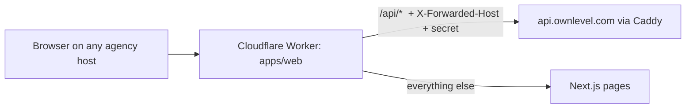
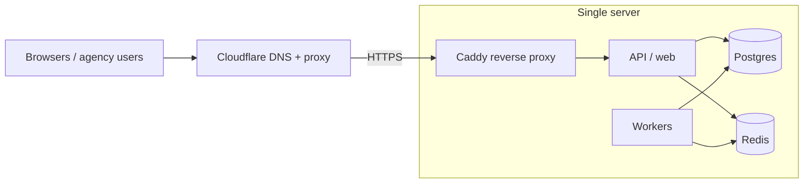
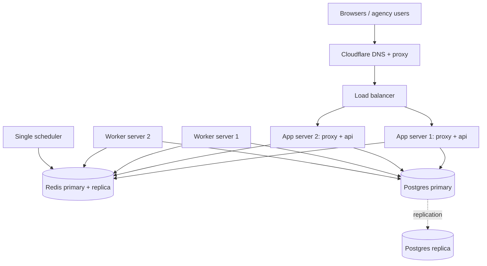

# Ownlevel — Deployment & Traffic Routing

Status: draft · Related: [2_Authentication.md](./2_Authentication.md) (hostnames, custom domains, sessions)

## Overview

Ownlevel starts on one machine and grows to several without architectural change. The app tier is stateless: sessions and permission caches live in Redis, tenant identity comes from the `Host` header, and agents and automations run in workers fed by events. Any app instance can serve any request.

| Component | Role | Stateful? |
| --- | --- | --- |
| Edge / reverse proxy | TLS, hostname routing, forwards to the app | No (holds certificates) |
| API / web (`apps/*`) | HTTP adapters that call `packages/core` | No |
| Workers | Events, agents, automations, domain verification | No |
| Postgres | System of record, RLS | Yes |
| Redis | Sessions, permission cache, hostname cache, queues | Yes |

A load balancer is **not needed on a single server**. A reverse proxy is always needed, to terminate TLS and route by hostname.

## Shared setup (both scenarios)

### DNS and certificates

Every agency gets `{slug}.ownlevel.app` and may add custom domains (see the Authentication doc).

| Hostname | DNS | Certificate |
| --- | --- | --- |
| `app.ownlevel.com` | A / CNAME to the edge | Normal certificate |
| `*.ownlevel.app` | Proxied wildcard `*` record in the `ownlevel.app` zone, served by the web Worker | Cloudflare Universal SSL covers `*.ownlevel.app` (one label), so flat slugs need no extra certificate |
| `app.youragency.com` (custom) | Agency CNAME to `domains.ownlevel.app` | Cloudflare for SaaS Custom Hostnames (registered by the domain worker after TXT verification) |

### Application rules that make scaling safe

- Sessions, the permission cache and the hostname resolver cache live in Redis, never in process memory. Revocation must take effect on every instance at once.
- The app trusts `Host` and `X-Forwarded-For` only from the edge's IPs. Ignore `X-Forwarded-Host` otherwise.
- Scheduled jobs (domain re-verification every 6 hours, session cleanup) run once per cluster: use a single scheduler or a Redis lock.
- Migrations run as a single one-off job per release, never at app start on every instance.
- Workers and web scale independently. Workers never run on the request path.
- Secrets (database URL, Redis URL, encryption keys, Cloudflare tokens) come from environment or a secret store, not from the image.

## Web on Cloudflare Workers

The Next.js app (`apps/web`) runs as one Worker, built with `@opennextjs/cloudflare`, for every hostname: the platform host, `{slug}.ownlevel.app` and agencies' custom domains. The API and MCP stay on our own servers behind Caddy.

- **Same-origin proxy.** The browser only talks to its own host; `app/api/[...path]/route.ts` forwards `/api/*` to `API_URL`, adding `X-Forwarded-Host` and `X-Ownlevel-Proxy: <secret>`. Cookies stay first-party and host-only, and there is no CORS.
- **Trust.** The API honours `X-Forwarded-Host` only when the secret matches (`PROXY_SHARED_SECRET`, identical on the Worker and the API). Better-auth's origin check accepts an origin only if its host resolves to the platform or an active agency domain.
- **Config.** `apps/web/wrangler.jsonc` holds routes and `API_URL`; `PROXY_SHARED_SECRET` is a Worker secret. `NEXT_PUBLIC_PLATFORM_ROOT_DOMAIN` is a build-time variable.

**Deploy runbook**

1. In Cloudflare, create the zones `ownlevel.com` (platform, `api`, `mcp`) and `ownlevel.app` (agency slugs, SaaS fallback).
2. API host env: `PLATFORM_ROOT_DOMAIN=ownlevel.app`, `PLATFORM_HOSTS=app.ownlevel.com`, `PROXY_SHARED_SECRET`, `DATABASE_URL`, `BETTER_AUTH_SECRET`, `BETTER_AUTH_URL=https://api.ownlevel.com`, `RESEND_API_KEY`, `EMAIL_FROM`. Run migrations, then start the API.
3. In `apps/web`: `pnpm wrangler login`, then `pnpm wrangler secret put PROXY_SHARED_SECRET`.
4. DNS: `app` (proxied) in `ownlevel.com`; `*` (proxied) and `domains` in `ownlevel.app`. The records can point at a dummy address (`100::`) because the Worker route answers before any origin is contacted.
5. `NEXT_PUBLIC_PLATFORM_ROOT_DOMAIN=ownlevel.app pnpm --filter @ownlevel/web cf:deploy`.
6. Smoke test (see [8_Testing.md](./8_Testing.md)): `app.ownlevel.com/signup` works, a new agency's `{slug}.ownlevel.app/login` shows its branding, and an unknown slug returns "Not found".
7. Custom domains: enable Cloudflare for SaaS on `ownlevel.app`, set the fallback origin to `domains.ownlevel.app`, and give the domain worker an API token that can manage Custom Hostnames. Check Cloudflare's "Workers as origin for custom hostnames" guidance for the `*/*` route in `wrangler.jsonc`.

**Local preview in the Workers runtime:** `pnpm --filter @ownlevel/web cf:preview` (uses the `preview` environment with no routes, because `wrangler dev` otherwise rewrites `Host` to the first route's hostname and breaks tenant resolution).

## Scenario 1: Single server

One machine runs everything. This is the starting point: no load balancer, no shared-state concerns, one thing to back up.

**Layout (containers on one host)**

| Service | Notes |
| --- | --- |
| `caddy` | Ports 80/443 only. Holds the wildcard certificate and, if used, on-demand TLS |
| `api` | One or two replicas on an internal network |
| `worker` | One or more processes |
| `postgres` | Data on a dedicated volume |
| `redis` | Persistence (AOF) on, since sessions live here |

**Setup steps**

1. Provision the server (Linux, 4+ vCPU, 8+ GB RAM to start) and a firewall that allows only 80/443 and SSH from your IP.
2. Install Docker and Compose. Create an internal network; publish no ports except Caddy's.
3. In Cloudflare, add the `api` and `mcp` records for the API host. Set SSL/TLS to **Full (strict)** and install a Cloudflare Origin CA certificate on Caddy (or let Caddy issue its own with DNS-01).
4. Start Postgres and Redis, then run migrations as a one-off job.
5. Start `api` and `worker`, then Caddy.
6. Confirm the host resolver works: `a.ownlevel.app` shows Agency A's login page, and an unknown slug returns a generic 404.

**Alternative: Cloudflare Tunnel.** Run `cloudflared` on the server instead of exposing 80/443. The firewall then blocks all inbound traffic, and Cloudflare routes hostnames to Caddy or the app through the tunnel.

**Backups and recovery**

- Postgres: nightly `pg_dump` or base backup with WAL archiving to object storage; test restores monthly.
- Redis: AOF on. Losing it signs users out and empties caches, which rebuild from Postgres (see Authentication, "If Redis data is lost or missing"). Queued jobs are the exception: enqueue from a Postgres outbox so they can be replayed.
- Server snapshots weekly.

**Limits of this setup**

- The server is a single point of failure. Deploys cause a brief blip unless you run two `api` replicas and roll them one at a time.
- Move to Scenario 2 when CPU or memory is regularly above ~60%, when you need zero-downtime failover, or when an agency requires an uptime SLA.

## Scenario 2: Multiple servers

Separate the tiers. Add a load balancer in front of the app machines. Move state to dedicated or managed services.

**Machines**

| Tier | Count | Notes |
| --- | --- | --- |
| Load balancer | 1 managed, or 2 for HA | Health checks on `/healthz`; spreads across app servers |
| App servers | 2+ | Stateless; each runs a local proxy and `api` |
| Worker servers | 1+ | Scale by queue depth |
| Postgres | Primary plus replica | Prefer a managed service; PgBouncer for connection pooling |
| Redis | Primary plus replica (or managed) | Shared by all app and worker machines |

**Load balancer options**

| Option | Good for | Watch for |
| --- | --- | --- |
| Cloudflare Load Balancing (paid add-on) | Already proxying through Cloudflare; built-in health checks and failover | Extra cost; still need a good origin certificate on each app server |
| Managed cloud LB (Hetzner, DigitalOcean, AWS ALB) | Simple, no machine to maintain | Wildcard and custom-domain certificates must be handled on the LB or passed through |
| Self-run HAProxy / Caddy pair | Full control, cheapest | You must run two for HA and manage failover |

**Setup steps**

1. Move Postgres and Redis off the app machine first (managed services recommended). Update connection strings; restart the single server and verify before adding machines.
2. Build the app image once; deploy the same image to every app and worker machine.
3. Create the load balancer with a health check on `/healthz`. Add the app servers, and set the proxy IPs the app is allowed to trust for `X-Forwarded-*`.
4. Certificates:
   - With Cloudflare proxying: install the same Origin CA certificate on every app server (or on the LB if it terminates TLS to origin).
   - With Caddy-issued certificates: use shared storage for Caddy's data directory, or terminate TLS only at the LB tier, so machines do not each request their own wildcard certificate.
5. Run the scheduler as one instance (or enable the Redis job lock) so domain re-verification and cleanup run once.
6. Run migrations from one place in the deploy pipeline, before rolling out the new app version.
7. Roll out deploys one app server at a time: remove it from the LB, update it, wait for health, then re-add it.
8. Add monitoring and alerts: LB 5xx rate, p95 latency, queue depth, Postgres replication lag, Redis memory, certificate expiry.

**Scaling signals**

| Signal | Action |
| --- | --- |
| API CPU or latency high | Add an app server |
| Queue depth growing | Add a worker server |
| Postgres CPU or connections high | Add PgBouncer, move reads to the replica, then scale up the primary |
| Redis memory high | Shorten session TTL cleanup, then scale up |

**Failure behavior**

- An app server dies: the LB's health check removes it; users see no session loss, because sessions are in Redis.
- A worker dies: jobs stay in the queue and are retried by another worker.
- Redis fails over: users may be signed out; no data is lost.
- Postgres primary fails: promote the replica (automatic with a managed service); the app reconnects.

## Choosing a scenario

| Situation | Use |
| --- | --- |
| Pre-launch, first agencies, no SLA | Scenario 1 |
| Several paying agencies, deploys without downtime wanted | Scenario 1 with two `api` replicas, or begin Scenario 2 step 1 |
| SLA commitments, sustained load, or failover requirement | Scenario 2 |

The move from Scenario 1 to 2 does not change the application. It moves state out first (Postgres, Redis), then adds app machines and a load balancer.
