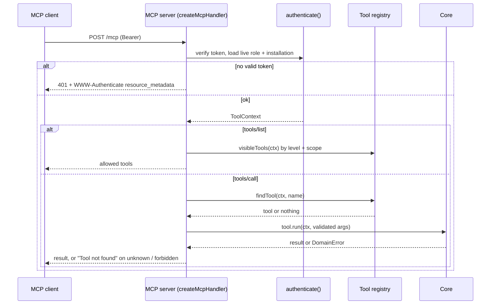
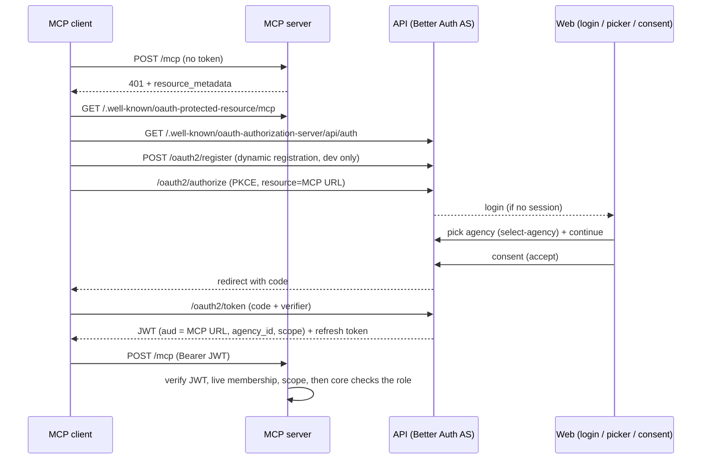
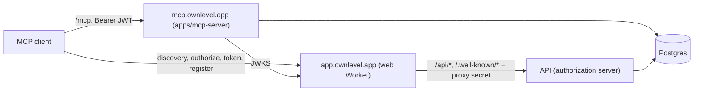
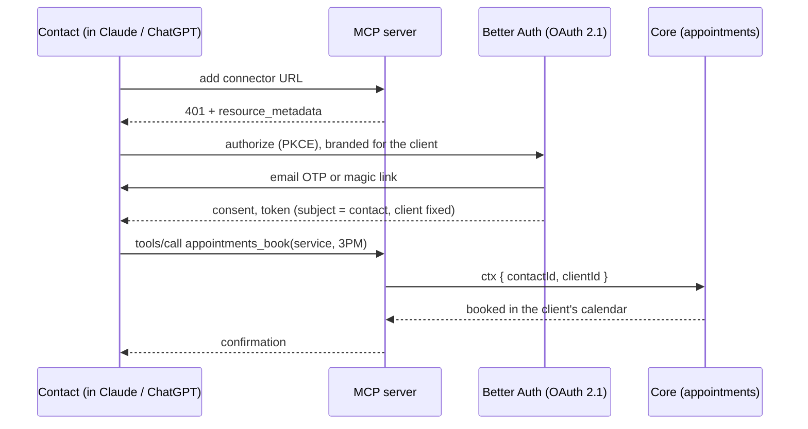

# Ownlevel — MCP Server

Status: agency (staff) slice built end to end with Better Auth OAuth 2.1; contact principal and appointments are planned.

## Overview

Ownlevel exposes one MCP server so that LLM clients (Claude, ChatGPT) can act inside Ownlevel. Authentication and the token model are in [2_Authentication.md](./2_Authentication.md#mcp-tool-authorization-agency-and-client); this document covers the server, the tool registry, and how clients distribute MCP to their own contacts.

Two layers, kept apart on purpose:

| Layer | Location | Responsibility |
| --- | --- | --- |
| Tool registry | `packages/ai/tools` | Defines each tool: schema, scope, permission, levels, sensitivity, and what it runs. Knows nothing about MCP, so REST or in-app agents can reuse it. |
| MCP server | `apps/mcp-server` | Speaks MCP over Streamable HTTP. Authenticates, filters `tools/list`, re-authorizes every `tools/call`, audits. No business logic. |

Business rules live in `packages/core`. A tool is a thin call into a core function, the same function REST uses. Never build a second permission engine for MCP.

## Who can call

| Caller | Identity | Install level | Sees |
| --- | --- | --- | --- |
| Agency staff | `user` + agency membership | Agency | Agency tools plus client tools (`client_id` required, checked against reach) |
| Client staff | `user` + client membership | Client | Client staff tools for that one client |
| Contact (the client's customer) | `contacts` row, no `user`, no role | Client | Contact tools for that one client, own data only |

Contacts are the third principal and are **not modelled in auth yet**. Staff identity, `withTenant` and RLS are keyed on `userId` and `agencyId` today.

## Tool registry

```ts
{
  name: 'agency_set_brand_color',
  permission: 'agency:settings',   // role_permissions; enforced again by core (requireRole)
  scope: 'agency:settings',        // OAuth scope on the token
  levels: ['agency'],              // agency | client
  audience: ['staff'],             // planned: staff | contact
  sensitivity: 'normal',           // normal | outbound | destructive
  input: z.object({ ... }),
  run: (ctx, args) => coreFunction(ctx.db, ctx, args.x),
}
```

Built so far: `agency_set_brand_color` (calls `updateBrandColor`, which merges; `updateBranding` replaces the whole object, so do not use it for single-field changes).

## Request flow



Behavior in `apps/mcp-server/src/handler.ts`:

- Stateless Streamable HTTP (web-standard transport, also runs on Workers). A new `Server` per request; context is re-derived from the token every time.
- `tools/list` is a convenience filter (level + scope). It is not a security boundary: `tools/call` re-checks, and core re-checks the role (`requireRole`) inside the tenant transaction.
- Unknown, hidden, out-of-scope and forbidden tools all return `Tool not found`, so nothing about the agency leaks.
- Arguments are validated with zod before `run`.
- `outbound` and `destructive` tools are refused until the approval flow exists.
- `audit` is a hook; `modules/audit` is still a stub.

## Authorization (Better Auth OAuth 2.1)

The API (`apps/api`) is the authorization server; the MCP server (`apps/mcp-server`) is only a resource server.

| Piece | Where |
| --- | --- |
| Plugins `jwt()` + `mcp()` (OAuth provider, audience-bound to the MCP URL) | `apps/api/src/auth.ts` |
| Discovery: `/.well-known/oauth-authorization-server/api/auth` (forwarded to Better Auth) | `apps/api/src/app.ts` |
| Discovery: `/.well-known/oauth-protected-resource/mcp` (RFC 9728) | `apps/mcp-server/src/server.ts` |
| Login page, agency picker, consent page | `apps/web/app/login`, `app/oauth/select-agency`, `app/oauth/consent` |
| Agency choice stored for the flow in progress | `POST /api/oauth/select-agency` -> `session.oauth_agency_id` (valid 5 minutes) |
| JWT verification (JWKS, issuer, audience, expiry) + live membership check | `apps/mcp-server/src/oauth-auth.ts` |
| Tables | `drizzle/0005_oauth_provider.sql` (`jwks`, `oauth_client`, `oauth_access_token`, `oauth_refresh_token`, `oauth_consent`, ...) |



How the pieces enforce the model:

- **Agency choice.** The consent is stored per agency (`reference_id`), and the JWT carries `agency_id`. The token is never accepted for another agency, and the MCP server re-checks the membership on every request, so removing a member stops access before the token expires (10 minutes).
- **Scopes.** `agency:settings` is the only tool scope today; `offline_access` issues a refresh token. Scopes are listed in `OAUTH_SCOPES` (`auth.ts`) and `SUPPORTED_SCOPES` (`oauth-auth.ts`); keep them in step with the registry.
- **Client registration.** Production clients identify themselves with Client ID Metadata Documents (`@better-auth/cimd`, on by default). Dynamic registration is for local testing only and is off unless `OAUTH_OPEN_REGISTRATION=1` (set in `apps/api/.env.example`).
- **Loopback redirects.** Clients that register `http://127.0.0.1:<port>/...` or `localhost` redirect URIs must send `application_type: "native"`; the server rejects them for `web` clients.
- **Grant types.** `authorization_code` and `refresh_token` only; `client_credentials` is disabled until installation tokens exist.
- **Issuer.** `BETTER_AUTH_URL` + `/api/auth` on the API, `OAUTH_ISSUER` on the MCP server; they must match. In production this is the platform origin (see Production).
- **Known gaps.** One platform-level authorization server (the login page is the platform host, not each agency's branded host). The consent page does not yet show which agency was picked. Agency-level installs only; no client picker.

## Production

Topology: the browser only talks to `app.ownlevel.app` (the web Worker). It proxies `/api/*` **and `/.well-known/*`** to the API, so the authorization server lives on the platform origin and shares the browser's session cookie. The MCP server runs on our servers at `mcp.ownlevel.app`.



What was wrong before, and is now fixed:

| Problem | Fix |
| --- | --- |
| Issuer was `api.ownlevel.app`. The browser session cookie is host-only on `app.ownlevel.app`, so `/oauth2/authorize` never saw the login and looped. (Local dev hid this: cookies ignore ports on `localhost`.) | `BETTER_AUTH_URL` is the platform origin; `/.well-known/*` is proxied by the web app (`apps/web/app/.well-known`, shared `lib/api-proxy.ts`). |
| Dynamic registration is dev-only, so no production client could register. | `@better-auth/cimd` (Client ID Metadata Documents, SSRF-guarded fetch) is on by default; dynamic registration is off unless `OAUTH_OPEN_REGISTRATION=1`. |
| Login and consent URLs came from `WEB_ORIGINS`, empty in production. | `WEB_URL`, defaulting to `https://<first PLATFORM_HOSTS>` when the API is not on localhost. |
| `MCP_ORIGIN`, `MCP_PUBLIC_URL` and the challenge URL could drift apart. | The challenge and metadata URLs derive from `MCP_PUBLIC_URL`. The server refuses to start in production with non-https URLs or without `DATABASE_URL`. |

**Environment**

| Where | Variable | Production value |
| --- | --- | --- |
| API | `BETTER_AUTH_URL` | `https://app.ownlevel.app` |
| API | `MCP_PUBLIC_URL` | `https://mcp.ownlevel.app/mcp` (token audience; must equal the MCP server's) |
| API | `OAUTH_CIMD` | unset (on). `0` on Workers |
| API | `OAUTH_OPEN_REGISTRATION` | unset (off) |
| API | `WEB_URL` | optional; defaults to the platform host |
| MCP server | `NODE_ENV` | `production` |
| MCP server | `MCP_PUBLIC_URL` | `https://mcp.ownlevel.app/mcp` |
| MCP server | `OAUTH_ISSUER` | `https://app.ownlevel.app/api/auth` |
| MCP server | `DATABASE_URL` | the non-owner app role (RLS applies) |
| MCP server | `MCP_DEV_AUTH` | never set |

**Run**: `pnpm --filter @ownlevel/mcp-server start` (behind Caddy on `mcp.ownlevel.app`; health at `/healthz`). Run the `0005` migration first.

**Verified**: `test:oauth` also passes in a production-shaped setup, with the issuer on a proxied single origin, and it checks that removing a membership rejects a still-valid token. Run it against the API and MCP server with `API_URL`, `MCP_URL` and `WEB_URL` pointing at that origin.

**Not verified or still open before launch**

- CIMD against a real client over public HTTPS (it cannot run on localhost). Do this against staging with Claude or ChatGPT.
- The API as a Cloudflare Worker: it bundles, but CIMD's DNS pinning needs Node, so with `OAUTH_CIMD=0` there is no way for clients to register. Run the API on Node (the Caddy scenario) for MCP.
- Rate limiting of `/oauth2/*` across instances: Better Auth's default limiter is per process. Back it with Redis (`secondaryStorage`) when running more than one API instance.
- No Dockerfile or Caddy entry for the MCP server exists yet.
- Browser-based MCP clients need CORS on the MCP and OAuth endpoints; server-side connectors (Claude, ChatGPT) do not.
- Single platform login host (no agency branding on the OAuth login page), consent page does not show the picked agency, and there is no per-installation revoke or audit trail yet.

## Testing locally with a real LLM client

Two ways to authenticate locally. Use OAuth to test the real flow; use the dev token for quick `curl` checks.

**1. Start everything**

Local registration of test clients needs `OAUTH_OPEN_REGISTRATION=1` in `apps/api/.env` (it is in `.env.example`; it is off by default).

```bash
docker compose up -d postgres
pnpm --filter @ownlevel/api db:migrate
pnpm --filter @ownlevel/api dev              # :4000 (authorization server)
pnpm --filter @ownlevel/web dev              # :3100 (login, picker, consent pages)
MCP_DEV_AUTH=1 pnpm --filter @ownlevel/mcp-server dev   # :4100/mcp (drop MCP_DEV_AUTH=1 to turn dev tokens off)
```

**2. Automated end-to-end check** (plays browser and MCP client: sign-up, agency, registration, PKCE, picker, consent, token, tool call, refresh)

```bash
pnpm --filter @ownlevel/mcp-server test:oauth
```

It creates a throwaway user and agency each run (`oauth-<ts>@e2e.test`, `e2e-<ts>`). Delete them afterwards with `delete from agencies where slug like 'e2e-%'` and `delete from "user" where email like 'oauth-%@e2e.test'`.

**3. Real client over OAuth**

| Client | How |
| --- | --- |
| Claude Code | `claude mcp add --transport http ownlevel-dev http://localhost:4100/mcp`, then run `/mcp` in Claude Code and authenticate. A browser opens: sign in, pick the agency, approve. |
| MCP Inspector | `npx @modelcontextprotocol/inspector`, choose Streamable HTTP, URL `http://localhost:4100/mcp`, then use its OAuth flow. |
| Claude Desktop, ChatGPT connectors | Need an HTTPS URL for both servers (tunnel both, and set `BETTER_AUTH_URL`, `MCP_PUBLIC_URL`, `MCP_ORIGIN`, `OAUTH_ISSUER`, `WEB_ORIGINS` to the public URLs). Not tested yet. |

Then ask: "Set my agency's brand color to #0ea5e9." If a client fails at registration with `invalid_redirect_uri`, it is sending a loopback redirect without `application_type: "native"` (see above).

**Dev token** (curl only; refused when `NODE_ENV=production`, and only accepted when `MCP_DEV_AUTH=1`)

```
Authorization: Bearer dev:<userId>:<agencyId>[:scope,scope]    # default scope: agency:settings
```

Identity is still checked against real memberships, and core enforces the role on every call. Use it with the rows from step 4 below and the raw HTTP check at the end.

**4. Find an agency owner to act as** (dev token only)

```bash
docker exec ownlevel-postgres-1 psql -U ownlevel -c \
  "select m.user_id, m.agency_id, u.email, r.key from memberships m join \"user\" u on u.id = m.user_id join roles r on r.id = m.role_id where m.client_id is null"
```

Use an `agency_owner` or `agency_admin` row to see a change succeed, and an `agency_user` row to see it denied.

**5. Connect a client with the dev token**

| Client | How |
| --- | --- |
| Claude Code | `claude mcp add --transport http ownlevel-dev http://localhost:4100/mcp --header "Authorization: Bearer dev:<userId>:<agencyId>"` |
| MCP Inspector | `npx @modelcontextprotocol/inspector`, choose Streamable HTTP, enter the URL, add the `Authorization` header |

**6. Try it**

In the client, ask: "Set my agency's brand color to #0ea5e9." Then confirm in the database:

```bash
docker exec ownlevel-postgres-1 psql -U ownlevel -c "select slug, branding from agencies"
```

**Expected results**

| Case | Result |
| --- | --- |
| No token | 401 with `WWW-Authenticate: Bearer resource_metadata=...` |
| User with no agency membership | 401 |
| Owner or admin calls `tools/list` | Lists `agency_set_brand_color` |
| Owner sets a valid color | Color changes; `appName`, `logoUrl` and `clientLabel` are kept |
| Invalid color (for example `red`) | Error: "Primary color must look like #4f46e5." |
| `agency_user` (staff) sets a color | `Tool not found`, database unchanged |
| Token without the `agency:settings` scope (`...:<agencyId>:other`) | `Tool not found` |

Every call also logs an `audit user=... tool=... ok|error` line in the server output until `audit_log` exists.

**Raw HTTP check** (no LLM needed):

```bash
curl -s localhost:4100/mcp \
  -H 'content-type: application/json' -H 'accept: application/json, text/event-stream' \
  -H "authorization: Bearer dev:<userId>:<agencyId>" \
  -d '{"jsonrpc":"2.0","id":1,"method":"tools/list"}'
```

Tests change real rows in your local database, so note the old color first and set it back afterwards.

## Distributing MCP to contacts

Goal: a client gives its contacts a connection URL; a contact adds it to their LLM and says "book a haircut at 3PM", and the appointment appears in the client's calendar.



Design:

1. **Same server, same registry.** Add `audience` to `ToolDef`. Contact tools are `levels: ['client']`, `audience: ['contact']`: `appointments_list_slots`, `appointments_book`, `appointments_cancel`, `appointments_mine`. Staff tools never appear for contacts, and the reverse.
2. **`ToolContext` becomes a union.** Staff: `userId` and a live role. Contact: `contactId` and `clientId`. Contact tools take no `client_id` argument; the install fixes it.
3. **Contact sign-in.** Passwordless email OTP on the client's branded host. Verifying it finds or creates the `contacts` row; the token subject is that contact. The consent screen offers only contact scopes (for example `appointments:book`).
4. **Distribution.** The client shares a connect URL (host-based, for example `https://app.clientbrand.com/mcp`, or `/client/:slug/mcp`), a QR code, and a copy-paste snippet. The URL's client must match the token's client. Client ID Metadata Documents avoid manual client registration.
5. **Data isolation.** Add RLS policies keyed on an `app.contact_id` setting so a contact can only touch rows with their own `contact_id`. Do not rely on application code alone.
6. **Abuse controls.** Per-contact rate limits, a client-level switch to enable or disable contact MCP, and confirmation before booking. `outbound` and `destructive` tools use MCP elicitation so the LLM must confirm ("Haircut, Thu 3:00 PM?") with the user.
7. **One connection per client.** See below.

### One connection per client

A contact-level token is bound to exactly one client. A contact who uses several clients (for example a salon and a gym) adds one connector per client and signs in separately for each.

- **Consent is unambiguous.** The consent screen is branded for one client and lists only that client's contact scopes. There is no picker, so a contact never grants access to a business they didn't mean to.
- **Revocation is a single row.** Disabling a contact's connection, or the client turning contact MCP off, removes one `app_installations` row at the client level. Nothing else is affected.
- **No cross-client reach.** The client is fixed by the install and the URL must match it (host-based or `/client/:slug/mcp`). Tools take no `client_id`, and the same `contacts` person in another client is a different row with a different token.
- **Tenancy stays simple.** The token carries `contactId` and `clientId`, so RLS and rate limits key on one pair. There is no "all my clients" token to scope or audit.
- **Cost.** More setup for contacts who use several clients. That is accepted; a shared multi-client contact identity would need a new cross-client consent model and is out of scope.

Agency staff keep the existing agency-level install, which can reach several clients (see 2_Authentication.md). This rule applies to contacts only.

## Status and roadmap

| Item | State |
| --- | --- |
| Registry, handler, `agency_set_brand_color`, `updateBrandColor` | Done (typechecked, smoke-tested with a fake context) |
| Better Auth OAuth provider (`jwt` + `mcp` plugins), migration `0005`, login / agency picker / consent pages | Done; verified by `test:oauth` (not yet with a real LLM client) |
| JWT verification, live membership check, `/.well-known/oauth-protected-resource` | Done. Per-installation revocation (`app_installations`) is not built; consent rows and short token life stand in for it |
| Client ID Metadata Documents (`@better-auth/cimd`) replacing dynamic registration in production | Wired and advertised; not tested with a real client (needs public HTTPS) |
| Consent page shows the picked agency; agency-branded login host | Not started |
| `audit_log` writes | `modules/audit` is a stub |
| Approval flow for `outbound` / `destructive` | Not started |
| `notifications/tools/list_changed` | Needs stateful sessions or SSE |
| Appointments schema and core (`listSlots`, `book`, `cancel`, no double booking) | Not started; also powers the calendar view |
| Contact principal (OTP, contact-scoped RLS) | Not started |
| Contact tools and the client's "connect your AI" page | Not started |
| Remove `endpoints/client` and `endpoints/partner` stubs for a single `/mcp` route | Open |

Suggested order: appointments core, then the contact principal, then contact tools and the connect page. Before launch, work through the "Not verified" list in Production.
