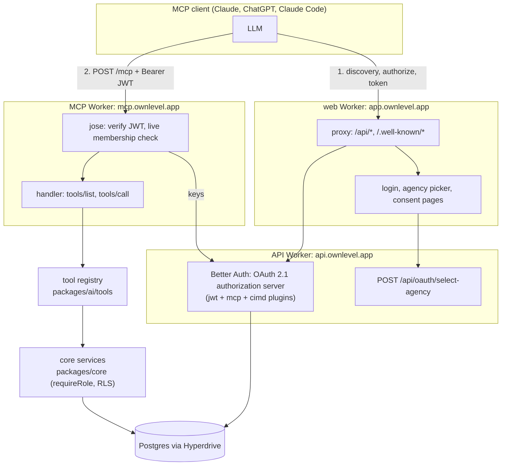
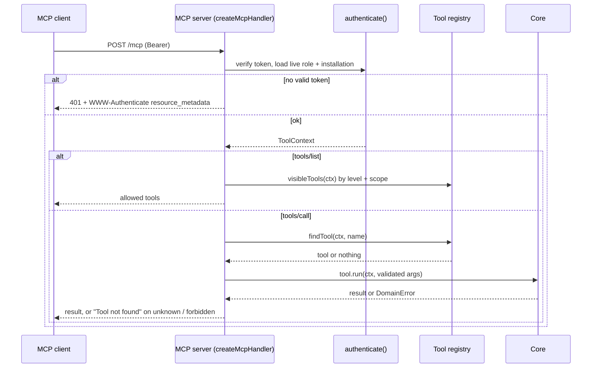
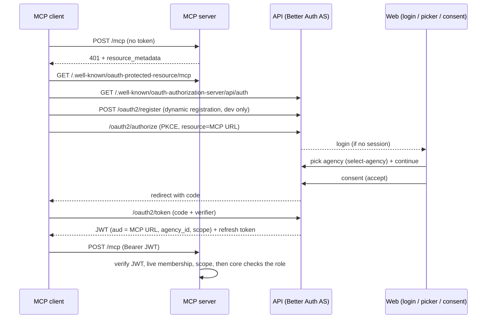
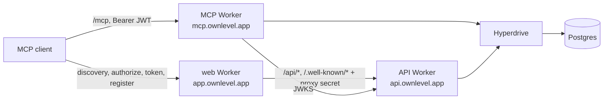
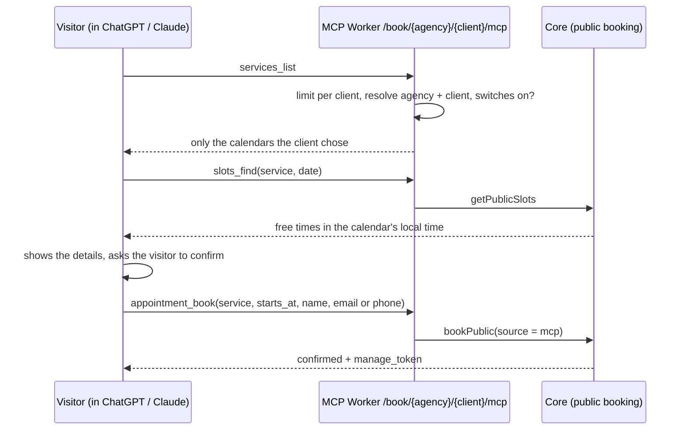

# Ownlevel — MCP Server

Status: staff connections (agency and client level, Better Auth OAuth 2.1) and the public booking endpoint for visitors' AI assistants are built; audit log and approval flow are planned.

## Overview

Ownlevel exposes one MCP server so that LLM clients (Claude, ChatGPT) can act inside Ownlevel. Authentication and the token model are in [2_Authentication.md](./2_Authentication.md#mcp-tool-authorization-agency-and-client); this document covers the server, the tool registry, and how clients let their visitors book through AI assistants ([Public booking](#public-booking-for-visitors-ai-assistants)).

Two layers, kept apart on purpose:

| Layer | Location | Responsibility |
| --- | --- | --- |
| Tool registry | `packages/ai/tools` | Defines each tool: schema, scope, permission, levels, sensitivity, and what it runs. Knows nothing about MCP, so REST or in-app agents can reuse it. |
| MCP server | `apps/mcp-server` | Speaks MCP over Streamable HTTP. Authenticates, filters `tools/list`, re-authorizes every `tools/call`, audits. No business logic. |

Business rules live in `packages/core`. A tool is a thin call into a core function, the same function REST uses. Never build a second permission engine for MCP.

## Architecture

Three pieces cooperate. The MCP server only verifies tokens and runs tools; everything about identity lives in the API and web app.



| Piece | Code | Runs as | Job |
| --- | --- | --- | --- |
| Authorization server | `apps/api/src/auth.ts`, `cimd-fetch.ts`, `app.ts` | API Worker, reached through the web Worker | Registers clients (CIMD), authenticates the user, records the agency choice and consent, issues short-lived JWTs and refresh tokens |
| Login, picker, consent UI | `apps/web/app/login`, `app/oauth/*` | web Worker | Browser steps of the OAuth flow |
| MCP server | `apps/mcp-server` (`worker.ts`, `app.ts`, `handler.ts`, `oauth-auth.ts`) | MCP Worker | Verifies the token, lists and calls tools |
| Tool registry | `packages/ai/tools` | imported by the MCP Worker | Declares each tool, its scope, level and permission |
| Core services | `packages/core` | imported by API and MCP | Business rules and the role check, shared with REST |

**What each layer decides**

| Question | Decided by | When |
| --- | --- | --- |
| Who is this? Which agency? Which scopes? | Authorization server (user login, picker, consent) | Once, when the client connects |
| Is the token genuine, for this server, unexpired? | MCP Worker (`jose`: signature, issuer, audience, expiry) | Every request |
| Is the user still a member of that agency? | MCP Worker (`hasAgencyMembership`) | Every request |
| Is the tool visible for this level and scope? | Tool registry (`visibleTools`, `findTool`) | `tools/list` and every `tools/call` |
| May this user's role do it? | Core (`requireRole` inside an RLS-scoped transaction) | Every `tools/call` |

A failure at any layer looks the same to the client (`Tool not found` or 401), so nothing leaks about which agencies or tools exist.

**Runtimes.** Production is Cloudflare Workers only (see [3_Deployment.md](./3_Deployment.md)). Locally the same code runs two ways: plain Node (`pnpm dev`, fastest) or `wrangler dev` in the Workers runtime (`cf:dev`, closest to production). `src/app.ts` is shared by both; only the entry file differs (`server.ts` vs `worker.ts`).

## Who can call

| Caller | Identity | Where | Sees |
| --- | --- | --- | --- |
| Agency staff | `user` + agency membership, OAuth token | `/mcp` | Agency tools plus client tools (`client_id` required, checked against reach) |
| Client staff | `user` + client membership, OAuth token | `/mcp` | Client staff tools for that one client |
| Visitor's AI assistant | None. Like the public booking page, no sign-in | `/book/{agency}/{client}/mcp` | Free times and booking for the calendars the client switched on; never other people's bookings |

Visitors (a client's customers) have no account and no login, so there is no contact principal, no contact token and no contact RLS. What a visitor's assistant can do is exactly what the public booking page allows, gated by the client's switches. Staff tools are never reachable on the public route: it has its own tool list.

## Tool registry

```ts
{
  name: 'agency_set_brand_color',
  permission: 'agency:settings',   // role_permissions; enforced again by core (requireRole)
  scope: 'agency:settings',        // OAuth scope on the token
  levels: ['agency'],              // agency | client
  sensitivity: 'normal',           // normal | outbound | destructive
  input: z.object({ ... }),
  run: (ctx, args) => coreFunction(ctx.db, ctx, args.x),
}
```

Built so far: `agency_set_brand_color` (calls `updateBrandColor`, which merges; `updateBranding` replaces the whole object, so do not use it for single-field changes), `clients_list`, `clients_create`, `calendars_create`, `calendars_list`, `appointments_list`, `slots_find`.

## Tool catalogue

One tool per core action; the LLM chains them. Staff tools never take identity (who is "me") as an argument: it comes from the token. Public booking tools take the visitor's own details, like the public form.

| Audience, level | Example prompt | Tools | Scope |
| --- | --- | --- | --- |
| Agency staff, agency | "Create a client named Bloom Salon with a calendar" | `clients_list`, `clients_create` (`with_calendar`), `calendars_create` (`client_id`) | `clients:read`, `clients:write`, `calendars:write` |
| Client staff, client (agency staff too, with `client_id`) | "What are my appointments tomorrow?" | `calendars_list`, `appointments_list` (`date`, `days`, `mine`), `slots_find` | `appointments:read` |
| Visitor, public endpoint (no token) | "Book a haircut at 10 am tomorrow" | `services_list`, `service_details`, `slots_find`, `appointment_book`, `appointment_cancel` | none |

Decisions:

- **"With a calendar" creates a default calendar.** There is no per-client module switch. `clients_create` with `with_calendar: true` creates the client, then a draft personal calendar named after the client with default hours and no host. The two steps are separate transactions: if the calendar fails, the client stays and the result says so.
- **`appointments_list` returns all of the client's appointments**; `mine: true` limits it to appointments the caller hosts.
- **Dates are local.** Tools take `date: "2025-06-12"` and the server resolves the range in the client's (or calendar's) timezone. LLMs must not compute UTC ranges.
- **Visitors book published calendars the client switched on**, the same rules as the public booking page (hours, notice, horizon, no double booking, the client's form questions).
- **Write tools carry MCP annotations** (`readOnlyHint`, `destructiveHint`) so Claude and ChatGPT ask before writing. Elicitation support varies by client, so it is not the only safeguard.

## Request flow



Behavior in `apps/mcp-server/src/handler.ts`:

- Stateless Streamable HTTP (web-standard transport, also runs on Workers). A new `Server` per request; context is re-derived from the token every time.
- `tools/list` is a convenience filter (level + scope). It is not a security boundary: `tools/call` re-checks, and core re-checks the role (`requireRole`) inside the tenant transaction.
- Unknown, hidden, out-of-scope and forbidden tools all return `Tool not found`, so nothing about the agency leaks.
- Arguments are validated with zod before `run`.
- `outbound` and `destructive` tools are refused until the approval flow exists.
- `audit` is a hook; `modules/audit` is still a stub.

## Authorization (Better Auth OAuth 2.1)

The API (`apps/api`) is the authorization server; the MCP server (`apps/mcp-server`) is only a resource server.

| Piece | Where |
| --- | --- |
| Plugins `jwt()` + `mcp()` (OAuth provider, audience-bound to the MCP URL) | `apps/api/src/auth.ts` |
| Discovery: `/.well-known/oauth-authorization-server/api/auth` (forwarded to Better Auth) | `apps/api/src/app.ts` |
| Discovery: `/.well-known/oauth-protected-resource/mcp` (RFC 9728) | `apps/mcp-server/src/server.ts` |
| Login page, agency picker, consent page | `apps/web/app/login`, `app/oauth/select-agency`, `app/oauth/consent` |
| Places the user can connect | `GET /api/oauth/targets`: agency-level memberships, and clients the user is a direct member of |
| Agency (or client) choice stored for the flow in progress | `POST /api/oauth/select-agency` `{ agencyId, clientId? }` -> `session.oauth_agency_id`, `session.oauth_client_id` (valid 5 minutes; migration `0010`) |
| JWT verification (JWKS, issuer, audience, expiry) + live membership check | `apps/mcp-server/src/oauth-auth.ts` |
| Tables | `drizzle/0005_oauth_provider.sql` (`jwks`, `oauth_client`, `oauth_access_token`, `oauth_refresh_token`, `oauth_consent`, ...) |



How the pieces enforce the model:

- **Agency or client choice.** The picker offers each agency (agency-level membership) and each client the user belongs to directly. The consent is stored per pick (`reference_id` is `<agencyId>` or `<agencyId>:<clientId>`), and the JWT carries `agency_id`, plus `tenant_client_id` for a client-level connection (not `client_id`: in JWT access tokens that claim names the OAuth app, RFC 9068). The token is never accepted for another agency or client, and the MCP server re-checks the membership on every request (`hasAgencyMembership`, or `hasClientMembership` for client tokens), so removing a member stops access before the token expires (10 minutes).
- **Scopes.** Tool scopes are `agency:settings`, `clients:read`, `clients:write`, `calendars:write` and `appointments:read`; the 401 challenge lists them all so clients request them; `offline_access` issues a refresh token. Scopes are listed in `OAUTH_SCOPES` (`auth.ts`) and `SUPPORTED_SCOPES` (`oauth-auth.ts`); keep them in step with the registry.
- **Client registration.** Production clients identify themselves with Client ID Metadata Documents (`@better-auth/cimd`, on by default). Dynamic registration is for local testing only and is off unless `OAUTH_OPEN_REGISTRATION=1` (set in `apps/api/.env.example`).
- **Loopback redirects.** Clients that register `http://127.0.0.1:<port>/...` or `localhost` redirect URIs must send `application_type: "native"`; the server rejects them for `web` clients.
- **Grant types.** `authorization_code` and `refresh_token` only; `client_credentials` is disabled until installation tokens exist.
- **Issuer.** `BETTER_AUTH_URL` + `/api/auth` on the API, `OAUTH_ISSUER` on the MCP server; they must match. In production this is the platform origin (see Production).
- **Known gaps.** One platform-level authorization server (the login page is the platform host, not each agency's branded host). The consent page does not yet show which agency or client was picked, and lists every requested scope even when the pick's level hides some tools.

## Production

Everything is a Cloudflare Worker (see [3_Deployment.md](./3_Deployment.md)): the browser talks to `app.ownlevel.app` (web Worker), which proxies `/api/*` and `/.well-known/*` to the API Worker, so the authorization server lives on the platform origin and shares the browser's session cookie. The MCP Worker serves `mcp.ownlevel.app`.



Design decisions that matter in production:

| Decision | Why |
| --- | --- |
| Issuer is `https://app.ownlevel.app/api/auth` (`BETTER_AUTH_URL`), not `api.` | The browser session cookie is host-only on `app.`, so `/oauth2/authorize` must be served from there or it never sees the login. Local dev hides this because cookies ignore ports on `localhost`. |
| The web Worker proxies `/.well-known/*` as well as `/api/*` | OAuth discovery lives at the origin root. See `apps/web/app/.well-known` and `lib/api-proxy.ts`. |
| Clients register with CIMD (`@better-auth/cimd`), dynamic registration is off unless `OAUTH_OPEN_REGISTRATION=1` | Open registration lets anyone create OAuth clients. |
| CIMD metadata is fetched by `apps/api/src/cimd-fetch.ts`, not the Node transport | The Node transport pins DNS and needs `node:dns`. Workers cannot reach private or loopback addresses; the fetch also requires a public https hostname on port 443, never follows redirects, and caps time (5 s) and size (64 KB). It cannot pin DNS, so it relies on that Workers isolation. |
| The MCP Worker verifies tokens with `jose`, not `@better-auth/mcp`'s request handler | Bundled together with the MCP SDK, the two zod module graphs initialise in the wrong order and the Worker fails at startup ("Class2 is not a constructor"). Plain JWKS verification does the same checks (signature, issuer, audience, expiry). |
| JWKS is fetched from `api.ownlevel.app` directly (`OAUTH_JWKS_URL`) | Skips a hop through the web Worker. |
| Public URLs derive from `MCP_PUBLIC_URL` | The challenge and metadata URLs cannot drift from the token audience. Outside localhost the server refuses to start with non-https URLs. |

**Configuration** (`apps/mcp-server/wrangler.jsonc` and `apps/api/wrangler.jsonc`)

| Where | Variable | Production value |
| --- | --- | --- |
| API | `BETTER_AUTH_URL` | `https://app.ownlevel.app` |
| API | `MCP_PUBLIC_URL` | `https://mcp.ownlevel.app/mcp` (token audience; must equal the MCP Worker's) |
| API | `OAUTH_CIMD` | unset (on) |
| API | `OAUTH_OPEN_REGISTRATION` | unset (off) |
| MCP | `MCP_PUBLIC_URL` | `https://mcp.ownlevel.app/mcp` |
| MCP | `OAUTH_ISSUER` | `https://app.ownlevel.app/api/auth` |
| MCP | `OAUTH_JWKS_URL` | `https://api.ownlevel.app/api/auth/jwks` |
| MCP | `MCP_DEV_AUTH` | never set (dev tokens also refuse to start unless the issuer is `localhost`) |

**Deploy**: run migrations `0005`, `0010` (client-level connections) and `0011` (AI booking switches), then `pnpm --filter @ownlevel/api cf:deploy` and `pnpm --filter @ownlevel/mcp-server cf:deploy` (full runbook in 3_Deployment.md). `mcp` needs a proxied DNS record.

**Verify** (read-only):

```bash
curl https://mcp.ownlevel.app/healthz                                   # ok
curl -i -X POST https://mcp.ownlevel.app/mcp -H 'content-type: application/json' \
  -H 'accept: application/json, text/event-stream' -d '{"jsonrpc":"2.0","id":1,"method":"tools/list"}'
# 401 with: WWW-Authenticate: Bearer resource_metadata="https://mcp.ownlevel.app/.well-known/oauth-protected-resource/mcp", scope="agency:settings clients:read clients:write calendars:write offline_access"
curl https://app.ownlevel.app/.well-known/oauth-authorization-server/api/auth   # has client_id_metadata_document_supported: true
```

**Tested**: `test:oauth` passes against the MCP Worker running in `workerd` (`pnpm --filter @ownlevel/mcp-server cf:dev`) and against a production-shaped single origin (issuer on the proxied web origin). It includes a check that removing a membership rejects a still-valid token.

**Not verified or still open before launch**

- CIMD against a real client over public HTTPS (it cannot run on localhost). Do this against staging with Claude or ChatGPT.
- Rate limiting of `/oauth2/*`: Better Auth's default limiter is per isolate, so it does not protect a multi-instance deployment. Add a shared store or Cloudflare rate-limiting rules.
- The JWKS table can accumulate signing keys (32 were seen in one deployment). Investigate whether Hyperdrive query caching hides the existing key from new isolates; if so, disable caching on the Hyperdrive config.
- DPoP-bound tokens are not enforced by the MCP Worker.
- Browser-based MCP clients need CORS on the MCP and OAuth endpoints; server-side connectors (Claude, ChatGPT) do not.
- Single platform login host (no agency branding on the OAuth login page), the consent page does not show the picked agency, and there is no per-installation revoke or audit trail yet.

## Testing overview

| What | Local | Production |
| --- | --- | --- |
| Is it up and routed correctly? | `curl localhost:4100/healthz` | `curl https://mcp.ownlevel.app/healthz` |
| Does auth reject bad callers? | curl with no token, garbage token | same, against `mcp.ownlevel.app` |
| Does the whole OAuth flow work? | `pnpm --filter @ownlevel/mcp-server test:oauth` (scripted browser + client) | A real client (Claude Code, Claude, ChatGPT) |
| Does the tool change data? | Query Postgres in Docker | Check the agency in the app or the database |
| Runtime fidelity | `cf:dev` runs the Worker in `workerd` | The real Worker |

Order to follow: local scripted test, then local with a real client, then production smoke checks, then production with a real client. Details below.

## Testing locally with a real LLM client

Two ways to authenticate locally. Use OAuth to test the real flow; use the dev token for quick `curl` checks.

**1. Start everything**

Local registration of test clients needs `OAUTH_OPEN_REGISTRATION=1` in `apps/api/.env` (it is in `.env.example`; it is off by default).

```bash
docker compose up -d postgres
pnpm --filter @ownlevel/api db:migrate
pnpm --filter @ownlevel/api dev              # :4000 (authorization server)
pnpm --filter @ownlevel/web dev              # :3100 (login, picker, consent pages)
MCP_DEV_AUTH=1 pnpm --filter @ownlevel/mcp-server dev   # :4100/mcp, plain Node for local use (drop MCP_DEV_AUTH=1 to turn dev tokens off)
# or in the Workers runtime: pnpm --filter @ownlevel/mcp-server cf:dev
```

**2. Automated end-to-end check** (plays browser and MCP client: sign-up, agency, registration, PKCE, picker, consent, token, tool call, refresh, a client-level connection, revocation)

```bash
pnpm --filter @ownlevel/mcp-server test:oauth
```

It creates a throwaway user and agency each run (`oauth-<ts>@e2e.test`, `e2e-<ts>`). Delete them afterwards with `delete from agencies where slug like 'e2e-%'` and `delete from "user" where email like 'oauth-%@e2e.test'`.

**3. Real client over OAuth**

| Client | How |
| --- | --- |
| Claude Code | `claude mcp add --transport http ownlevel-dev http://localhost:4100/mcp`, then run `/mcp` in Claude Code and authenticate. A browser opens: sign in, pick the agency, approve. |
| MCP Inspector | `npx @modelcontextprotocol/inspector`, choose Streamable HTTP, URL `http://localhost:4100/mcp`, then use its OAuth flow. |
| Claude Desktop, ChatGPT connectors | Need an HTTPS URL for both servers (tunnel both, and set `BETTER_AUTH_URL`, `MCP_PUBLIC_URL`, `MCP_ORIGIN`, `OAUTH_ISSUER`, `WEB_ORIGINS` to the public URLs). Not tested yet. |

Then ask: "Set my agency's brand color to #0ea5e9." or "Create a client named Bloom Salon with a calendar." If a client fails at registration with `invalid_redirect_uri`, it is sending a loopback redirect without `application_type: "native"` (see above).

**Dev token** (curl only; refused when `NODE_ENV=production`, and only accepted when `MCP_DEV_AUTH=1`)

```
Authorization: Bearer dev:<userId>:<agencyId>[/<clientId>][:scope,scope]    # /<clientId> = client-level connection; default: all supported scopes
```

Identity is still checked against real memberships, and core enforces the role on every call. Use it with the rows from step 4 below and the raw HTTP check at the end.

**4. Find an agency owner to act as** (dev token only)

```bash
docker exec ownlevel-postgres-1 psql -U ownlevel -c \
  "select m.user_id, m.agency_id, u.email, r.key from memberships m join \"user\" u on u.id = m.user_id join roles r on r.id = m.role_id where m.client_id is null"
```

Use an `agency_owner` or `agency_admin` row to see a change succeed, and an `agency_user` row to see it denied.

**5. Connect a client with the dev token**

| Client | How |
| --- | --- |
| Claude Code | `claude mcp add --transport http ownlevel-dev http://localhost:4100/mcp --header "Authorization: Bearer dev:<userId>:<agencyId>"` |
| MCP Inspector | `npx @modelcontextprotocol/inspector`, choose Streamable HTTP, enter the URL, add the `Authorization` header |

**6. Try it**

In the client, ask: "Set my agency's brand color to #0ea5e9." Then confirm in the database:

```bash
docker exec ownlevel-postgres-1 psql -U ownlevel -c "select slug, branding from agencies"
```

**Expected results**

| Case | Result |
| --- | --- |
| No token | 401 with `WWW-Authenticate: Bearer resource_metadata=...` |
| User with no agency membership | 401 |
| Owner or admin calls `tools/list` | Lists `agency_set_brand_color` |
| Owner sets a valid color | Color changes; `appName`, `logoUrl` and `clientLabel` are kept |
| Invalid color (for example `red`) | Error: "Primary color must look like #4f46e5." |
| `agency_user` (staff) sets a color | `Tool not found`, database unchanged |
| Token without the `agency:settings` scope (`...:<agencyId>:other`) | `Tool not found` |

Every call also logs an `audit user=... tool=... ok|error` line in the server output until `audit_log` exists.

**Raw HTTP check** (no LLM needed):

```bash
curl -s localhost:4100/mcp \
  -H 'content-type: application/json' -H 'accept: application/json, text/event-stream' \
  -H "authorization: Bearer dev:<userId>:<agencyId>" \
  -d '{"jsonrpc":"2.0","id":1,"method":"tools/list"}'
```

Tests change real rows in your local database, so note the old color first and set it back afterwards.

## Testing in production

Do these in order. Steps 1 to 3 are read-only; step 4 changes one agency setting, so use a test agency or note the old color and set it back.

**1. Deployment is routed to the right Worker**

```bash
curl https://mcp.ownlevel.app/healthz     # expect: ok  (an HTML 404 page means the request hit the web Worker: see Troubleshooting)
curl -i -X POST https://mcp.ownlevel.app/mcp -H 'content-type: application/json' \
  -H 'accept: application/json, text/event-stream' -d '{"jsonrpc":"2.0","id":1,"method":"tools/list"}'
# expect: 401 and  WWW-Authenticate: Bearer resource_metadata="https://mcp.ownlevel.app/.well-known/oauth-protected-resource/mcp", scope="agency:settings clients:read clients:write calendars:write offline_access"
```

**2. Discovery chain is consistent**

```bash
curl https://mcp.ownlevel.app/.well-known/oauth-protected-resource/mcp
#   "resource": "https://mcp.ownlevel.app/mcp", "authorization_servers": ["https://app.ownlevel.app/api/auth"]
curl https://app.ownlevel.app/.well-known/oauth-authorization-server/api/auth
#   "issuer" matches the line above; has "client_id_metadata_document_supported": true;
#   has NO "registration_endpoint" (open registration must stay off)
curl https://app.ownlevel.app/api/auth/jwks      # a non-empty "keys" array
```

**3. Bad tokens are rejected**

```bash
curl -i -X POST https://mcp.ownlevel.app/mcp -H 'authorization: Bearer garbage' \
  -H 'content-type: application/json' -H 'accept: application/json, text/event-stream' -d '{}'
# expect 401 with error="invalid_token" in WWW-Authenticate
```

**4. Real client, end to end**

1. Add the server: `claude mcp add --transport http ownlevel https://mcp.ownlevel.app/mcp`, then run `/mcp` and choose Authenticate. (In Claude or ChatGPT, add a custom connector with that URL.)
2. In the browser: sign in at `app.ownlevel.app`, pick the agency, approve the consent screen. You return to the client, which now lists the tool.
3. Ask: "Set my agency's brand color to #0ea5e9."
4. Confirm: the agency's color changed in the app, or `select slug, branding from agencies where slug = '<slug>';`.
5. Negative checks: sign in as an `agency_user` (not owner or admin) and repeat; the tool must answer "not found" and the color must stay. Remove the member from the agency and call again with the old token; it must return 401.

**5. Logs while testing**

```bash
pnpm --filter @ownlevel/mcp-server exec wrangler tail          # MCP Worker: one `audit user=... tool=... ok|error` line per call
pnpm --filter @ownlevel/api exec wrangler tail --format pretty # API Worker: OAuth endpoints
```

**Rolling back.** `pnpm --filter @ownlevel/mcp-server exec wrangler rollback` returns the MCP Worker to its previous version; the API and web Workers have their own rollbacks. Database changes are not rolled back.

**Troubleshooting**

| Symptom | Likely cause |
| --- | --- |
| `/healthz` returns an HTML "404: This page could not be found" | The `mcp` DNS record is missing or not proxied, or the MCP Worker is not deployed, so the web Worker's wildcard route answered. |
| `/mcp` returns 401 even after signing in, error `invalid_token` | Audience or issuer mismatch: `MCP_PUBLIC_URL` and `OAUTH_ISSUER` must be identical on the API and MCP Workers. Or the API's keys changed and the Worker has a stale key set (redeploy or wait for the key cache). |
| Authorization loops back to the login page | The authorization server is not on the platform origin (`BETTER_AUTH_URL` must be `https://app.ownlevel.app`), so it cannot see the session cookie. |
| Client cannot register, no `client_id_metadata_document_supported` in the metadata | The API Worker has not been redeployed with CIMD enabled, or `OAUTH_CIMD=0` is set. |
| `invalid_redirect_uri` on registration | A client with a loopback redirect is not sending `application_type: "native"` (dynamic registration, local only). |
| Tool call returns "Tool not found" for the owner | The token lacks the `agency:settings` scope (the client did not request it), or the member's role is not owner or admin. |
| 401 right after a team change | Expected: membership is re-checked on every request. |

## Public booking for visitors' AI assistants

Goal: a client gives its customers one link. A customer adds it to ChatGPT or Claude and says "book a haircut at 10 tomorrow"; the assistant checks free times and books, and the appointment appears in the client's calendar. No sign-in, like the public booking page. Customers do not need an Ownlevel account, and there is no per-customer identity.



### The URL

`https://mcp.ownlevel.app/book/{agencySlug}/{clientSlug}/mcp`, one per client (the client's booking address name is `clientSlug`). The assistant discovers the client's offered calendars (services) from `services_list`. The dashboard shows the link with a copy button in the client's settings. It sits on the MCP host for now, so agencies with a custom domain see `mcp.ownlevel.app` in the link. Branded URLs on the agency host (for example `app.clientbrand.com/mcp/...`, routed through the web Worker) are a later step.

### The client's controls (dashboard)

Everything is **off by default**; nothing is exposed until the client opts in at two levels. The MCP Worker needs the two rate-limit bindings in `wrangler.jsonc` (`unsafe.bindings`), and the API needs `MCP_PUBLIC_URL` (already set) so the dashboard can show the link.

| Switch | Where | Column | Who can change it |
| --- | --- | --- | --- |
| Master: "Let visitors' AI assistants book" | Client settings > Booking page | `clients.ai_booking` | Agency owner, admin, client admin |
| Per calendar: "Offer this calendar to AI assistants" | Calendar settings > AI assistants | `calendars.ai_booking` | Same (the `clientSettings` action) |

A calendar is reachable only if the client is active, the master switch is on, the calendar is **published** and its own switch is on. Anything else, including an unknown agency or client, is the same `404`, so nothing leaks. Turning the master switch off closes the whole endpoint at once (cancelling an existing booking still works through the emailed link).

### Tools

| Tool | Does |
| --- | --- |
| `services_list` | The offered calendars: id, name, description, duration, timezone |
| `service_details` | What booking needs (email, phone or either) and the client's form questions |
| `slots_find` | Free start times on local days (`date`, `days` up to 7), in the calendar's timezone |
| `appointment_book` | Books with the visitor's name and email or phone, same validation, contact matching and double-booking protection as the public form. Returns a `manage_token` |
| `appointment_cancel` | Cancels with that `manage_token` (only for this client) |

- **No "my appointments".** Without sign-in there is no safe way to look up someone's bookings, so cancelling works only through the token the booking returned (or the emailed link). The token is the secret; keep it in the conversation.
- **What visitors see:** only free times and the details the public page already shows (names of hosts, the form). Never other appointments or attendee data.
- **Source:** bookings are stored with `source = mcp` and linked to a contact exactly like public bookings (`created_by_source = mcp`), so they show in the dashboard as AI bookings.
- **Annotations and wording.** Read tools are `readOnlyHint`; `appointment_book` is a write and `appointment_cancel` is `destructiveHint`, so Claude and ChatGPT ask before running them. The tool description also tells the assistant to show the service, time and details and get the visitor's OK, and never to invent a name, email or phone.
- **Retries.** The assistant may repeat a call after a timeout; an idempotency key derived from the service, time, person and the current hour makes the second call return the same booking.

### Abuse controls

The public page uses Cloudflare Turnstile, which an assistant cannot solve, so the endpoint relies on other limits:

- **Rate limits per client, not per IP** (Workers rate-limit bindings `AI_CLIENT_LIMITER`, 300 per minute, and `AI_BOOK_LIMITER`, 10 booking calls per minute). Assistants call from their provider's shared IPs, so a per-IP limit would throttle every user of that provider together. Limits are per Cloudflare location and slow abuse; they are not exact. Not enforced on plain Node (local).
- **A person can hold at most 3 upcoming bookings per client** through this endpoint (`MAX_UPCOMING_PER_PERSON_AI`, matched on email or phone), so one person cannot fill a calendar.
- **The client can see and cancel** AI bookings (source `mcp`) and can switch the endpoint off at any time.

**TODO, email confirmation.** Add an optional step where a booking stays "pending" until the visitor opens a link emailed to them. This stops fake or someone else's email and impersonation, at the price of an extra step and the notifications work in [5_1_Calendar.md](./5_1_Calendar.md). Not built: it is only worth it if abuse shows up. A confirmation email with the manage link after booking is part of the same notifications TODO.

### Not verified

- Whether ChatGPT and Claude custom connectors accept a server with no authentication on every plan and workspace type. Check before promising it to clients.
- Behaviour with a real assistant over public HTTPS. Automated check: `pnpm --filter @ownlevel/mcp-server test:booking` (23 checks: the switches, only chosen calendars offered, free times in local time, booking, retry, taken slot, not-offered time, per-person cap, cancel with the token, another client's token refused).

## Status and roadmap

| Item | State |
| --- | --- |
| Registry, handler, `agency_set_brand_color`, `updateBrandColor` | Done (typechecked, smoke-tested with a fake context) |
| Better Auth OAuth provider (`jwt` + `mcp` plugins), migration `0005`, login / agency picker / consent pages | Done; verified by `test:oauth` (not yet with a real LLM client) |
| JWT verification, live membership check, `/.well-known/oauth-protected-resource` | Done. Per-installation revocation (`app_installations`) is not built; consent rows and short token life stand in for it |
| Client ID Metadata Documents (`@better-auth/cimd`) with a Workers-safe fetch, replacing dynamic registration in production | Wired; not tested with a real client (needs public HTTPS) |
| MCP Worker (`apps/mcp-server/wrangler.jsonc`, `src/worker.ts`) | Built and tested in `workerd`; deploy and DNS record pending |
| Consent page shows the picked agency; agency-branded login host | Not started |
| `audit_log` writes | `modules/audit` is a stub |
| Approval flow for `outbound` / `destructive` | Not started |
| `notifications/tools/list_changed` | Needs stateful sessions or SSE |
| Appointments schema and core (`getSlots`, `book`, `cancelAll`, no double booking) | Done (calendars module) |
| Agency tools: `clients_list`, `clients_create` (with default calendar), `calendars_create` | Done |
| Client-level install (client picker at consent, `tenant_client_id` claim), `calendars_list`, `appointments_list`, `slots_find` | Done; verified by `test:oauth` and dev tokens |
| Public booking endpoint `/book/{agency}/{client}/mcp`: master + per-calendar switches (migration `0011`), tools, per-client rate limits, per-person cap | Done; verified by `test:booking` (not yet with a real assistant) |
| Dashboard: AI switches and the link to copy (client settings, calendar settings) | Done |
| Email confirmation before an AI booking counts | TODO (see Abuse controls) |
| Branded public MCP URL on the agency's own host | Not started |
| Contact accounts and sign-in (email OTP, SMS OTP) | Dropped: visitors book without an account, like the public page |
| Remove `endpoints/client` and `endpoints/partner` stubs for a single `/mcp` route | Open |

Suggested order from here: audit log and annotations on the staff tools, then the email confirmation and notifications TODO. Before launch, work through the "Not verified" lists in Production and Public booking.


