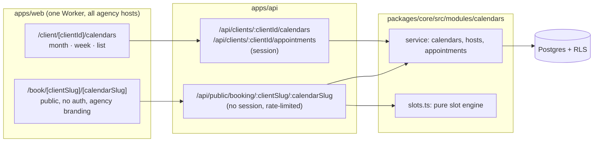
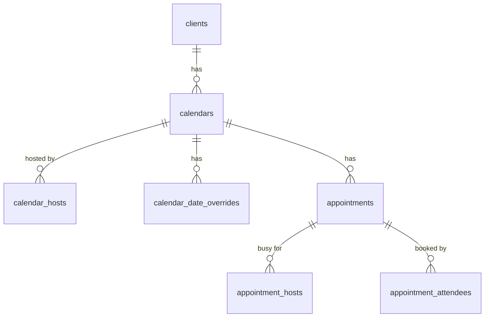
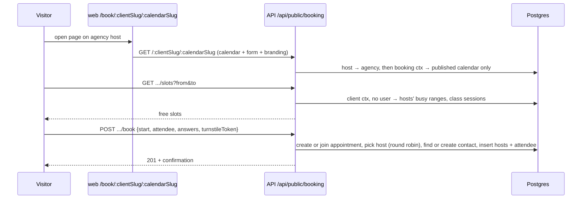

# Ownlevel — Calendars

Status: draft (planning) · Related: [1_Architecture.md](./1_Architecture.md) (tenancy, RLS), [5_2_contacts.md](./5_2_contacts.md) (contacts, booking integration), [2_Authentication.md](./2_Authentication.md) (roles, hosts), [3_Deployment.md](./3_Deployment.md) (Workers)

## Overview

Agencies create calendars for their clients. Clients view their calendars in month, week and list views. A published calendar has a public booking page on the agency's host, at a readable URL the client configures, where visitors book appointments. The client configures which details the booking form asks for.

| Goal | How |
| --- | --- |
| Agencies create calendars per client | Client-scoped `calendars` table, standard RLS |
| Four calendar types | Personal, round robin, class, collective (see [Calendar types](#calendar-types)) |
| Clients view calendars | Month, week and list views over one range query |
| Public booking page | `{agency host}/book/{clientSlug}/{calendarSlug}`, no login, agency branding |
| Client-configurable booking form | `booking_form` field definitions on the calendar, validated on submit |
| No double booking | Postgres exclusion constraint on each host's busy time |

**Current state of the code:**

- `packages/core/src/modules/appointments/` is an empty stub (nothing imports it). It is renamed to `calendars`.
- Contacts exist (`packages/core/src/modules/crm`, see [5_2_contacts.md](./5_2_contacts.md)). Bookings link to them by email (see [Contacts](#contacts)).
- No `permissions` table yet. Authorization uses role keys (`requireRole`), which only checks agency-level memberships; client-level access needs an equivalent.
- No Redis or BullMQ; everything runs on Cloudflare Workers. Background work uses Cron Triggers or Queues.
- `clients` has no slug. Readable booking URLs add one.
- RLS contexts today need a user or a host/slug. The public booking page needs a new narrow context.

## Calendar types

The user picks a type when creating a calendar. The type decides how many hosts take part, how many attendees fit in a slot, and when a slot counts as free.

| Type | Hosts | Attendees per slot | Slot is free when | Example |
| --- | --- | --- | --- | --- |
| `personal` | exactly 1 | 1 | the host is free | Client meetings, private consultations |
| `round_robin` | 2 or more | 1 | at least one host is free; one is assigned | Sales calls, onboarding sessions |
| `class` | exactly 1 | up to `capacity` | the session has seats left (or the host is free, if no one booked yet) | Webinars, group training, online classes |
| `collective` | 2 or more | 1 | every host is free | Panel interviews, committee reviews |

**Hosts** are users who can reach the client: client members, or agency staff with access to that client. Hosts are checked when added, and removed hosts keep their past appointments.

**A host is never double-booked**, across all calendars. Every appointment writes one `appointment_hosts` row per host with that host's busy range, and an exclusion constraint on `(user_id, busy)` rejects overlaps. Constraints are checked against all rows regardless of RLS, so this also holds for agency staff who host for several clients.

**Round-robin assignment:** among the hosts free at the chosen slot, pick the one with the oldest `last_assigned_at`, ties broken by `priority`. `last_assigned_at` is updated in the same transaction as the booking. Weighted or availability-first distribution can be added later.

**Class sessions** are created when the first attendee books a slot; later bookings join that session. A unique index on `(calendar_id, starts_at)` stops two people from creating the same session at once, and the session row is locked (`select ... for update`) while seats are counted.

**The type is fixed at creation.** The update API rejects any change to `type`; to switch, create a new calendar.

## Architecture



Module layout:

```
packages/core/src/modules/calendars/      (replaces modules/appointments)
  index.ts        service: calendar CRUD, hosts, appointments, public booking
  slots.ts        pure slot calculation per calendar type (no DB)
  assign.ts       round-robin host selection
  form.ts         booking form schema (zod) and answer validation
packages/core/src/db/calendars-schema.ts
apps/api/drizzle/00xx_calendars.sql      tables, RLS, constraints, clients.slug
apps/web/app/client/[clientId]/calendars/            month, week, list, settings
apps/web/app/book/[clientSlug]/[calendarSlug]/       public booking page
```

## Data model

All tables are client-scoped: `agency_id` and `client_id` on every row, RLS enabled and forced.

| Tables | Policy | Why |
| --- | --- | --- |
| `calendars`, `calendar_hosts`, `calendar_date_overrides` | Standard tenant policy: agency context reads all its clients' rows; writes need a `client_id` | Configuration only |
| `appointments`, `appointment_hosts`, `appointment_attendees` | Client context only, like contacts: agency context sees nothing | Attendee names, emails and phones are contact data, which never leaves the client |

User ids are `text` (they reference the auth `user` table), not `uuid`. The SQL below is the design; the implemented schema is `packages/core/src/db/calendars-schema.ts` and migration `0007_calendars.sql`.



```sql
create extension if not exists btree_gist;

-- Readable booking URLs: /book/{clients.slug}/{calendars.slug}
alter table clients add column slug citext;
-- Default country for phone numbers typed without a country code (ISO 3166-1 alpha-2)
alter table clients add column country char(2);
alter table agencies add column country char(2);
create unique index on clients (agency_id, slug) where slug is not null;

create table calendars (
  id                 uuid primary key default gen_random_uuid(),
  agency_id          uuid not null references agencies(id) on delete cascade,
  client_id          uuid not null references clients(id) on delete cascade,
  type               text not null check (type in ('personal','round_robin','class','collective')),
  name               text not null,
  slug               citext not null,               -- configurable, unique per client
  description        text,
  status             text not null default 'draft', -- draft | published | archived
  timezone           text not null,                 -- defaults to clients.timezone
  default_country    char(2),                       -- phone default; null = client's, then agency's
  duration_min       int not null default 30,
  slot_interval_min  int not null default 30,
  capacity           int,                           -- class only: seats per session
  buffer_before_min  int not null default 0,
  buffer_after_min   int not null default 0,
  min_notice_min     int not null default 60,       -- no bookings sooner than this
  max_days_ahead     int not null default 60,       -- booking horizon
  weekly_hours       jsonb not null,                -- {"mon":[["09:00","17:00"]], ...} local time
  booking_form       jsonb not null default '[]',   -- field definitions, see Booking form
  created_by         text references "user"(id),
  created_at         timestamptz not null default now(),
  updated_at         timestamptz not null default now(),
  unique (client_id, slug),
  check ((type = 'class') = (capacity is not null))
);
create index on calendars (client_id, status);

create table calendar_hosts (
  calendar_id       uuid not null references calendars(id) on delete cascade,
  user_id           text not null references "user"(id),
  agency_id         uuid not null,
  client_id         uuid not null,
  priority          int not null default 0,         -- round robin tie-break
  last_assigned_at  timestamptz,                    -- round robin rotation
  primary key (calendar_id, user_id)
);
-- Host count per type (1 for personal and class, 2+ for round robin and collective)
-- is checked in the service, since it spans rows.

create table calendar_date_overrides (             -- holidays and one-off hours
  id           uuid primary key default gen_random_uuid(),
  agency_id    uuid not null,
  client_id    uuid not null references clients(id) on delete cascade,
  calendar_id  uuid not null references calendars(id) on delete cascade,
  date         date not null,                       -- in the calendar's timezone
  intervals    jsonb not null,                      -- [] = closed all day
  unique (calendar_id, date)
);

-- One row per meeting. For class calendars, one row per session.
create table appointments (
  id                 uuid primary key default gen_random_uuid(),
  agency_id          uuid not null,
  client_id          uuid not null references clients(id) on delete cascade,
  calendar_id        uuid not null references calendars(id),
  starts_at          timestamptz not null,
  ends_at            timestamptz not null,
  status             text not null default 'booked',-- booked | cancelled | completed
  capacity           int,                           -- class: copied from the calendar
  notes              text,                          -- internal, staff only
  created_by         text references "user"(id),    -- null for public bookings
  created_at         timestamptz not null default now(),
  cancelled_at       timestamptz
);
create index on appointments (client_id, calendar_id, starts_at);
create unique index on appointments (calendar_id, starts_at) where status = 'booked' and capacity is not null; -- one session per class slot (not for other types: round robin may book two hosts at the same start)

-- Each host's busy time; this is what prevents double booking.
create table appointment_hosts (
  appointment_id  uuid not null references appointments(id) on delete cascade,
  user_id         text not null references "user"(id),
  agency_id       uuid not null,
  client_id       uuid not null,
  busy            tstzrange not null,               -- [starts_at - buffer_before, ends_at + buffer_after)
  active          boolean not null default true,    -- false once the appointment is cancelled
  primary key (appointment_id, user_id),
  exclude using gist (user_id with =, busy with &&) where (active)
);

-- People who booked. One per appointment, except class sessions.
create table appointment_attendees (
  id                 uuid primary key default gen_random_uuid(),
  agency_id          uuid not null,
  client_id          uuid not null,
  appointment_id     uuid not null references appointments(id) on delete cascade,
  status             text not null default 'booked',-- booked | cancelled | no_show | attended
  source             text not null,                 -- public | staff | mcp
  attendee           jsonb not null,                -- {name, email, phone, timezone}
  answers            jsonb not null default '[]',   -- [{key, label, type, value}]
  contact_id         uuid,                          -- see Contacts below
  manage_token_hash  text,                          -- sha256 of the cancel/reschedule token
  created_by         text references "user"(id),
  created_at         timestamptz not null default now(),
  cancelled_at       timestamptz
);
create index on appointment_attendees (appointment_id);
```

Foreign key, added in the same migration: `foreign key (client_id, contact_id) references contacts (client_id, id) on delete set null (contact_id)`. The composite key keeps every link inside one client. Index: `(client_id, contact_id)`, for the contact's appointment history.

**Design notes**

- **Double booking** is rejected by Postgres. Two visitors racing for the same host and time cannot both insert; the loser gets a constraint error, which the API returns as `409 slot_taken`.
- **Buffers** are baked into `busy` at booking time, so later buffer changes don't move existing appointments.
- **Times:** weekly hours and overrides are stored in the calendar's local time, and slots are calculated in that timezone, so daylight-saving changes don't shift availability. Appointment times are stored in UTC (`timestamptz`).
- **Answers are a snapshot** with their labels. Editing or deleting a form field never breaks past appointments.
- **Working hours are per calendar.** Availability comes from the calendar's weekly hours and date overrides, minus each host's busy time. Hosts have no personal schedule.
- **Hosts who work for several clients:** a client never sees bookings from other clients. Slot calculation runs in one client's RLS context, so it can't read the host's appointments there. A function `host_busy(user_ids, from, to)` returns only `(user_id, busy_start, busy_end)` (no appointment, calendar, client or attendee details) for the hosts of the calendar being booked, so those times are not offered. RLS is forced even for the table owner, so `security definer` wouldn't help; instead the function sets a transaction-local `app.busy_lookup` flag that a narrow `SELECT` policy on `appointment_hosts` honours, and clears it afterwards. Only this function sets the flag. The exclusion constraint is the final guard either way.

## Contacts

Every attendee is linked to a contact, so one person's appointments show up together. The contact record page has an Appointments tab (upcoming and past, across all of the client's calendars), and bookings add `appointment.booked` and `appointment.cancelled` events to the contact's timeline. Contact data never leaves the client, so this link never crosses clients. Field rules are in [5_2_contacts.md](./5_2_contacts.md#calendar-integration).

**On every booking** (public, staff-created or MCP), in the same transaction as the attendee insert:

1. **Normalise.** Email: trim and lowercase. Phone: strip spaces and punctuation, then convert to E.164 using the [default country](#phone-numbers-and-default-country).
2. **Lock** on `(client_id, normalised phone, else email)` with `pg_advisory_xact_lock`, so two simultaneous bookings for the same person can't each create a contact.
3. **Find the contact** (table below).
4. **Not found:** create one through the CRM record service in `contact` mode, with `created_by_source = 'booking'` (or `staff` / `mcp` to match the booking source). Name, email and phone from the form fill the standard fields.
5. Set `appointment_attendees.contact_id`, keep the `attendee` and `answers` snapshot, and write the timeline event.

**Matching.** Phone is checked first, then email. A contact matches on its primary phone (compared as E.164) or its primary email.

| Phone matches | Email matches | Result |
| --- | --- | --- |
| exactly one contact | the same contact, or nothing | Link to it |
| exactly one contact (A) | a different contact (B) | Link to A, the phone match; add a `booking.identity_conflict` timeline event on both with the other contact's id, so staff can merge later |
| several contacts | one of those contacts | Link to that one; the email breaks the tie |
| several contacts | a contact not among them, or nothing | Ambiguous phone: link to the email match if there is one; otherwise create a new contact and show it under possible duplicates in the CRM |
| nothing | one contact | Link to it |
| nothing | nothing | Create a new contact |

Phone goes first because it is the identifier people actually give. The CRM does not enforce a unique phone (family members and offices share a number), which is why the several-matches rows exist: email is only used to break that tie, never to override a single phone match. A booking without a phone (allowed when the client made phone optional) skips the phone step and matches on email alone.

**Rules**

- **Existing contact data is not overwritten.** The attendee snapshot on the appointment keeps what was typed at booking time. Only booking form fields mapped to a contact field (`contactFieldKey`) are written to the contact, and only fields marked `contact_input`. This stops a stranger from changing a contact's details by booking with their phone or email.
- **One exception, filling empty identifiers.** If the matched contact has no primary email (or phone) and the booking supplies one, it is saved as the contact's primary, unless another contact in the client already has that value. It never replaces an existing value. This lets a later booking with only an email find a contact first created by phone.
- **Empty values never clear contact data.**
- **A race is safe.** The advisory lock above takes the phone when there is one, otherwise the email; for email, the unique index on `(client_id, emails_primary_email)` makes the loser re-read the contact it lost to.
- **Changing the contact's email or phone later** does not touch past attendees; they are linked by `contact_id`, not by the value.
- **Cancelling** keeps the link, so the history stays complete.
- **Deleting a contact** runs the calendar erase hook first: it clears `attendee` and `answers` on that contact's attendee rows and keeps the status, so seat counts and calendar history stay correct and show "Deleted contact"; then `contact_id` is set to null. The hook is registered with `registerDeleteHook` from the CRM module.
- **Spam:** bookings can create contacts from the public page, so Turnstile and rate limits (see Public booking) also protect the contact list. Bookings that fail validation create nothing.

### Phone numbers and default country

Visitors rarely type a country code, so matching only works if every number is converted to E.164 (`+14155550123`) the same way.

- **Default country** is an ISO country code resolved in this order: `calendars.default_country`, then `clients.country`, then `agencies.country`. The agency owner sets the agency's during onboarding (preselected from the browser's language region, for example `en-GB` → `GB`, falling back to `US`), and new clients copy it, the same way they copy timezone and currency today. A client can change theirs in settings.
- **It is always set.** `agencies.country` is required when an agency is created or migrated (existing agencies are backfilled from their timezone, and `US` if that gives nothing), so there is always a fallback and parsing never fails for lack of a country.
- **Booking page.** The phone input has a country selector, preselected with the default country; the visitor can change it. A number typed with `+` and a country code is used as typed. The selector is the only country signal; the visitor's IP location is not used.
- **Storage.** The CRM phones field keeps `primary_phone_number` (national number), `primary_phone_country_code` and `primary_phone_calling_code`, as in [5_2_contacts.md](./5_2_contacts.md#field-types). Matching compares the E.164 form built from those, and `appointment_attendees.attendee.phone` stores E.164.
- **Invalid numbers** (wrong length for the country, not a possible number) are rejected with a validation error before anything is created.
- **Same logic everywhere.** The CRM record service, booking and MCP all use one phone parser in `packages/core`, so the default country is applied identically. The CRM doc's `defaultCountry` phone setting becomes an optional per-field override of this chain.

**Migration and backfill.** Phones are parsed with the default country. Appointments created before the link have `contact_id` null. A one-off job runs per client: for each attendee with an email or phone, find or create the contact as above and set `contact_id`.

## Readable URLs

Booking pages live at `{agency host}/book/{clientSlug}/{calendarSlug}`, for example `app.youragency.com/book/acme-dental/cleaning`.

- **Client slug:** set by agency owners and admins (and `client_admin`), unique per agency. Suggested from the client name on creation.
- **Calendar slug:** set by anyone who can edit the calendar, unique per client. Suggested from the calendar name.
- **Format:** lowercase letters, digits and hyphens, 3–60 characters. Reserved words (`api`, `admin`, `embed`, ...) are rejected.
- **Changing a slug breaks old links and embeds.** The settings screen warns before saving. Redirects from old slugs can be added later if needed.

## Booking form

The client configures `booking_form`, an ordered list of field definitions validated by a zod schema in `form.ts`.

```ts
type BookingField = {
  key: string;            // stable, generated from the label on creation
  contactFieldKey?: string; // CRM contact field this answer is saved to; type and options come from it
  label: string;          // client data, not translated
  type: "text" | "textarea" | "email" | "phone" | "number" | "select" | "multiselect" | "checkbox" | "date";
  required: boolean;
  placeholder?: string;
  options?: string[];     // select and multiselect only
};
```

- Name, phone and email are fixed fields. Name is always required. Phone and email are both required by default; the client may make one of them optional, but at least one must be required, because the contact match needs it. A booking can't be created with neither.
- Submitted answers are validated on the server against the calendar's current form. Unknown keys are dropped.
- Limits: at most 20 custom fields, labels up to 120 characters, text values up to 2,000 characters.
- **Contact fields:** a form field can point at a CRM contact field, `{ contactFieldKey: "company_size" }`. It takes its type, options and validation from the CRM field, and only fields marked `contact_input` can be chosen. The answer is written to the contact on booking (see [Contacts](#contacts)). Fields without it only live on the appointment.

## Slot engine

`slots.ts` is a pure function, so it can be unit-tested without a database (including daylight-saving dates and each calendar type).

```ts
computeSlots({
  type, capacity,
  weeklyHours, overrides, timezone,      // calendar rules
  durationMin, slotIntervalMin, bufferBeforeMin, bufferAfterMin,
  minNoticeMin, maxDaysAhead,
  hostBusy,                              // Map<userId, ranges> for the calendar's hosts
  sessions,                              // class only: existing sessions with seats taken
  from, to, now,
}): { start: string; end: string; seatsLeft?: number }[]  // ISO UTC
```

Steps:

1. Expand weekly hours and overrides into open intervals for each local date.
2. Cut them into slots every `slotIntervalMin`.
3. Keep a slot according to the type's rule (table in [Calendar types](#calendar-types)), checking the buffered range against `hostBusy`.
4. Drop slots before `now + minNotice` or after `now + maxDaysAhead`.

The public page never learns which host is free; it only sees the slot. Round robin picks the host at booking time.

## Public booking



> **TODO (notifications):** after a booking, cancellation or reschedule, send the attendee a confirmation with a manage link (cancel/reschedule) and notify the hosts. Reminders (for example 24h and 1h before) need a Cron Trigger or Queue. Decide the channels (email first, SMS later) and templates in the notifications design, and link it here.

**RLS.** The host resolves the agency first (existing `host` context). The page is then found in that agency's context, which can only read configuration (clients and calendars, never appointments), and only an active client's `published` calendar is returned. Everything after runs in that calendar's agency and client context with no user, so RLS limits it to that one client. (A dedicated `app.booking_*` context was not needed: agency context already cannot see attendee data.) The public routes only ever return free slots (and seats left, for classes), never existing appointments, hosts' schedules or attendee data.

**Routes** (no session):

| Route | Returns |
| --- | --- |
| `GET /api/public/booking/:clientSlug/:calendarSlug` | Name, description, type, duration, timezone, host names and avatars, form fields, agency branding |
| `GET /api/public/booking/:clientSlug/:calendarSlug/slots?from&to` | Free slots, window capped at 45 days (a month grid and the days around it) |
| `POST /api/public/booking/:clientSlug/:calendarSlug/book` | Creates or joins the appointment |
| `POST /api/public/booking/manage/:token/cancel` | Cancels the attendee's booking via the emailed link |

**Abuse protection:** Cloudflare Turnstile on `book`, the Workers rate-limit binding per IP and per calendar, and an `Idempotency-Key` header on `book`.

**Hosting:** the page lives in `apps/web` at `/book/[clientSlug]/[calendarSlug]` and works on every agency host (`{slug}.ownlevel.app` and custom domains), with the agency's branding. `?embed=1` renders it without page chrome, so clients can iframe it on their own site. Booking page UI strings come from `messages/en.json`; calendar names and field labels are client data and are not translated.

## Calendar views

Month, week and list are one query with different rendering:

```
GET /api/clients/:clientId/appointments?from&to&calendarId=...&hostId=...&status=...
```

- Range capped at 62 days; list view pages by `starts_at`.
- Each item carries its hosts and attendees (class sessions show seats taken out of capacity).
- Filter by calendar and by host; "My appointments" is `hostId = me`.
- Dates and times use `useFormatter` from next-intl, displayed in the client's timezone with a switch to the viewer's local timezone.
- A light custom grid fits the UI kit and next-intl. A library like FullCalendar is an option if the custom grid turns out to be too much work.

**Staff routes** (session):

| Route | Purpose |
| --- | --- |
| `GET/POST /api/clients/:clientId/calendars` | List, create (with type) |
| `GET/PATCH/DELETE /api/clients/:clientId/calendars/:id` | Read, update (hours, form, slug, status), archive |
| `PUT/DELETE /api/clients/:clientId/calendars/:id/hosts/:userId` | Add or remove a host |
| `PUT /api/clients/:clientId/calendars/:id/overrides/:date` | Set or clear a date override |
| `GET/POST /api/clients/:clientId/appointments` | Range query, staff-created booking |
| `PATCH /api/clients/:clientId/appointments/:id` | Reschedule, cancel, notes |
| `PATCH /api/clients/:clientId/appointments/:id/attendees/:attendeeId` | Cancel one attendee, mark no-show or attended |

## Permissions

These become `calendars:*` permission keys once a permissions table exists.

| Action | agency owner/admin | agency user | client_admin | client_user |
| --- | --- | --- | --- | --- |
| Create (and pick type), publish, archive calendar | ✅ | ❌ | ❌ | ❌ |
| Edit hours, overrides, hosts, calendar slug | ✅ | ✅ | ✅ | ❌ |
| Edit booking form | ✅ | ✅ | ✅ | ❌ |
| Set client slug | ✅ | ❌ | ✅ | ❌ |
| View appointments | ✅ | ✅ | ✅ | ✅ |
| Create, cancel, reschedule any appointment | ✅ | ✅ | ✅ | ❌ |
| Create, cancel, reschedule their own appointments | ✅ | ✅ | ✅ | ✅ |

"Their own" means appointments where the `client_user` is a host or which they created. Agency users with `assigned` client access only reach their assigned clients. As elsewhere, a calendar or client the caller can't reach returns 404, not 403.

## Phases

1. **Core (built):** rename the `appointments` stub to `calendars`; schema, RLS and constraint tests in `apps/api/test/rls.test.ts`; calendar CRUD with types and hosts; slot engine with unit tests per type; appointments range API; month, week and list views; staff-created appointments.
2. **Public booking (built):** client and calendar slugs, contact find-or-create and link, Appointments tab on the contact record, backfill, form builder, `/book/[clientSlug]/[calendarSlug]`, round-robin assignment, class seats, cancel link.
3. **Later:** notifications and reminders (see TODO), reschedule via link, embed snippet, MCP tools (`get_availability`, `book_appointment`), snapshot export and import, slug redirects, Google and Outlook sync, paid bookings.

## Implementation status

**Phase 1 is built**: `packages/core/src/modules/calendars` (`calendars.ts`, `appointments.ts`, `slots.ts`, `assign.ts`, `form.ts`, `access.ts`), migration `0007_calendars.sql`, routes in `apps/api/src/app.ts`, and the web UI under `apps/web/app/client/[clientId]/calendars` (month, week and list views, appointment dialog, calendar settings). Tests: `apps/api/test/calendar-slots.test.ts` (slot engine, no database) and `apps/api/test/calendars.test.ts` (RLS, permissions, double booking, every type).

Differences from the design above:

- **Not in phase 1, so not in the migration yet:** `clients.slug`, `clients.country`, `agencies.country` and `calendars.default_country` (they belong to the public page and phone matching). `calendars.slug` exists and is unique per client.
- **`appointment_attendees.contact_id`** is a plain column with an index; the composite foreign key to `contacts` and the find-or-create link arrive with phase 2. Staff bookings store the attendee on the appointment only.
- **Booking form:** the API validates and stores `booking_form` (`form.ts`), but there is no builder UI until phase 2.
- **Extra route:** `GET /api/clients/:clientId/calendars/eligible-hosts` lists the people who can be hosts (this client's members and agency staff), for the host picker. Staff may also call `GET .../calendars/:id/slots` to see free times when booking.
- **Staff booking rules:** staff may book outside working hours, but never over a host's existing appointment (`409 conflict`, `reason: slot_taken`). A full class session returns `409` with `reason: full`.
- **Cancelled and completed appointments are final.** Book a new one instead of reopening.
- **Hosts** are validated against memberships when added: this client's members or agency-level members of its agency. A host with `assigned` agency access is treated as having access to all clients until client assignments exist.
- **Calendar type** is rejected by the update route; publishing needs one host (personal, class) or two or more (round robin, collective).

**Phase 2 is built**: public booking, contact linking, form builder.

- **Code:** `calendars/public.ts` (page, slots, booking, manage link), `calendars/contacts.ts` (default country, phone-first contact matching, erase hook, backfill), `calendars/booking-settings.ts` (client slug and country), `crm/phone.ts` (the one phone parser). Migration `0008_booking.sql`. Web: `apps/web/app/book/[clientSlug]/[calendarSlug]` (page, `?embed=1`) and `book/manage/[token]`, the form builder in calendar settings, booking settings in client settings, a country picker in onboarding, and an Appointments list on the contact page.
- **Tests:** `apps/api/test/booking.test.ts` covers phone parsing and the default-country chain, booking addresses, the public page (only published calendars, no host emails, only offered slots), required fields and answers, every type, idempotency, the manage link, every row of the matching table, the simultaneous-booking race, mapped contact fields, contact delete, and the backfill. It was also run end to end over HTTP through the web proxy.
- **Matching:** exactly the table above. `appointment_attendees.contact_id` has the composite foreign key to `contacts`. Staff bookings link contacts too.
- **Phone parsing** uses `libphonenumber-js` (min metadata, "possible number" check). The CRM now reads numbers typed without `+` in the default country (field setting, else client, else agency), and fills the country and calling code. A booking converts the phone to E.164 first, using the visitor's country picker.
- **Booking address:** a client's slug is suggested from its name when it is created (existing clients have none until set in the client's settings; their pages return 404 until then). `manage` is reserved. Writing `clients.slug` and `country` needs agency context under RLS, so a `client_admin`'s change is permission-checked in the client's context and written in a second transaction that touches only those two columns.
- **Idempotency:** `Idempotency-Key` is stored on the attendee row (unique per client). A repeat returns the first booking with `replayed: true` and no manage token (only its hash is stored).
- **Manage link:** `{clientId}.{attendeeId}.{secret}`; only a SHA-256 of the secret is stored. The visitor gets it on the confirmation page. **Not emailed yet** (see the notifications TODO).
- **Abuse protection:** Turnstile is verified when `TURNSTILE_SECRET` is set (the page renders the widget when `NEXT_PUBLIC_TURNSTILE_SITE_KEY` is set); with no secret the check is skipped and a warning is logged once, so set it in production. Rate limits use Workers rate-limit bindings (`PUBLIC_IP_LIMITER`, `PUBLIC_CALENDAR_LIMITER`, `BOOK_IP_LIMITER` in `wrangler.jsonc`); on Node nothing is limited. These two could not be exercised locally, so check them in the Workers preview. `idempotency-key` is forwarded by the web proxy.
- **Not done yet:** the `booking.identity_conflict` and `appointment.booked` timeline events (the CRM has no timeline yet; the conflicting contact is detected but not recorded); emailing the confirmation and manage link; reminders.
- **Backfill:** `pnpm --filter @ownlevel/api db:backfill-calendar-contacts <agencyId>` links older attendees to contacts. Safe to re-run; attendees whose phone no longer parses are skipped and counted.

## Things to know

- **Confirmation emails are not sent.** The visitor gets their manage link on the confirmation page only, until the notifications work exists (see the notifications TODO). The contact timeline events (`appointment.booked`, `booking.identity_conflict`) are skipped because the CRM has no timeline yet.
- **Turnstile and rate limits were not exercised locally.** Check them in the Workers preview. With `TURNSTILE_SECRET` unset the bot check is skipped (one warning is logged), so set it in production. Rate limits only exist on Workers, not on Node.
- **Existing clients have no booking address.** Their pages return 404 until an owner, admin or `client_admin` sets one in the client's settings. New clients get one suggested from their name.
- **No dedicated booking context in the database.** The public page is found in agency context (configuration only, never appointments) and everything after runs in the one client's context. See the RLS paragraph under Public booking.
- **Client settings are written in agency context.** RLS only lets agency context write `clients`, so a `client_admin`'s change to the booking address or phone country is permission-checked in the client's context, then written in a second transaction that touches only those two columns.
- **The CRM now reads numbers without `+`.** A number typed without a country code is read in the default country, so the CRM test that expected `4155550123` to be rejected now expects only an impossible number (like `123`) to be rejected.
- **The public slot window is 45 days**, not 31 (staff slot lookups are still capped at 31).
