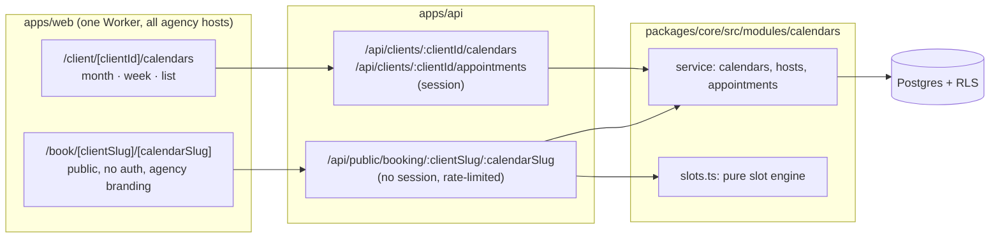
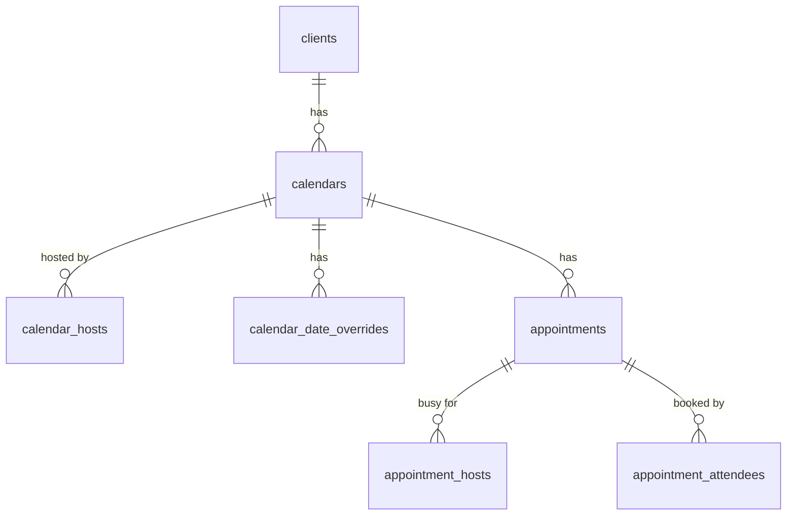
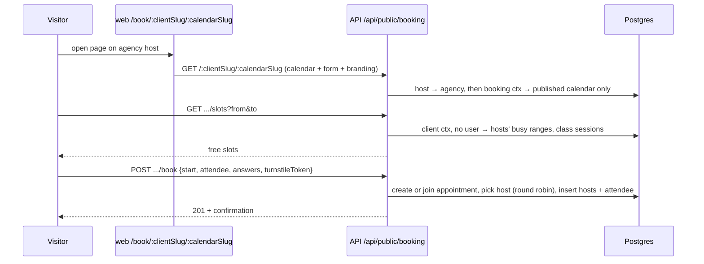

# Ownlevel — Calendars

Status: draft (planning) · Related: [1_Architecture.md](./1_Architecture.md) (tenancy, RLS), [2_Authentication.md](./2_Authentication.md) (roles, hosts), [3_Deployment.md](./3_Deployment.md) (Workers)

## Overview

Agencies create calendars for their clients. Clients view their calendars in month, week and list views. A published calendar has a public booking page on the agency's host, at a readable URL the client configures, where visitors book appointments. The client configures which details the booking form asks for.

| Goal | How |
| --- | --- |
| Agencies create calendars per client | Client-scoped `calendars` table, standard RLS |
| Four calendar types | Personal, round robin, class, collective (see [Calendar types](#calendar-types)) |
| Clients view calendars | Month, week and list views over one range query |
| Public booking page | `{agency host}/book/{clientSlug}/{calendarSlug}`, no login, agency branding |
| Client-configurable booking form | `booking_form` field definitions on the calendar, validated on submit |
| No double booking | Postgres exclusion constraint on each host's busy time |

**Current state of the code:**

- `packages/core/src/modules/appointments/` is an empty stub (nothing imports it). It is renamed to `calendars`.
- No `contacts` table yet. Appointments store attendee details directly; contacts are linked later.
- No `permissions` table yet. Authorization uses role keys (`requireRole`), which only checks agency-level memberships; client-level access needs an equivalent.
- No Redis or BullMQ; everything runs on Cloudflare Workers. Background work uses Cron Triggers or Queues.
- `clients` has no slug. Readable booking URLs add one.
- RLS contexts today need a user or a host/slug. The public booking page needs a new narrow context.

## Calendar types

The user picks a type when creating a calendar. The type decides how many hosts take part, how many attendees fit in a slot, and when a slot counts as free.

| Type | Hosts | Attendees per slot | Slot is free when | Example |
| --- | --- | --- | --- | --- |
| `personal` | exactly 1 | 1 | the host is free | Client meetings, private consultations |
| `round_robin` | 2 or more | 1 | at least one host is free; one is assigned | Sales calls, onboarding sessions |
| `class` | exactly 1 | up to `capacity` | the session has seats left (or the host is free, if no one booked yet) | Webinars, group training, online classes |
| `collective` | 2 or more | 1 | every host is free | Panel interviews, committee reviews |

**Hosts** are users who can reach the client: client members, or agency staff with access to that client. Hosts are checked when added, and removed hosts keep their past appointments.

**A host is never double-booked**, across all calendars. Every appointment writes one `appointment_hosts` row per host with that host's busy range, and an exclusion constraint on `(user_id, busy)` rejects overlaps. Constraints are checked against all rows regardless of RLS, so this also holds for agency staff who host for several clients.

**Round-robin assignment:** among the hosts free at the chosen slot, pick the one with the oldest `last_assigned_at`, ties broken by `priority`. `last_assigned_at` is updated in the same transaction as the booking. Weighted or availability-first distribution can be added later.

**Class sessions** are created when the first attendee books a slot; later bookings join that session. A unique index on `(calendar_id, starts_at)` stops two people from creating the same session at once, and the session row is locked (`select ... for update`) while seats are counted.

**The type is fixed at creation.** The update API rejects any change to `type`; to switch, create a new calendar.

## Architecture



Module layout:

```
packages/core/src/modules/calendars/      (replaces modules/appointments)
  index.ts        service: calendar CRUD, hosts, appointments, public booking
  slots.ts        pure slot calculation per calendar type (no DB)
  assign.ts       round-robin host selection
  form.ts         booking form schema (zod) and answer validation
packages/core/src/db/calendars-schema.ts
apps/api/drizzle/00xx_calendars.sql      tables, RLS, constraints, clients.slug
apps/web/app/client/[clientId]/calendars/            month, week, list, settings
apps/web/app/book/[clientSlug]/[calendarSlug]/       public booking page
```

## Data model

All tables are client-scoped: `agency_id` and `client_id` on every row, RLS enabled and forced, standard tenant policy from the architecture doc.



```sql
create extension if not exists btree_gist;

-- Readable booking URLs: /book/{clients.slug}/{calendars.slug}
alter table clients add column slug citext;
create unique index on clients (agency_id, slug) where slug is not null;

create table calendars (
  id                 uuid primary key default gen_random_uuid(),
  agency_id          uuid not null references agencies(id) on delete cascade,
  client_id          uuid not null references clients(id) on delete cascade,
  type               text not null check (type in ('personal','round_robin','class','collective')),
  name               text not null,
  slug               citext not null,               -- configurable, unique per client
  description        text,
  status             text not null default 'draft', -- draft | published | archived
  timezone           text not null,                 -- defaults to clients.timezone
  duration_min       int not null default 30,
  slot_interval_min  int not null default 30,
  capacity           int,                           -- class only: seats per session
  buffer_before_min  int not null default 0,
  buffer_after_min   int not null default 0,
  min_notice_min     int not null default 60,       -- no bookings sooner than this
  max_days_ahead     int not null default 60,       -- booking horizon
  weekly_hours       jsonb not null,                -- {"mon":[["09:00","17:00"]], ...} local time
  booking_form       jsonb not null default '[]',   -- field definitions, see Booking form
  created_by         uuid references "user"(id),
  created_at         timestamptz not null default now(),
  updated_at         timestamptz not null default now(),
  unique (client_id, slug),
  check ((type = 'class') = (capacity is not null))
);
create index on calendars (client_id, status);

create table calendar_hosts (
  calendar_id       uuid not null references calendars(id) on delete cascade,
  user_id           uuid not null references "user"(id),
  agency_id         uuid not null,
  client_id         uuid not null,
  priority          int not null default 0,         -- round robin tie-break
  last_assigned_at  timestamptz,                    -- round robin rotation
  primary key (calendar_id, user_id)
);
-- Host count per type (1 for personal and class, 2+ for round robin and collective)
-- is checked in the service, since it spans rows.

create table calendar_date_overrides (             -- holidays and one-off hours
  id           uuid primary key default gen_random_uuid(),
  agency_id    uuid not null,
  client_id    uuid not null references clients(id) on delete cascade,
  calendar_id  uuid not null references calendars(id) on delete cascade,
  date         date not null,                       -- in the calendar's timezone
  intervals    jsonb not null,                      -- [] = closed all day
  unique (calendar_id, date)
);

-- One row per meeting. For class calendars, one row per session.
create table appointments (
  id                 uuid primary key default gen_random_uuid(),
  agency_id          uuid not null,
  client_id          uuid not null references clients(id) on delete cascade,
  calendar_id        uuid not null references calendars(id),
  starts_at          timestamptz not null,
  ends_at            timestamptz not null,
  status             text not null default 'booked',-- booked | cancelled | completed
  capacity           int,                           -- class: copied from the calendar
  notes              text,                          -- internal, staff only
  created_by         uuid references "user"(id),    -- null for public bookings
  created_at         timestamptz not null default now(),
  cancelled_at       timestamptz
);
create index on appointments (client_id, calendar_id, starts_at);
create unique index on appointments (calendar_id, starts_at) where status = 'booked'; -- one session per class slot

-- Each host's busy time; this is what prevents double booking.
create table appointment_hosts (
  appointment_id  uuid not null references appointments(id) on delete cascade,
  user_id         uuid not null references "user"(id),
  agency_id       uuid not null,
  client_id       uuid not null,
  busy            tstzrange not null,               -- [starts_at - buffer_before, ends_at + buffer_after)
  active          boolean not null default true,    -- false once the appointment is cancelled
  primary key (appointment_id, user_id),
  exclude using gist (user_id with =, busy with &&) where (active)
);

-- People who booked. One per appointment, except class sessions.
create table appointment_attendees (
  id                 uuid primary key default gen_random_uuid(),
  agency_id          uuid not null,
  client_id          uuid not null,
  appointment_id     uuid not null references appointments(id) on delete cascade,
  status             text not null default 'booked',-- booked | cancelled | no_show | attended
  source             text not null,                 -- public | staff | mcp
  attendee           jsonb not null,                -- {name, email, phone, timezone}
  answers            jsonb not null default '[]',   -- [{key, label, type, value}]
  contact_id         uuid,                          -- see TODO (contacts) below
  manage_token_hash  text,                          -- sha256 of the cancel/reschedule token
  created_by         uuid references "user"(id),
  created_at         timestamptz not null default now(),
  cancelled_at       timestamptz
);
create index on appointment_attendees (appointment_id);
```

> **TODO (contacts):** `appointment_attendees.contact_id` stays null for now; attendee details live in `attendee`. Once the CRM `contacts` table exists, find or create the contact by `(client_id, email)` on booking, set `contact_id`, add the foreign key and backfill existing rows. Link this section to the CRM doc then.

**Design notes**

- **Double booking** is rejected by Postgres. Two visitors racing for the same host and time cannot both insert; the loser gets a constraint error, which the API returns as `409 slot_taken`.
- **Buffers** are baked into `busy` at booking time, so later buffer changes don't move existing appointments.
- **Times:** weekly hours and overrides are stored in the calendar's local time, and slots are calculated in that timezone, so daylight-saving changes don't shift availability. Appointment times are stored in UTC (`timestamptz`).
- **Answers are a snapshot** with their labels. Editing or deleting a form field never breaks past appointments.
- **Working hours are per calendar.** Availability comes from the calendar's weekly hours and date overrides, minus each host's busy time. Hosts have no personal schedule.
- **Hosts who work for several clients:** a client never sees bookings from other clients. Slot calculation runs in one client's RLS context, so it can't read the host's appointments there. A `security definer` function `host_busy(user_ids, from, to)` returns only the busy time ranges (no ids, calendars, clients or attendee details) for the hosts of the calendar being booked, so those times are not offered. The exclusion constraint is the final guard either way.

## Readable URLs

Booking pages live at `{agency host}/book/{clientSlug}/{calendarSlug}`, for example `app.youragency.com/book/acme-dental/cleaning`.

- **Client slug:** set by agency owners and admins (and `client_admin`), unique per agency. Suggested from the client name on creation.
- **Calendar slug:** set by anyone who can edit the calendar, unique per client. Suggested from the calendar name.
- **Format:** lowercase letters, digits and hyphens, 3–60 characters. Reserved words (`api`, `admin`, `embed`, ...) are rejected.
- **Changing a slug breaks old links and embeds.** The settings screen warns before saving. Redirects from old slugs can be added later if needed.

## Booking form

The client configures `booking_form`, an ordered list of field definitions validated by a zod schema in `form.ts`.

```ts
type BookingField = {
  key: string;            // stable, generated from the label on creation
  label: string;          // client data, not translated
  type: "text" | "textarea" | "email" | "phone" | "number" | "select" | "multiselect" | "checkbox" | "date";
  required: boolean;
  placeholder?: string;
  options?: string[];     // select and multiselect only
};
```

- Name and email are fixed fields and always required. Phone is a fixed field the client can mark optional or required.
- Submitted answers are validated on the server against the calendar's current form. Unknown keys are dropped.
- Limits: at most 20 custom fields, labels up to 120 characters, text values up to 2,000 characters.
- Later: map fields to CRM contact custom fields.

## Slot engine

`slots.ts` is a pure function, so it can be unit-tested without a database (including daylight-saving dates and each calendar type).

```ts
computeSlots({
  type, capacity,
  weeklyHours, overrides, timezone,      // calendar rules
  durationMin, slotIntervalMin, bufferBeforeMin, bufferAfterMin,
  minNoticeMin, maxDaysAhead,
  hostBusy,                              // Map<userId, ranges> for the calendar's hosts
  sessions,                              // class only: existing sessions with seats taken
  from, to, now,
}): { start: string; end: string; seatsLeft?: number }[]  // ISO UTC
```

Steps:

1. Expand weekly hours and overrides into open intervals for each local date.
2. Cut them into slots every `slotIntervalMin`.
3. Keep a slot according to the type's rule (table in [Calendar types](#calendar-types)), checking the buffered range against `hostBusy`.
4. Drop slots before `now + minNotice` or after `now + maxDaysAhead`.

The public page never learns which host is free; it only sees the slot. Round robin picks the host at booking time.

## Public booking



> **TODO (notifications):** after a booking, cancellation or reschedule, send the attendee a confirmation with a manage link (cancel/reschedule) and notify the hosts. Reminders (for example 24h and 1h before) need a Cron Trigger or Queue. Decide the channels (email first, SMS later) and templates in the notifications design, and link it here.

**RLS.** The host resolves the agency first (existing `host` context). A new narrow booking context (`app.booking_client_slug` and `app.booking_calendar_slug`, set through `withTenant` like `host` and `slug`) then exposes only the one calendar row in that agency with matching slugs and `status = 'published'`. Once the calendar is found, the API runs the rest in that calendar's agency and client context with no user. The public routes only ever return free slots (and seats left, for classes), never existing appointments, hosts' schedules or attendee data.

**Routes** (no session):

| Route | Returns |
| --- | --- |
| `GET /api/public/booking/:clientSlug/:calendarSlug` | Name, description, type, duration, timezone, host names and avatars, form fields, agency branding |
| `GET /api/public/booking/:clientSlug/:calendarSlug/slots?from&to` | Free slots, window capped at 31 days |
| `POST /api/public/booking/:clientSlug/:calendarSlug/book` | Creates or joins the appointment |
| `POST /api/public/booking/manage/:token/cancel` | Cancels the attendee's booking via the emailed link |

**Abuse protection:** Cloudflare Turnstile on `book`, the Workers rate-limit binding per IP and per calendar, and an `Idempotency-Key` header on `book`.

**Hosting:** the page lives in `apps/web` at `/book/[clientSlug]/[calendarSlug]` and works on every agency host (`{slug}.ownlevel.app` and custom domains), with the agency's branding. `?embed=1` renders it without page chrome, so clients can iframe it on their own site. Booking page UI strings come from `messages/en.json`; calendar names and field labels are client data and are not translated.

## Calendar views

Month, week and list are one query with different rendering:

```
GET /api/clients/:clientId/appointments?from&to&calendarId=...&hostId=...&status=...
```

- Range capped at 62 days; list view pages by `starts_at`.
- Each item carries its hosts and attendees (class sessions show seats taken out of capacity).
- Filter by calendar and by host; "My appointments" is `hostId = me`.
- Dates and times use `useFormatter` from next-intl, displayed in the client's timezone with a switch to the viewer's local timezone.
- A light custom grid fits the UI kit and next-intl. A library like FullCalendar is an option if the custom grid turns out to be too much work.

**Staff routes** (session):

| Route | Purpose |
| --- | --- |
| `GET/POST /api/clients/:clientId/calendars` | List, create (with type) |
| `GET/PATCH/DELETE /api/clients/:clientId/calendars/:id` | Read, update (hours, form, slug, status), archive |
| `PUT/DELETE /api/clients/:clientId/calendars/:id/hosts/:userId` | Add or remove a host |
| `PUT /api/clients/:clientId/calendars/:id/overrides/:date` | Set or clear a date override |
| `GET/POST /api/clients/:clientId/appointments` | Range query, staff-created booking |
| `PATCH /api/clients/:clientId/appointments/:id` | Reschedule, cancel, notes |
| `PATCH /api/clients/:clientId/appointments/:id/attendees/:attendeeId` | Cancel one attendee, mark no-show or attended |

## Permissions

These become `calendars:*` permission keys once a permissions table exists.

| Action | agency owner/admin | agency user | client_admin | client_user |
| --- | --- | --- | --- | --- |
| Create (and pick type), publish, archive calendar | ✅ | ❌ | ❌ | ❌ |
| Edit hours, overrides, hosts, calendar slug | ✅ | ✅ | ✅ | ❌ |
| Edit booking form | ✅ | ✅ | ✅ | ❌ |
| Set client slug | ✅ | ❌ | ✅ | ❌ |
| View appointments | ✅ | ✅ | ✅ | ✅ |
| Create, cancel, reschedule any appointment | ✅ | ✅ | ✅ | ❌ |
| Create, cancel, reschedule their own appointments | ✅ | ✅ | ✅ | ✅ |

"Their own" means appointments where the `client_user` is a host or which they created. Agency users with `assigned` client access only reach their assigned clients. As elsewhere, a calendar or client the caller can't reach returns 404, not 403.

## Phases

1. **Core:** rename the `appointments` stub to `calendars`; schema, RLS and constraint tests in `apps/api/test/rls.test.ts`; calendar CRUD with types and hosts; slot engine with unit tests per type; appointments range API; month, week and list views; staff-created appointments.
2. **Public booking:** client and calendar slugs, form builder, `/book/[clientSlug]/[calendarSlug]`, round-robin assignment, class seats, cancel link.
3. **Later:** notifications and reminders (see TODO), reschedule via link, embed snippet, contact linking (see TODO), MCP tools (`get_availability`, `book_appointment`), snapshot export and import, slug redirects, Google and Outlook sync, paid bookings.
