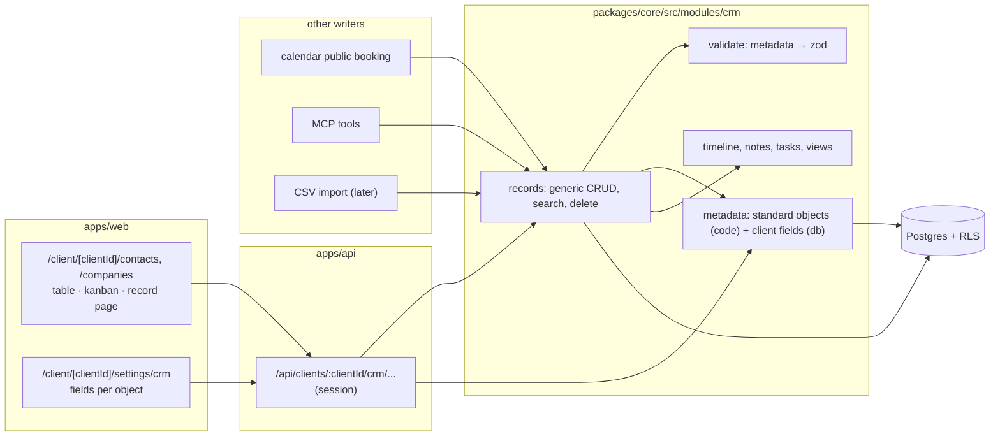
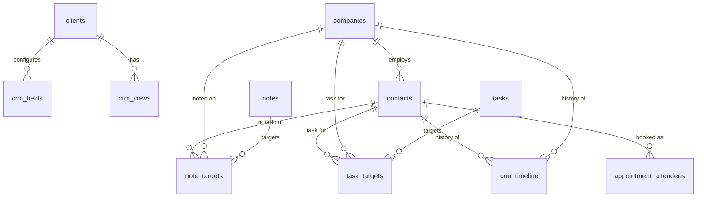

# Ownlevel — CRM (Contacts)

Status: draft (planning) · Related: [1_Architecture.md](./1_Architecture.md) (tenancy, RLS), [2_Authentication.md](./2_Authentication.md) (roles, principals), [4_MCP.md](./4_MCP.md) (contact principal, tools), [5_1_Calendar.md](./5_1_Calendar.md) (booking form, attendees)

## Overview

Contacts are the core of a CRM: the client's own customers and leads. The CRM is metadata-driven: a **metadata layer** describes each object and its typed fields, and one generic record service reads, writes, validates and searches any object from that metadata. Each client configures its own fields. Contacts, and all other CRM records, belong to exactly one client and never leave it.

| Goal | How |
| --- | --- |
| Contacts are client-level only | Strict RLS: CRM records are visible only in that client's context, never in agency context |
| No cross-client links | Same person in two clients = two unrelated rows; composite FKs keep every reference inside one client |
| Client configures which data it collects | Per-client field metadata: standard fields can be relabelled, reordered, required or turned off; custom fields can be added |
| Client configures the type of each field | Typed fields (text, number, select, emails, phones, currency, ...), validated on every write |
| One logic for every object | Objects and fields are metadata; one record service, one validator, one API shape, one view system |
| CRM basics around contacts | Companies, notes, tasks, timeline and saved views |

**Current state of the code:**

- `packages/core/src/modules/contacts/` and `pipelines/` are empty stubs. `contacts` becomes `crm`.
- No CRM tables yet. This doc replaces the earlier sketch in the architecture doc.
- No `permissions` table yet. Authorization uses role keys (`requireRole`), as in the calendar doc.
- No outbox yet. Events below are emitted once it exists.
- `appointment_attendees.contact_id` is a placeholder waiting for this module (see the calendar doc TODO).

## CRM model

- **Object metadata** (`objectMetadata`): one row per object (`person`, `company`, custom objects) with labels, `isSystem`, `isActive`, `isSearchable`, `duplicateCriteria` and a label identifier field.
- **Field metadata** (`fieldMetadata`): one row per field with `type`, `name`, `label`, `isNullable`, `defaultValue`, `options`, `settings`, `isSystem`, `isActive`. System fields can only be relabelled or turned off; they can't be deleted.
- **Typed fields, including composites.** `FULL_NAME` (first, last), `EMAILS` (primary + additional), `PHONES` (number, country code, calling code + additional), `LINKS`, `ADDRESS`, `CURRENCY` (amount in micros + currency code), `ACTOR` (who created a record: user, import, API, workflow, ...).
- **Relations** as a pair of fields (`MANY_TO_ONE` / `ONE_TO_MANY`) with an `onDelete` action (`CASCADE`, `SET_NULL`, `RESTRICT`).
- **Notes and tasks** attached to any record through target join objects (`noteTarget`, `taskTarget`).
- **Timeline activity**: an event feed per record (`person.created`, `person.updated` with a diff, linked notes, tasks, meetings).
- **Views**: saved table or kanban layouts per object with visible fields, filters, sorts and grouping.
- **Records**: `position` (float) for manual ordering, `createdBy` (actor), `searchVector` (`tsvector` + GIN index).

**Design choices and why:**

| Common approach | Ownlevel | Why |
| --- | --- | --- |
| A Postgres schema per workspace; adding a field runs `ALTER TABLE` at runtime | Shared tables with RLS. Standard fields are real columns (migrations); custom field values go in a `data` JSONB column | The architecture rejects schema-per-tenant: it breaks down at hundreds of thousands of clients, and runtime DDL doesn't fit RLS or Workers with Hyperdrive |
| Standard metadata copied into every workspace | Standard objects and fields are defined in code; the database only holds per-client overrides and custom fields | No seeding or backfill per client; adding a standard field is one column migration |
| Workspace = tenant | Client = tenant for CRM data; agency context sees nothing | Contacts never leave the client |
| GraphQL and REST generated from metadata | Generic REST routes per object, validated by a zod schema built from metadata | Matches the existing Hono API; no GraphQL stack |
| Soft delete (`deletedAt`), trash and restore | No trash. Delete erases the record immediately, with everything about it | A deleted contact must be gone, including from past bookings; no retention window |
| Custom objects and custom relation fields | Later (phase 3), with a generic records table | Real FKs only exist for standard relations; the first version doesn't need custom objects |
| No equivalent | `contact_input` flag on fields | Clients collect data from contacts themselves (public booking form, contact portal, contact MCP) |

Not in scope for now: email and calendar sync objects (`message`, `calendarEvent`), favorites, attachments, and a CRM workflow engine (Ownlevel has its own workflows module).

## Isolation: contacts never leave the client

The standard tenant policy lets agency context (`app.client_id` unset) read every client's rows. CRM record tables (`contacts`, `companies`, `notes`, `note_targets`, `tasks`, `task_targets`, `crm_timeline`) do **not** use it. They can only be read or written when a single client is set in the transaction.

| Rule | Enforced by |
| --- | --- |
| CRM rows need `app.client_id` set and equal to the row's `client_id` | RLS policy (below) |
| No agency-wide contact list, search, export or report | No such routes; RLS returns nothing in agency context anyway |
| Agency staff reach contacts only by entering a client (`/client/[clientId]/contacts`) | Routes always take `:clientId`; reach checked as today (`assigned` vs `all`) |
| Every reference to a CRM record stays in the same client | Composite FKs `(client_id, x_id) → x (client_id, id)` everywhere, including other modules |
| No dedupe, merge or linking across clients | Unique indexes are per client; no global person table |
| Snapshots copy field configuration and views, never records | `exportConfig` exports `crm_fields` and `crm_views` only |
| Agency-level integrations don't receive CRM data | CRM events go only to client-scoped webhook subscriptions and installations |
| Agency-level MCP tokens pass a `client_id` and run in that client's context | No multi-client CRM tool |

The one exception is **aggregate counts** (contacts per client, for plan limits and billing). A `security definer` function `contact_counts(agency_id)` returns `(client_id, count)` only, no row data.

```sql
-- Applied to every CRM record table. app_client_id() NULL makes the comparison NULL,
-- so agency context sees nothing.
alter table contacts enable row level security;
alter table contacts force row level security;
create policy contacts_client_only on contacts
  using      (agency_id = app_agency_id() and client_id = app_client_id())
  with check (agency_id = app_agency_id() and client_id = app_client_id());
```

Configuration tables (`crm_fields`, `crm_views`) hold no contact data, so they use the standard tenant policy (agency context can read them; writes need a `client_id`).

## Architecture



Module layout:

```
packages/core/src/modules/crm/              (replaces modules/contacts)
  standard/        standard objects and fields in code: contact.ts, company.ts, note.ts, task.ts
  field-types/     one file per type: zod schema, storage mapping, filter operators
  metadata.ts      effective field list per client = standard (code) + overrides + custom (db)
  records.ts       generic CRUD, search and delete for any object
  validate.ts      build the zod validator for an object from its effective fields
  timeline.ts      write and read timeline events
  views.ts         saved views
  erase.ts         delete hooks other modules register (run in the delete transaction)
packages/core/src/db/crm-schema.ts
apps/api/drizzle/00xx_crm.sql                     tables, strict RLS, indexes
apps/web/app/client/[clientId]/contacts/           table, kanban, record page
apps/web/app/client/[clientId]/companies/
apps/web/app/client/[clientId]/settings/crm/
```

## Metadata

An object's **effective field list** is computed per request, in the same transaction as the write:

1. Standard fields from code (`standard/contact.ts`): key, type, settings, default label and position, and which properties the client may change.
2. Override rows in `crm_fields` for standard fields the client changed (label, position, active, required, contact_input).
3. Custom field rows in `crm_fields`.

```ts
// standard/contact.ts (excerpt)
export const contact = defineObject({
  key: "contact",
  table: "contacts",
  labelIdentifier: "name",
  searchable: ["name", "emails", "phones"],
  duplicateCriteria: [["emails"], ["phones"]],
  fields: [
    { key: "name",         type: "full_name", label: "Name",      canDeactivate: false },
    { key: "emails",       type: "emails",    label: "Emails" },
    { key: "phones",       type: "phones",    label: "Phones" },
    { key: "job_title",    type: "text",      label: "Job title" },
    { key: "city",         type: "text",      label: "City" },
    { key: "linkedin",     type: "links",     label: "LinkedIn" },
    { key: "avatar_url",   type: "text",      label: "Avatar",    system: true },
    { key: "company",      type: "relation",  label: "Company",   relation: { object: "company", kind: "many_to_one", inverse: "contacts", onDelete: "set_null" } },
    { key: "created_by",   type: "actor",     label: "Created by", system: true },
    { key: "position",     type: "position",  label: "Position",  system: true },
  ],
});
```

```sql
-- Per-client field configuration: overrides for standard fields, full rows for custom fields.
create table crm_fields (
  id             uuid primary key default gen_random_uuid(),
  agency_id      uuid not null references agencies(id) on delete cascade,
  client_id      uuid not null references clients(id) on delete cascade,
  object         text not null,                  -- contact | company | note | task
  key            text not null,                  -- immutable; [a-z][a-z0-9_]{0,39}; custom keys can't clash with standard ones
  standard       boolean not null,               -- true = override row for a code-defined field
  type           text,                           -- custom only; standard types come from code
  label          text,                           -- client data, not translated; null = default label
  description    text,
  settings       jsonb not null default '{}',    -- custom only; per-type settings
  options        jsonb,                          -- custom select / multi_select: [{id, label, color, position}]
  default_value  jsonb,                          -- custom only
  active         boolean not null default true,  -- false: hidden, writes rejected, values kept
  required       boolean not null default false,
  contact_input  boolean not null default false, -- the contact may provide this value (forms, portal, contact MCP)
  position       double precision,               -- display order; float so a reorder updates one row
  created_at     timestamptz not null default now(),
  updated_at     timestamptz not null default now(),
  unique (client_id, object, key),
  check (standard = (type is null))
);
```

**Rules**

- **Standard fields:** the client can change label, description, position, `required`, `contact_input` and `active` (unless the field is marked `canDeactivate: false`, like `name`). Key and type never change; they can't be deleted. `system` fields (`created_by`, `position`, `avatar_url`) are hidden from field settings.
- **At least one identifier:** `emails` and `phones` can't both be turned off, and a contact needs a name, an email or a phone.
- **Custom fields:** at most 100 per object per client, labels up to 120 characters, 200 options per select.
- **Field keys are immutable.** Labels change freely; keys are what stored values, workflows, booking forms and API clients refer to.

## Field types

Type names are in snake case. Standard fields store composite types in columns named `{field}_{sub_field}`. Custom fields store the same shape as one JSON value under their key in `data`.

| Type | Value shape | `settings` | Filters |
| --- | --- | --- | --- |
| `text` | string | `maxLength` (default 255, max 5000), `multiline` | equals, contains, empty |
| `number` | number | `decimals` (0 = integer), `min`, `max`, `display` (number, percentage) | =, <, >, between, empty |
| `boolean` | `true` / `false` | none | is true, is false, empty |
| `date` | `"YYYY-MM-DD"` | none | before, after, between, empty |
| `date_time` | ISO 8601 UTC | none | before, after, between, empty |
| `select` | option id | `options` | is, is any of, empty |
| `multi_select` | option id array | `options` | has any, has all, empty |
| `rating` | `"RATING_1"` … `"RATING_5"` | none | is, ≥, ≤, empty |
| `currency` | `{amount_micros, currency_code}` | `defaultCurrency` (client currency) | amount =, <, >, empty |
| `full_name` | `{first_name, last_name}` | none | contains, empty |
| `emails` | `{primary_email, additional_emails[]}` | none | contains, empty |
| `phones` | `{primary_phone_number, primary_phone_country_code, primary_phone_calling_code, additional_phones[]}` | `defaultCountry` | contains, empty |
| `links` | `{primary_link_url, primary_link_label, secondary_links[]}` | none | contains, empty |
| `address` | `{street1, street2, city, postcode, state, country, lat, lng}` | none | city, state, country contains, empty |
| `rich_text` | `{markdown}` | none | contains |
| `array` | string array | none | contains, empty |
| `relation` | target record id (`many_to_one`) | `relation` | is, is any of, empty |
| `actor` | `{source, user_id, name}`; source = `staff`, `booking`, `import`, `api`, `mcp`, `workflow`, `contact` | system only | is |
| `position` | float | system only | n/a (sort) |

- **Canonical values.** Emails are lowercased, phones stored as E.164 parts (parsed with the client's default country), currency as integer micros, `null` and `""` never stored (empty = key absent).
- **Options use ids**, so renaming an option label never touches stored values. Removing an option in use asks whether to clear it from those records.
- **Relations** are standard only for now (`contact.company` ↔ `company.contacts`). Custom relation fields come with custom objects (see below).
- **Dates and times** display with `useFormatter` in the client's timezone.

**Changing a custom field's type** is allowed only when no record has a value for it, or for these safe conversions: `text` → `rich_text`, `select` → `multi_select`, `number` → `currency`. Anything else: create a new field. Changing `settings` (for example lowering `maxLength`) applies to new writes only.

## Data model



Every record table has the same system columns, then its standard field columns, then `data` for custom fields:

```sql
create extension if not exists pg_trgm;

create table contacts (
  -- system columns (all CRM record tables)
  id                                uuid primary key default gen_random_uuid(),
  agency_id                         uuid not null references agencies(id) on delete cascade,
  client_id                         uuid not null references clients(id) on delete cascade,
  position                          double precision not null default 0,
  created_by_source                 text not null,  -- actor
  created_by_user_id                text references "user"(id) on delete set null,
  created_by_name                   text,
  created_at                        timestamptz not null default now(),
  updated_at                        timestamptz not null default now(),
  search_vector                     tsvector,       -- written by the record service from searchable fields
  data                              jsonb not null default '{}',  -- custom field values by key
  -- standard fields
  name_first_name                   text,
  name_last_name                    text,
  emails_primary_email              citext,
  emails_additional_emails          jsonb not null default '[]',
  phones_primary_phone_number       text,
  phones_primary_phone_country_code text,
  phones_primary_phone_calling_code text,
  phones_additional_phones          jsonb not null default '[]',
  job_title                         text,
  city                              text,
  linkedin_primary_link_url         text,
  linkedin_primary_link_label       text,
  linkedin_secondary_links          jsonb not null default '[]',
  avatar_url                        text,
  company_id                        uuid,
  unique (client_id, id),
  -- companies is created first in the migration; set null on company_id only (Postgres 15+)
  foreign key (client_id, company_id) references companies (client_id, id) on delete set null (company_id)
);
create unique index on contacts (client_id, emails_primary_email) where emails_primary_email is not null;
create index on contacts (client_id, phones_primary_phone_number);
create index on contacts (client_id, position);
create index on contacts using gin (search_vector);
create index on contacts using gin (data jsonb_path_ops);

create table companies (
  -- system columns as above, plus:
  name                        text,
  domain_primary_link_url     text,
  domain_primary_link_label   text,
  domain_secondary_links      jsonb not null default '[]',
  employees                   int,
  address_street1             text,  -- ... address_street2, _city, _postcode, _state, _country, _lat, _lng
  annual_revenue_amount_micros bigint,
  annual_revenue_currency_code char(3),
  unique (client_id, id)
);

create table notes (
  -- system columns as above, plus:
  title      text,
  body       jsonb,                                  -- rich_text {markdown}
  unique (client_id, id)
);

create table tasks (
  -- system columns as above, plus:
  title             text,
  body              jsonb,
  due_at            timestamptz,
  status            text not null default 'todo',    -- todo | in_progress | done
  assignee_user_id  text references "user"(id) on delete set null,
  unique (client_id, id)
);

-- Notes and tasks attach to one or more records.
-- One nullable column per target object; exactly one is set.
create table note_targets (
  id          uuid primary key default gen_random_uuid(),
  agency_id   uuid not null,
  client_id   uuid not null,
  note_id     uuid not null,
  contact_id  uuid,
  company_id  uuid,
  foreign key (client_id, note_id)    references notes (client_id, id) on delete cascade,
  foreign key (client_id, contact_id) references contacts (client_id, id) on delete cascade,
  foreign key (client_id, company_id) references companies (client_id, id) on delete cascade,
  check (num_nonnulls(contact_id, company_id) = 1)
);
-- task_targets: same shape with task_id.

-- Per-record event feed. Other modules write here too.
create table crm_timeline (
  id                 uuid primary key default gen_random_uuid(),
  agency_id          uuid not null,
  client_id          uuid not null,
  contact_id         uuid,
  company_id         uuid,
  name               text not null,                -- contact.created, contact.updated, note.created, appointment.booked
  properties         jsonb not null default '{}',  -- e.g. {diff: {job_title: {before, after}}}
  linked_object      text,                         -- note | task | appointment
  linked_record_id   uuid,
  actor              jsonb not null,               -- {source, user_id, name}
  happened_at        timestamptz not null default now(),
  foreign key (client_id, contact_id) references contacts (client_id, id) on delete cascade,
  foreign key (client_id, company_id) references companies (client_id, id) on delete cascade,
  check (num_nonnulls(contact_id, company_id) = 1)
);
create index on crm_timeline (client_id, contact_id, happened_at desc);
create index on crm_timeline (client_id, company_id, happened_at desc);

-- Saved views (fields, filters and sorts folded into one row).
create table crm_views (
  id             uuid primary key default gen_random_uuid(),
  agency_id      uuid not null,
  client_id      uuid not null references clients(id) on delete cascade,
  object         text not null,
  name           text not null,
  type           text not null default 'table',  -- table | kanban
  kanban_field   text,                           -- select field key to group by
  fields         jsonb not null,                 -- [{key, visible, width, position}]
  filters        jsonb not null default '[]',    -- [{key, op, value}]
  sorts          jsonb not null default '[]',    -- [{key, direction}]
  visibility     text not null default 'shared', -- shared | private
  created_by     text references "user"(id) on delete set null,
  position       double precision not null,
  created_at     timestamptz not null default now()
);
```

**Design notes**

- **Columns vs JSONB.** Standard fields are columns so they get real indexes, uniqueness and FKs, and other modules can join on them. Custom field values live in `data`; the GIN index serves equality and containment filters, and the leading `client_id` narrows everything else. Per-field expression indexes are not created per client (that doesn't scale); if a client needs fast range filters on a custom field, search moves to the external index in the scaling path.
- **Search.** The record service writes `search_vector` from the object's searchable fields (`simple` configuration, so names aren't stemmed) on every insert and update. Short or partial queries also match email and phone prefixes.
- **Duplicates.** Primary email is unique per client. Matches on `duplicateCriteria` (same phone) are shown as "possible duplicates"; merging is later.
- **Updates write a timeline event** with a diff of changed keys, in the same transaction.

## Validation

`validate.ts` builds a zod object from the effective field list. Every writer (UI, API, import, booking, MCP) goes through it.

| Mode | Used by | Unknown or inactive keys | `required` | Fields allowed |
| --- | --- | --- | --- | --- |
| `staff` | UI, API, staff MCP tools, import | rejected (`400 invalid_input` naming the key) | enforced on create; on update only for keys sent | all active, non-system fields |
| `contact` | public booking, contact portal, contact MCP | dropped silently | enforced for fields the form asks | only `contact_input` fields |

- Partial updates merge; sending `null` clears a value. Composite values are replaced whole.
- Values of inactive fields stay stored but are not returned or shown. Reactivating a field brings them back.
- Deleting a custom field removes the definition and its key from `data` on every record immediately, after a confirmation that shows how many records have a value. Turn a field off instead to keep its values.
- API responses always use one shape per record, `{id, fields: {key: value}, created_by, created_at, updated_at}`, whether a field is a column or in `data`.

## Deletion

There is no trash and no retention window. Deleting a record erases it and everything about it immediately, in one transaction. It can't be undone, so the UI asks for confirmation and the MCP tool requires elicitation.

**Deleting a contact:**

1. Each module that stores contact data registers an erase hook in `erase.ts`, run in the same transaction. Calendars' hook **deletes the attendee details in past bookings**: `attendee` and `answers` are cleared on that contact's `appointment_attendees` rows and the status is kept, so seat counts and the calendar history stay correct but show "Deleted contact".
2. Notes and tasks whose only target is this contact are deleted; shared ones lose this target.
3. The contact row is deleted; `note_targets`, `task_targets` and `crm_timeline` rows cascade.
4. An outbox event `contact.deleted` (id only) tells webhooks and integrations to drop their copies.

Deleting a company sets `company_id` to null on its contacts and removes its notes, tasks and timeline the same way. Modules that reference contacts later (conversations, workflows) must register an erase hook before they ship; a test checks every FK to `contacts` has one.

## Calendar integration

Closes the TODO in [5_1_Calendar.md](./5_1_Calendar.md#data-model).

- A booking form field can reference a contact field (`{ contactFieldKey: "company_size" }`). It takes its type, options and validation from the contact field; only `contact_input` fields can be referenced.
- On booking, the service finds the contact by `(client_id, emails_primary_email)` or creates one (`created_by_source = 'booking'`), writes mapped answers, sets `appointment_attendees.contact_id`, and adds an `appointment.booked` timeline event. Existing values are overwritten only for fields the form asked.
- A migration backfills `contact_id` for existing attendees and adds the composite FK `(client_id, contact_id) → contacts (client_id, id)`.

## API

All routes are client-scoped and run `withTenant` with that `clientId`. A client the caller can't reach returns 404. `:object` is `contacts`, `companies`, `notes` or `tasks`; one generic handler serves all of them from metadata.

| Route | Purpose |
| --- | --- |
| `GET /api/clients/:clientId/crm/:object?q&filter&sort&view&cursor` | List and search (cursor pagination, 50 per page) |
| `POST /api/clients/:clientId/crm/:object` | Create |
| `GET/PATCH/DELETE /api/clients/:clientId/crm/:object/:id` | Read, partial update, delete permanently |
| `GET /api/clients/:clientId/crm/:object/:id/timeline?cursor` | Timeline events |
| `GET /api/clients/:clientId/crm/metadata/:object` | Effective field list (types, settings, options, labels) |
| `POST /api/clients/:clientId/crm/metadata/:object/fields` | Add a custom field |
| `PATCH /api/clients/:clientId/crm/metadata/:object/fields/:key` | Change a field (rules above) |
| `DELETE /api/clients/:clientId/crm/metadata/:object/fields/:key` | Delete a custom field and its values |
| `GET/POST/PATCH/DELETE /api/clients/:clientId/crm/views...` | Saved views |

- `filter` is a list of `{key, op, value}` checked against the field's type and operators; `view` applies a saved view's filters and sorts.
- Email conflicts return `409 contact_exists` with the existing contact's id.

**Events** (once the outbox exists): `contact.created`, `contact.updated` (changed keys), `contact.deleted`, same for companies, plus `crm_field.changed`. All carry `client_id` and go only to that client's subscribers.

## UI

- **Contacts and Companies** in the client workspace nav. Table view (columns from the view's fields, inline editing by type, search, filters, sorts), kanban view grouped by a select field, view switcher with saved views.
- **Record page**: fields in configured order, company link, notes, tasks, timeline, linked appointments.
- **Settings → CRM**: per object, the field list with add field (label, type, options), toggles for active, required and "contact can provide", drag to reorder.
- Field, option and view names are client data and are not translated. Type names, operators, timeline event text and all other UI strings go in `messages/en.json` under a `crm` namespace.

## Permissions

These become `crm:*` permission keys once a permissions table exists.

| Action | agency owner/admin | agency user | client_admin | client_user |
| --- | --- | --- | --- | --- |
| View records | ✅ | ✅ | ✅ | ✅ |
| Create and edit records, notes, tasks | ✅ | ✅ | ✅ | ✅ |
| Delete records (permanent) | ✅ | ❌ | ✅ | ❌ |
| Manage fields and shared views | ✅ | ❌ | ✅ | ❌ |
| Private views | ✅ | ✅ | ✅ | ✅ |
| Export (later) | ✅ | ❌ | ✅ | ❌ |

Agency roles apply only inside a client the user can reach (`assigned` users: assigned clients only). There is no agency-level CRM permission because there is no agency-level CRM view.

## MCP

Staff tools in `packages/ai/tools`, `levels: ['agency', 'client']`. Agency tokens must pass `client_id`; the tool runs in that one client's context.

| Tool | Scope | Sensitivity |
| --- | --- | --- |
| `crm_describe` (objects and effective fields) | `crm:read` | normal |
| `crm_search`, `crm_get` | `crm:read` | normal |
| `crm_create`, `crm_update`, `crm_add_note`, `crm_add_task` | `crm:write` | normal |
| `crm_delete` | `crm:write` | destructive |

`crm_describe` lets the LLM learn the client's fields and types before writing. `crm_delete` is permanent, so it uses elicitation to confirm. Contact-principal tools (a contact reading or editing their own `contact_input` fields) come with the contact principal in [4_MCP.md](./4_MCP.md#distributing-mcp-to-contacts), using an `app.contact_id` RLS setting.

## Testing

- RLS tests in `apps/api/test/rls.test.ts`: agency context reads zero rows from every CRM record table; client A can't read, update or reference client B's records; composite FKs reject cross-client ids; `contact_counts` returns counts only.
- Field type unit tests: valid and invalid values, canonical storage, composite column mapping, safe type conversions.
- Metadata tests: standard + override + custom merge; rules on standard fields; key clashes.
- Delete test: attendee details are cleared, notes and timeline removed, and every FK to `contacts` has an erase hook.

## Phases

1. **Contacts:** metadata (code + `crm_fields`), field types, generic record service and validation, `contacts` with strict RLS, table view with search and filters, record page, field settings, delete.
2. **CRM basics:** companies and the contact–company relation, notes, tasks, timeline, saved views and kanban, booking integration and attendee backfill, MCP tools, outbox events.
3. **Later:** opportunities with several pipelines per client, custom objects and custom relation fields (see [Deferred: custom objects](#deferred-custom-objects)), CSV import and export, merge duplicates within a client, snapshot export of fields and views, contact-principal tools.

## Deferred: custom objects

Phase 1 and 2 support only the standard objects (contacts, companies, notes, tasks) and standard relations (contact ↔ company). Letting a client define its own objects (for example "Vehicle" or "Property") and custom relation fields between any two objects is deferred to phase 3:

- **Why deferred.** Standard objects get real tables and real composite FKs, so isolation and deletion are enforced by Postgres. Custom objects can't have their own tables (no runtime DDL), so they need a generic `crm_records` table (`object_id`, `data`) plus a link table for relations, where FKs can't name the target table. That weakens the guarantees above and needs its own design.
- **What keeps the door open.** Metadata already keys everything by `object`, the record service and API are generic per object, and views, notes, tasks and the timeline reference records by object. Adding custom objects means a `crm_objects` table, the generic records table, and a target column for it in `note_targets`, `task_targets` and `crm_timeline`.

## Decisions

- **Deletion is immediate.** No trash, no restore, no retention window; deleting a contact also clears its attendee details in past bookings.
- **Opportunities use several pipelines per client**, with `pipelines` and `pipeline_stages` tables (not a single stage select field). Designed with opportunities in phase 3.
