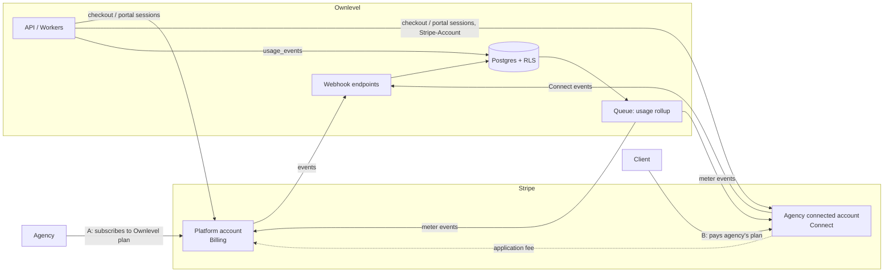
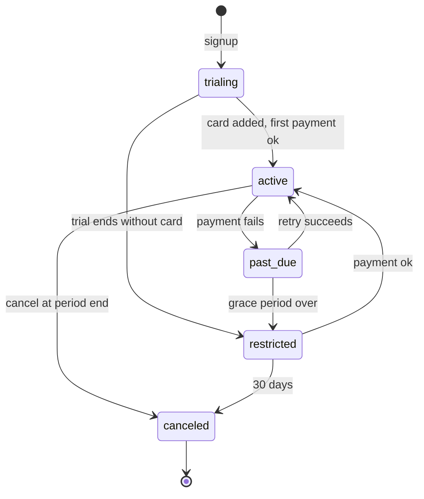
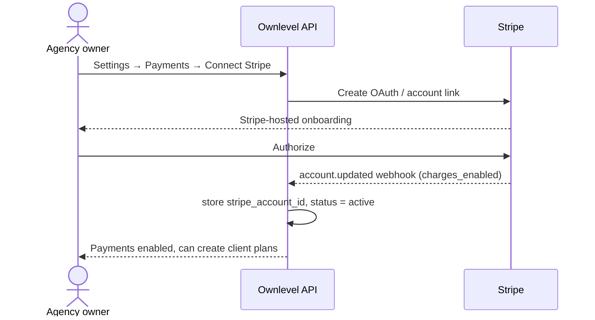
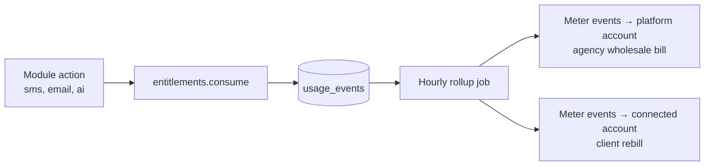

# Ownlevel — Monetization & Billing

Status: draft (planning) · Related: [1_Architecture.md](./1_Architecture.md) (`plans`, `client_plans`, `client_modules`, `usage_events`), [2_Authentication.md](./2_Authentication.md) (roles, permissions), [3_Deployment.md](./3_Deployment.md) (Workers, hostnames), [4_MCP.md](./4_MCP.md) (tool scopes)

## Overview

Two separate money flows, kept apart on purpose:

| Flow | Payer → Payee | Money goes to | Stripe model |
| --- | --- | --- | --- |
| **A. Platform billing** | Agency → Ownlevel | Ownlevel | Stripe Billing on Ownlevel's own account |
| **B. Resale billing** | Client → Agency | The agency | Stripe Connect: the agency's own connected account |

Flow A is how Ownlevel earns. Flow B is the "SaaS mode" from the architecture doc: the agency resells access (a `client_plan`) to its clients under its own brand and keeps the revenue. Ownlevel never holds the agency's money beyond what Stripe Connect does, and takes an optional application fee on flow B.

Out of scope here: a client charging its own contacts (invoices, checkout, products). That is the `payments` module in the architecture doc; it can reuse the Connect plumbing from flow B later (see [Later](#later)).

**Current state of the code:**

- `agencies.plan_id`, `plans`, `client_plans`, `client_modules` and `usage_events` exist in the schema doc only; no billing code, no Stripe dependency.
- `usage_events` is the metering table; nothing writes to it yet.
- `contact_counts(agency_id)` (see [5_2_contacts.md](./5_2_contacts.md)) already exists for the contacts meter.
- No `permissions` table yet; authorization uses role keys (`requireRole`).

## Principles

- **Stripe is the source of truth for money; Postgres is the source of truth for access.** We mirror subscription state into our tables via webhooks and decide entitlements from our copy, never by calling Stripe on a request.
- **Entitlements, not billing checks, gate features.** Billing writes `agencies.plan_id` and `client_modules`; the app only reads those. A billing outage never takes the product down.
- **Two Stripe contexts, never mixed.** Flow A objects live on the platform account; flow B objects live on the agency's connected account (`Stripe-Account` header). A helper takes an explicit context so a call can't hit the wrong account.
- **Idempotent webhooks.** Every event is stored once by Stripe event id before processing; handlers are safe to replay.
- **Secrets stay out of the repo and the database.** Stripe keys are Worker secrets; we store only Stripe ids.

## Architecture



## Flow A: Ownlevel charges agencies

### Pricing model

Seat-free, built around what costs Ownlevel money and what agencies value:

| Component | Billed as | Notes |
| --- | --- | --- |
| Base plan | Flat monthly/annual price per agency | `plans` row: Starter, Growth, Scale, plus enterprise by contract |
| Included clients | Limit in `plans.limits.clients` | Extra clients billed per client per month (graduated price) |
| Included usage | Limits per meter (`sms.sent`, `email.sent`, `ai.tokens`, contacts) | Above the allowance, overage billed per unit |
| White-label, custom domains, MCP | Plan features (`plans.limits.features[]`) | Gated by entitlement, not by separate prices |
| Trial | 14 days, no card, on Growth limits | Ends in `past_due`-like `trial_expired` state: read-only, not deleted |

Exact prices are product decisions and live in Stripe Products/Prices plus `plans.stripe_price_ids`; none are hardcoded.

### Schema

Extends the existing `plans` and `agencies` tables.

```sql
alter table plans
  add column stripe_product_id text,
  add column stripe_price_ids  jsonb not null default '{}',  -- {"base_month":"price_..","client_overage":"price_.."}
  add column is_public boolean not null default true,
  add column sort int not null default 0;

alter table agencies
  add column stripe_customer_id text unique;

-- Mirror of the agency's Ownlevel subscription (one active per agency)
create table agency_subscriptions (
  id                     uuid primary key default gen_random_uuid(),
  agency_id              uuid not null references agencies(id) on delete cascade,
  plan_id                uuid not null references plans(id),
  stripe_subscription_id text unique not null,
  status                 text not null,   -- trialing | active | past_due | unpaid | canceled
  current_period_end     timestamptz,
  trial_end              timestamptz,
  cancel_at_period_end   boolean not null default false,
  grace_until            timestamptz,     -- end of dunning grace, then restricted
  updated_at             timestamptz not null default now()
);
create unique index on agency_subscriptions (agency_id) where status <> 'canceled';
```

RLS: agency-level table, readable and writable only in agency context for the owning agency; writes come from the webhook handler through a service context, not from user requests.

### Lifecycle



| State | Product behaviour |
| --- | --- |
| `trialing`, `active` | Full access within plan limits |
| `past_due` | Full access, banner to agency admins, email dunning (Stripe Smart Retries) |
| `restricted` | Read-only for agency and clients; outbound sends (SMS, email, workflows, AI) blocked; public booking pages and inbound webhooks keep working so end customers aren't broken |
| `canceled` | Same as `restricted`; data kept 30 days, then the agency enters the delete flow |

Mapping to `agencies.status`: `active`, `suspended` (restricted, billing), `cancelled`.

### Checkout and self-service

- **Subscribe / change plan:** API creates a Stripe Checkout Session (`mode=subscription`) or a subscription update; the agency never enters card data on our pages.
- **Manage card, invoices, cancel:** Stripe Customer Portal session, opened from Settings → Billing.
- **Plan change rules:** upgrades apply immediately with proration; downgrades apply at period end and are rejected if current usage exceeds the target plan (e.g. more clients than the lower plan allows), with a message listing what to remove.

### Entitlement enforcement

```ts
// one place decides; modules call it, they never read plans directly
await entitlements.assert(ctx, 'clients.create');          // count limit
await entitlements.assert(ctx, 'feature:white_label');     // feature flag
await entitlements.consume(ctx, 'sms.sent', quantity);     // meter, may block
```

- Limits come from `plans.limits`, overridden per agency by `agencies.limit_overrides` (enterprise deals, goodwill).
- Resolved result is cached in Redis per agency, invalidated by the webhook handler on any subscription change (same mechanism as `resolveAccess`).
- Hard limits (clients, features) block with `402`-style error code `plan_limit`; usage meters are soft by default (billed as overage) with an optional per-agency spend cap that turns them hard.

## Flow B: agencies charge their clients

### Stripe Connect choice

| Option | Verdict |
| --- | --- |
| **Standard** connected accounts | **Default.** Agency owns its Stripe account and customer relationship, handles its own disputes, tax settings and payouts. Least liability and compliance work for Ownlevel; agencies often already have Stripe |
| Express | Better onboarding UX, but Ownlevel takes on more responsibility (negative balances, support). Revisit if agencies without Stripe accounts are a large share |
| Custom | Rejected: full compliance burden |
| Agency enters its own API keys | Rejected: no Connect fee, no webhooks we can trust, secrets handling risk |

Charges use **direct charges** on the agency's account with an optional `application_fee_percent` for Ownlevel. The agency is the merchant of record, so the client's invoice and statement show the agency, not Ownlevel.

### Onboarding



Client plans can be drafted before Connect is done but can't be assigned to a client until `charges_enabled = true`.

### Schema

```sql
-- the agency's connected account
create table agency_payment_accounts (
  agency_id         uuid primary key references agencies(id) on delete cascade,
  stripe_account_id text unique not null,
  charges_enabled   boolean not null default false,
  payouts_enabled   boolean not null default false,
  details_submitted boolean not null default false,
  fee_percent       numeric(5,2),             -- Ownlevel's application fee; NULL = plan default
  country           char(2),
  updated_at        timestamptz not null default now()
);

-- extend the existing client_plans (agency's resale plans)
alter table client_plans
  add column currency            char(3) not null default 'USD',
  add column stripe_product_id   text,        -- on the agency's connected account
  add column stripe_price_id     text,
  add column trial_days          int not null default 0,
  add column status              text not null default 'active',  -- active | archived
  add column included_limits     jsonb not null default '{}';     -- feeds client_modules.limits
-- existing price_cents + interval stay the source for the Price we create in Stripe

-- the client's subscription to the agency (one active per client)
create table client_subscriptions (
  id                     uuid primary key default gen_random_uuid(),
  agency_id              uuid not null references agencies(id) on delete cascade,
  client_id              uuid not null references clients(id) on delete cascade,
  client_plan_id         uuid not null references client_plans(id),
  stripe_customer_id     text not null,       -- on the connected account
  stripe_subscription_id text unique not null,
  status                 text not null,       -- trialing | active | past_due | unpaid | canceled
  current_period_end     timestamptz,
  cancel_at_period_end   boolean not null default false,
  updated_at             timestamptz not null default now()
);
create unique index on client_subscriptions (client_id) where status <> 'canceled';
```

RLS: `client_subscriptions` uses the standard tenant policy. Agency context reads all its clients' rows. A client admin may read their own row (to show plan and invoices) but all money mutations go through the API with `billing:manage` checks.

`clients.client_plan_id` (existing) becomes a denormalised pointer, set only by the subscription webhook handler or by an agency admin for **manual / off-platform** billing (see below).

### Ways an agency can bill a client

| Mode | What happens | Ownlevel's role |
| --- | --- | --- |
| **Stripe subscription** | Client gets a Checkout link; pays the agency monthly/annually; plan modules turn on automatically | Creates sessions, mirrors state, enforces entitlements |
| **Invoice** | Agency sends a Stripe invoice (hosted page) to the client billing email | Same, `collection_method=send_invoice` |
| **Manual / free** | Agency sets a plan with no Stripe subscription (bills elsewhere, or comped) | Entitlements only, flagged `billing_mode = 'manual'` on the client |
| **Usage rebilling** | Agency marks up SMS / email / AI usage and bills it to the client | See below |

### Usage rebilling (wallet vs. metered)

Ownlevel's wholesale cost for SMS/email/AI is billed to the agency in flow A. To resell, the agency sets a **markup** per meter, and the client is charged on flow B.

| Option | Verdict |
| --- | --- |
| Metered billing on the client's subscription (Stripe Meters on the connected account) | **Default.** Simple, one invoice per month, no float held |
| Prepaid wallet per client with auto-recharge | Later. Better for risky clients, but needs balance ledger and refund rules |

```sql
create table client_meter_prices (
  client_plan_id uuid not null references client_plans(id) on delete cascade,
  meter          text not null,               -- sms.sent, email.sent, ai.tokens
  included       numeric not null default 0,
  unit_price_micros bigint not null,          -- what the client pays the agency
  primary key (client_plan_id, meter)
);
```

`usage_events.unit_cost_micros` is Ownlevel's cost (shown to the agency as its wholesale bill). Client price comes from `client_meter_prices`. The agency's margin report is `client price − cost` per meter, per client, computed from `usage_events`.

### Fees

Ownlevel's revenue on flow B is a configurable percent (`agency_payment_accounts.fee_percent`, defaulting from the agency's plan; higher plans pay less, enterprise can be 0). Stripe processing fees are paid by the agency's connected account. The agency's UI shows gross, Stripe fee, Ownlevel fee and net.

### What the client sees

- Client admins get **Settings → Plan & billing** showing plan, next invoice, invoices and a "Manage payment method" button (Stripe Customer Portal on the agency's connected account, branded as the agency).
- Invoices and receipts come from the agency's Stripe account with the agency's branding and statement descriptor. Ownlevel's name does not appear.
- Failed payments follow the same states as flow A, with the agency deciding the policy: `grace_days` and what happens after (`restrict` or `none`) are fields on `client_plans`.

## Webhooks

Two endpoints on the API worker, both verifying Stripe's signature with separate secrets:

| Endpoint | Source | Key events |
| --- | --- | --- |
| `POST /webhooks/stripe/platform` | Platform account | `customer.subscription.created/updated/deleted`, `invoice.paid`, `invoice.payment_failed`, `checkout.session.completed` |
| `POST /webhooks/stripe/connect` | Connected accounts (`event.account`) | `account.updated`, `account.application.deauthorized`, same subscription / invoice events, `charge.dispute.created` |

```sql
create table stripe_events (
  id           text primary key,              -- Stripe event id: dedupe key
  account_id   text,                          -- NULL = platform
  type         text not null,
  payload      jsonb not null,
  received_at  timestamptz not null default now(),
  processed_at timestamptz,
  error        text
);
```

Handler flow: verify signature → insert `stripe_events` (ignore on conflict) → enqueue → worker processes in a tenant context resolved from `stripe_customer_id` / `stripe_account_id` → update mirror tables → invalidate entitlement cache → emit domain events (`billing.subscription.changed`). Events can arrive out of order, so handlers fetch the object's current state from Stripe instead of trusting the payload's snapshot.

`account.application.deauthorized`: mark the payment account inactive, pause client subscriptions' entitlement changes (clients keep current access, agency is alerted), and block new checkouts.

## Permissions and API

New permissions (module `billing`):

| Permission | Default roles | Why |
| --- | --- | --- |
| `billing:agency.read` | agency_owner, agency_admin | See Ownlevel plan, usage, invoices |
| `billing:agency.manage` | agency_owner | Change plan, open portal, cancel |
| `billing:connect.manage` | agency_owner | Connect / disconnect Stripe |
| `billing:clients.read` | agency_owner, agency_admin | See client subscriptions, MRR, margins |
| `billing:clients.manage` | agency_owner, agency_admin | Create client plans, assign, refund |
| `billing:client.read` | client_admin | A client sees its own plan and invoices |

Money-moving and plan-changing actions write to `audit_log`. Billing tools are **agency-level only** in MCP and need an explicit `billing` scope, so an installed app or AI agent can't change prices by default; refunds and cancellations are not exposed as tools in v1.

Routes (all under the existing agency / client context):

| Route | Purpose |
| --- | --- |
| `GET /billing` | Agency plan, subscription state, usage vs limits |
| `POST /billing/checkout`, `POST /billing/portal` | Flow A sessions |
| `POST /payments/connect`, `GET /payments/account` | Flow B onboarding and status |
| `CRUD /client-plans` | Agency's resale plans (syncs Product/Price to Stripe) |
| `POST /clients/:id/subscription` | Assign plan: returns Checkout URL, or sets manual mode |
| `GET /clients/:id/billing` | Subscription, invoices, usage (agency and the client itself) |
| `GET /billing/reports` | MRR, churn, margins per client |

## Usage metering



- `consume` writes a `usage_events` row in the same transaction as the action (so a failed send isn't billed) and updates a Redis counter for fast limit checks.
- The rollup job aggregates per billing period and sends Stripe meter events with an idempotency key `(agency, client, meter, hour)`. Stripe has the total; our table is the audit trail and the base for dashboards.
- Contacts are counted, not eventful: use `contact_counts(agency_id)` nightly, never row data.
- Monthly partitioning of `usage_events` as noted in the scaling path.

## Tax, currency and compliance

- **Flow A:** Stripe Tax on the platform account; agencies enter a VAT/tax id at checkout.
- **Flow B:** the agency is the merchant, so tax is the agency's responsibility; we expose the Stripe Tax toggle of their connected account but don't calculate on their behalf.
- Currencies: platform prices in USD (and EUR when needed); client plans support any Stripe-supported currency, with `clients.currency` as the default.
- Card data never touches Ownlevel (Checkout and Portal only), which keeps us at PCI SAQ A.
- Refunds and disputes on flow B are handled by the agency in its own Stripe dashboard; we show the status and notify.

## Self-hosting

Self-hosters run the same code without Ownlevel's Stripe account. Billing is behind a `BILLING_ENABLED` flag:

- Off (default for self-host): every agency gets an unlimited internal plan; flow A code paths are inert.
- Flow B can still be enabled by the self-hoster configuring their own Stripe Connect platform keys.

## Implementation plan

| # | Step | Verify |
| --- | --- | --- |
| 1 | Entitlements service + `plans.limits`, wired to client creation and feature flags, no Stripe yet | Unit tests per limit; RLS tests for `agency_subscriptions` |
| 2 | Stripe SDK, `stripe_events`, platform webhook, `agencies.stripe_customer_id` | Replay-safe handler test; Stripe CLI `trigger` smoke script |
| 3 | Flow A: Checkout, Portal, subscription mirror, lifecycle states, restricted mode | Manual run through trial → active → past_due → restricted with Stripe test clocks |
| 4 | Billing UI for agencies (Settings → Billing), strings in `apps/web/messages/en.json` | `pnpm --filter @ownlevel/web typecheck`, manual |
| 5 | Usage metering: `consume`, rollup job, Stripe meters; overage and spend caps | Rollup idempotency test; compare Stripe totals to `usage_events` |
| 6 | Flow B: Connect onboarding, `agency_payment_accounts`, Connect webhook | Test-mode connected account; `deauthorized` handling |
| 7 | Client plans CRUD syncing to Stripe, client subscriptions, entitlement application via `client_modules` | Assign plan → modules enabled; cancel → modules restricted |
| 8 | Usage rebilling: `client_meter_prices`, margin report | Report matches hand-calculated sample |
| 9 | Client "Plan & billing" page, audit events, MCP `billing` scope (read only) | RLS test: client A cannot read client B's subscription |

Each table above gets its RLS test in `apps/api/test/rls.test.ts`; add a Stripe test-mode script to the smoke tests described in [8_Testing.md](./8_Testing.md).

## Open questions

1. **Pricing:** price points, included clients and meters per plan, and whether to also offer a free tier (affects abuse controls).
2. **Application fee on flow B:** charge one, and how much? Free-plan agencies could pay more, enterprise less.
3. **Standard vs. Express Connect:** confirm Standard; does a meaningful share of target agencies lack a Stripe account?
4. **Restricted mode:** is read-only plus blocked outbound the right penalty, or should it also lock logins for clients?
5. **Wallet:** do agencies need prepaid balances at launch, or is monthly metered billing enough?
6. **Currencies and countries:** which countries do we support for Connect at launch?
7. **Who pays for AI usage:** pass-through at cost plus markup, or bundled into plan allowances only?

## Later

- Client charging its own contacts: products, one-off checkout, invoices, subscriptions in the `payments` module, reusing the same Connect account (the contact becomes a Stripe customer on the agency's account; the client's own payout account would need a second connected account level or agency-managed payouts, to be designed).
- Prepaid wallets with auto-recharge.
- Marketplace app revenue share (installed apps from [2_Authentication.md](./2_Authentication.md) charging through the platform).
- Annual-plan discounts, coupons and referral credits for agencies.
