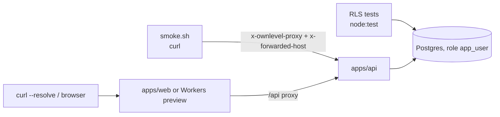

# Ownlevel — Testing

Status: draft · Related: [2_Authentication.md](./2_Authentication.md), [3_Deployment.md](./3_Deployment.md)

## Overview

Tenant isolation is the property we can least afford to get wrong, so the tests start there. There are three layers:

| Layer | What it proves | Where | Needs |
| --- | --- | --- | --- |
| RLS tests | Postgres itself refuses cross-tenant reads and writes | `apps/api/test/rls.test.ts` | Postgres |
| API smoke script | Signup, host resolution, branding, handoff, invitations, password reset, and the proxy-trust rules work end to end | `apps/api/test/smoke.sh` | Postgres, running API |
| Manual and runtime checks | The web app, the Cloudflare Workers runtime, and the browser flows | This document | API, web or Workers preview |



## Setup

```bash
docker compose up -d postgres            # Postgres 17 on :5432
pnpm install
pnpm --filter @ownlevel/api db:migrate   # applies drizzle/*.sql, including 0003_rls.sql
pnpm --filter @ownlevel/api dev          # API on :4000 (or `start`, which does not watch)
pnpm --filter @ownlevel/web dev          # web on :3100
```

Environment (defaults work for local runs; see each app's `.env.example`):

| Variable | Where | Local value |
| --- | --- | --- |
| `PLATFORM_ROOT_DOMAIN` | api, web (`NEXT_PUBLIC_…`) | `localhost`, so agencies are `{slug}.localhost` |
| `PLATFORM_HOSTS` | api | `localhost` |
| `PROXY_SHARED_SECRET` | api and web | `dev-proxy-secret-change-me` (must match on both sides) |
| `API_URL` | web | `http://localhost:4000` |

Browsers and `curl` resolve `*.localhost` to `127.0.0.1`, so `http://acme.localhost:3100` works without editing `/etc/hosts`.

## 1. Static checks

```bash
pnpm typecheck        # api, web, core, tenancy must pass
```

`sdk` and `worker` report "No inputs were found" until they contain code; that is expected.

## 2. RLS tests

```bash
pnpm --filter @ownlevel/api test
```

The suite creates two agencies (A and B) with a user, a client and a ledger row each, then runs every query as `app_user` through `withTenant`. It deletes its own data afterwards. What it asserts:

| Case | Expected |
| --- | --- |
| No tenant context | Every tenancy table returns zero rows |
| Agency A context | Sees only A's agency, domains, clients and memberships |
| Insert a row with B's `agency_id` while in A | Rejected: "violates row-level security policy" |
| Update or delete B's rows while in A | Matches nothing; B's data is unchanged |
| Update A's row to set `agency_id = B` | Rejected (the `WITH CHECK` stops escaping scope) |
| Client context | Sees only its own client row; cannot create clients |
| Roles | System roles visible to all; A's custom role invisible to B; the app cannot write system roles |
| Usage ledger | Cross-agency insert rejected; B sees none of A's events |
| Host context | Sees exactly one active hostname's agency and domain, and no clients or memberships |
| User context | A person sees only their own memberships |
| Slug lookup | Reveals only the slug asked for; duplicates surface as `slug_taken` |
| Role attributes | `app_user` is not superuser and has no `BYPASSRLS` |

Add a case here whenever you add a tenant table. Every new business table needs a policy, `FORCE ROW LEVEL SECURITY`, and a test that proves a second agency cannot see or write it.

## 3. API smoke script

```bash
API_LOG=/tmp/api.log pnpm --filter @ownlevel/api start > /tmp/api.log 2>&1 &
API_LOG=/tmp/api.log apps/api/test/smoke.sh
```

The script plays the role of the web proxy: it sends `x-ownlevel-proxy: <secret>` and `x-forwarded-host: <host>` with an `Origin` header on the same host. It creates a fresh agency (`smoke-<timestamp>`) every run. The dev email transport prints links to the API console, so `API_LOG` lets the script read the invite token (or pass `INVITE_TOKEN`; without either it skips the acceptance steps).

| Step | Expected |
| --- | --- |
| Owner signs up on the platform host | 200 |
| Slug check, create agency, check again, create duplicate | available → 201 → taken → 409 |
| `POST /api/agencies` on an agency host | 404 (agency signup is platform-only) |
| `GET /api/host` on the agency host / an unknown host | agency JSON / 404 |
| `x-forwarded-host` sent **without** the secret | Ignored: still resolves as platform |
| Platform session → one-time token → verify on the agency host | 200, session works there |
| Reuse the one-time token | 400 |
| Branding: valid update, invalid color, public read | 200, 400, new name served on the host |
| Invite, preview, preview on another host | 201, details, 404 |
| Invitee signs up, hits `/api/team` before accepting | 200, then 403 |
| Accept with a wrong token, the real token, the real token again | 404, 200, 404 |
| Staff reads the team, tries to edit branding | member list, 403 |
| Password reset for a member | 200, and an email is logged with a `/reset-password?token=` link |

Every one of these runs with RLS enforced, because the services use `withTenant`; a missing context or policy shows up as a 500 or an empty result.

## 4. Manual checks in the browser

Run API and web, then:

1. `http://localhost:3100/signup` → create an account → lands on `/onboarding`.
2. Type an agency name. The slug fills in with a live availability hint (`acme.localhost`). Submit.
3. You are redirected to `http://acme.localhost:3100/auth/handoff?token=…` and arrive signed in at `/dashboard`, with no second login.
4. **Branding:** Branding → set app name, color and logo URL → Save. The header, button color and tab title change without a restart; the preview updates live as you type.
5. Open `http://acme.localhost:3100/login` in a private window: branded, with no "Create account" link, and `/signup` returns 404.
6. `http://nope.localhost:3100/login` shows "Not found".
7. **Forgot password:** `/forgot-password` → enter the email → copy the link from the API console → set a new password → sign in. A non-member's email returns the same message but sends nothing.
8. **Invitations:** Team → invite an email → copy the `/accept-invite?token=` link from the API console → open it in a private window → create an account (new person) or sign in (existing person) → lands in the portal. Revoke a pending invite and confirm its link then says "invalid or has expired".

## 5. Proxy, origin and cookie checks

These are the checks that guard the white-label design. Replace `acme` with a real slug.

```bash
H=acme.localhost:3100
# Sign in through the web proxy; the cookie must be host-only and HttpOnly
curl -si -c jar -X POST http://$H/api/auth/sign-in/email \
  -H "origin: http://$H" -H 'content-type: application/json' \
  -d '{"email":"you@example.com","password":"…"}' | grep -i set-cookie

# Same-origin mutation passes; a foreign origin and another agency's origin are refused (403)
curl -s -o /dev/null -w '%{http_code}\n' -b jar -X POST http://$H/api/auth/update-user \
  -H "origin: http://$H" -H 'content-type: application/json' -d '{"name":"x"}'          # 200
curl -s -o /dev/null -w '%{http_code}\n' -b jar -X POST http://$H/api/auth/update-user \
  -H "origin: http://evil.com" -H 'content-type: application/json' -d '{"name":"x"}'    # 403

# A session from one host is useless on another
curl -s -b jar http://other.localhost:3100/api/me                                       # 401
```

Origin checks only run on requests that carry a cookie, so test with `-b jar`; an unauthenticated request with a bad `Origin` is not blocked, by design.

## 6. Cloudflare Workers runtime

Production runs the web app as a Worker, so repeat the host checks in `workerd` before deploying:

```bash
cd apps/web
cp .dev.vars.example .dev.vars.preview          # API_URL, PROXY_SHARED_SECRET
pnpm cf:build
pnpm exec opennextjs-cloudflare preview --env preview --port 3100

SLUG=acme; H=$SLUG.localhost:3100
curl -s --resolve $H:127.0.0.1 http://$H/login | grep -o 'Acme'     # branded login
curl -s --resolve $H:127.0.0.1 http://$H/api/host                    # {"kind":"agency",…}
curl -s -o /dev/null -w '%{http_code}\n' --resolve $H:127.0.0.1 http://$H/signup   # 404
```

Use `--resolve`, not `-H "Host: …"`; `workerd` builds the request from the URL. After a deploy, run the same three commands against the real hostnames and add:

| Check | Expected |
| --- | --- |
| `https://app.ownlevel.com/signup` | 200 |
| `https://<slug>.ownlevel.app/login` | Agency branding |
| `https://<unknown>.ownlevel.app/login` | "Not found" |
| `https://<slug>.ownlevel.app/api/host` | JSON for that agency (proves the proxy and secret are wired) |
| `https://api.ownlevel.com/api/host` with a forged `x-forwarded-host` | Platform, not the agency |

## 7. Pitfalls we hit

| Symptom | Cause | Fix |
| --- | --- | --- |
| New code seems ignored; `EADDRINUSE` in the log | An older API or web process still holds the port, and `pkill -f` patterns miss `node …/tsx/dist/cli.mjs` | Kill by port: `lsof -ti tcp:4000 \| xargs kill` (same for 3100); for Workers kill `wrangler` and `workerd` too |
| Origin check never rejects anything | Better-auth's dynamic `baseURL` with `allowedHosts: ["*"]` silently trusted every origin | Keep a static `baseURL`; the API rewrites the request URL to the real host and `trustedOrigins` is a DB-backed function |
| Worker preview shows the platform page for every host | `wrangler dev` rewrites `Host` to the first route's hostname | Preview with `--env preview` (no routes) |
| Proxy returns the platform instead of the agency | `PROXY_SHARED_SECRET` differs between web and API, so `X-Forwarded-Host` is ignored | Make the two values identical |
| `Role is not available` when inviting | System roles were only created lazily for the owner | Migration `0003` seeds all five; re-run migrations |
| Test teardown fails on a foreign key | `roles.agency_id` has no cascade | Delete the agency's roles before the agency (the RLS test does) |
| macOS `sed -i` fails with "extra characters" | BSD `sed` needs `-i ''` | Use `sed -i '' …` |

## 8. Not covered yet

- No browser automation. Sections 4 and the page rendering are checked by hand.
- No tests for custom-domain verification, the Cloudflare Custom Hostnames calls, or the domain worker; those features are not built yet.
- Email delivery is only exercised through the console transport; test Resend with a real key in staging.
- Client-level RLS (`client_id` on business tables such as contacts) is covered for `clients` and `usage_events` only; each module adds its own cases as it lands.
- Load and failover tests for the multi-server scenario in the deployment doc.
